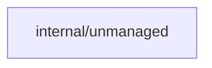
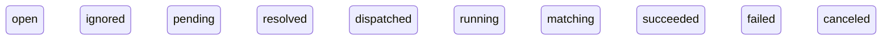
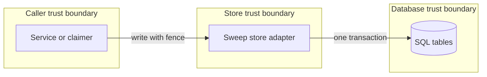

## Context

This part adds persistence only: ports, an in-memory adapter, a conformance suite and SQL adapters.

## Decisions

1. **Ports and suite first.** Keep the operations of ADR 164 decision 18 and ADR 165 decision 13. Write the suite and the memory adapter before the SQL adapters.
2. **Fence in the transaction.** Each SQL write locks the namespace row, compares the failover version, then writes in one transaction. A stale, missing or soft-deleted namespace returns namespace.ErrFenced.
3. **Pool check by stable ID.** A target stores the pool ID. CreateTarget, UpdateTarget and StartScan read the pool in the same transaction. Only an operator pool with the sweep purpose passes (Owner decision, 13 Nov 2026 (queue P14)).
4. **Busy check.** StartScan refuses with ErrScanBusy while the target has a sweep in a non-final status. A unique index on the open sweep makes concurrent starts safe in SQL. The memory adapter holds a lock.
5. **Transitions.** AdvanceScan uses NextScan. A pair that the table does not hold returns ErrTransition. Act uses Next, ErrStatusChanged and writes its audit entry in the same transaction.
6. **Delete of a target.** DeleteTarget refuses while the target has a sweep not in a final status. A duplicate name in a namespace returns the exists error.
7. **Bounds.** The store refuses a command or scope list above the ADR 164 limits.

## Structure

An unexported type fencedTx wraps the SQL transaction. Only its constructor makes a value, and it reads and checks the fence. Write methods take a fencedTx, so no write path skips the fence.

## Risks

- Adapters drift from the port. The shared suite runs on all three.
- Two writers race on the fence. The row lock and a concurrent test cover it.
- A crash after the fence check rolls back the transaction.
- A pool is deleted after the target is saved. StartScan checks it again.

## Layers (defense in depth)

| Layer | Guard | Hostile test |
| --- | --- | --- |
| port adapter | Page limit, Record batch limit and namespace ID form are checked before SQL. | A table test sends a page of 501, a batch of 1,001 and a bad namespace ID to each adapter. |
| service | The store checks the fence and the pool in the same transaction. | A table test writes with a stale fence, a jobs pool, a namespace sweep pool and a deleted pool. Each is refused. |
| HTTP handler | No handler in this part. The last part adds routes with actions. | None here. The suite sends hostile input straight to the store. |

## Diagrams

Modules that the change touches, and their imports on main:

States on main in the touched packages:

## Quality attributes

| Attribute | Target | Unit | Scope |
| --- | --- | --- | --- |
| Test coverage of the port | 3 | adapters that pass the one conformance suite | the sweep store: memory, SQLite and PostgreSQL |
| Page and batch bounds | 500 findings per page and 1000 observations per Record call | items per call | FindingStore calls |

## Threat model

Data flow and trust boundaries:

| Boundary | STRIDE | Threat | Layer | Guard | Hostile test |
| --- | --- | --- | --- | --- | --- |
| Caller to store | T | A caller writes with a stale fence after a failover and changes a namespace that moved. | boundary check | The port refuses a bad namespace ID before SQL. | TestSweepStoreBounds sends a malformed namespace ID to each adapter. |
| Caller to store | T | A caller writes with a stale fence after a failover and changes a namespace that moved. | encode or contain | All SQL uses placeholders and keys rows by namespace ID. | TestSweepStoreBounds sends a name with SQL text and the store keeps it as data. |
| Caller to store | T | A caller writes with a stale fence after a failover and changes a namespace that moved. | limit | A write changes rows of one namespace only. | TestSweepStoreFence checks that a write to one namespace leaves the rows of another. |
| Caller to store | T | A caller writes with a stale fence after a failover and changes a namespace that moved. | authorize at point of use | The store locks the namespace row and compares the failover version in the write transaction. | TestSweepStoreFence sends a stale fence directly to each adapter. |
| Caller to store | T | A caller writes with a stale fence after a failover and changes a namespace that moved. | fail closed | A missing or soft-deleted namespace returns namespace.ErrFenced. | TestSweepStoreFence writes to a missing and a deleted namespace. |
| Caller to store | E | A target names a user pool, so a sweep runs on user runners. | boundary check | The pool ID must have the form of a pool ID. | TestSweepStorePool sends a malformed pool ID. |
| Caller to store | E | A target names a user pool, so a sweep runs on user runners. | encode or contain | The store reads the pool by ID in the write transaction, never by name. | TestSweepStorePool renames a pool and the target keeps its pool. |
| Caller to store | E | A target names a user pool, so a sweep runs on user runners. | limit | A target holds one pool ID. | TestSweepStorePool sends a list of pools and the store refuses it. |
| Caller to store | E | A target names a user pool, so a sweep runs on user runners. | authorize at point of use | The store requires an operator pool with the sweep purpose at create, update and start. | TestSweepStorePool sends a jobs pool and a namespace sweep pool. |
| Caller to store | E | A target names a user pool, so a sweep runs on user runners. | fail closed | A deleted or unknown pool is refused. | TestSweepStorePool starts a sweep on a deleted pool. |
| Caller to store | D | A caller sends an oversize batch or page to exhaust the store. | boundary check | The port validates the size of each call before SQL. | TestSweepStoreBounds sends 1,001 observations. |
| Caller to store | D | A caller sends an oversize batch or page to exhaust the store. | encode or contain | Queries use limit placeholders, never built text. | TestSweepStoreBounds sends a negative limit. |
| Caller to store | D | A caller sends an oversize batch or page to exhaust the store. | limit | The port refuses a batch above 1,000 and a page above 500. | TestSweepStoreBounds sends 501 for a page. |
| Caller to store | D | A caller sends an oversize batch or page to exhaust the store. | authorize at point of use | The fence check runs before any row write of a batch. | TestSweepStoreFence sends a large batch with a stale fence and nothing is stored. |
| Caller to store | D | A caller sends an oversize batch or page to exhaust the store. | fail closed | A refused call stores nothing. | TestSweepStoreRollback checks that no row stays after a refusal. |

## Failure modes

| Step | Failure | Retry | State after |
| --- | --- | --- | --- |
| Fence check | The failover version is stale. | The caller reads the namespace and retries with the live fence. | No row changed. |
| Row write after fence check | A SQL error or crash. | The caller retries the whole write. | The transaction rolled back and no row changed. |
| StartScan | The target has a sweep not in a final status. | The caller waits for the sweep to end or cancels it, then starts again. | The open sweep is unchanged and no new sweep exists. |
| Pool check | The pool is not an operator sweep pool, or it is deleted. | The caller names a valid pool. | The target and the sweeps are unchanged. |
| Restore | A pool of a stored target is gone after a restore. | The caller names a valid pool before the next start. | The target stays and the next start is refused. |

## Change impact (computed from main)

Tests:

- `internal/unmanaged/unmanagedtest/mem_test.go` names `unmanaged.ScanStore`
- `internal/unmanaged/unmanagedtest/mem_test.go` names `CreateTarget`
- `internal/unmanaged/unmanagedtest/mem_test.go` names `UpdateTarget`
- `internal/unmanaged/unmanagedtest/mem_test.go` names `DeleteTarget`
- `internal/unmanaged/unmanagedtest/mem_test.go` names `StartScan`
- `internal/unmanaged/unmanagedtest/mem_test.go` names `AdvanceScan`

ADRs:

- `docs/adr/0164-cloud-sweeps-on-the-teams-runner.md` names `unmanaged.ScanStore`
- `docs/adr/0166-context-and-graph-gaps-found-before-the-implementation.md` names `unmanaged.ScanStore`
- `docs/adr/0163-resource-index-and-unmanaged-resources-from-state.md` names `unmanaged.ScanStore`
- `docs/adr/0164-cloud-sweeps-on-the-teams-runner.md` names `CreateTarget`
- `docs/adr/0343-runner-work-imports-sweeps-and-the-runner-repository.md` names `CreateTarget`
- `docs/adr/0164-cloud-sweeps-on-the-teams-runner.md` names `UpdateTarget`
- `docs/adr/0343-runner-work-imports-sweeps-and-the-runner-repository.md` names `UpdateTarget`
- `docs/adr/0164-cloud-sweeps-on-the-teams-runner.md` names `DeleteTarget`
- `docs/adr/0164-cloud-sweeps-on-the-teams-runner.md` names `StartScan`
- `docs/adr/0164-cloud-sweeps-on-the-teams-runner.md` names `AdvanceScan`
