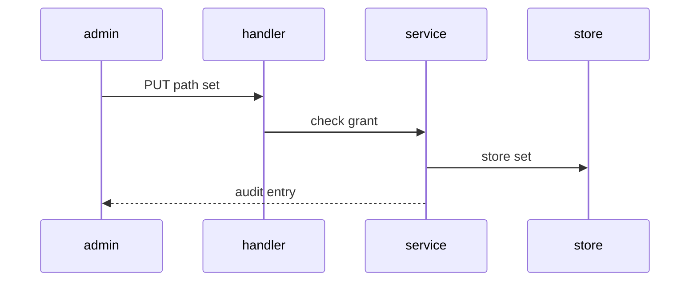
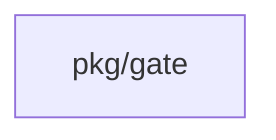
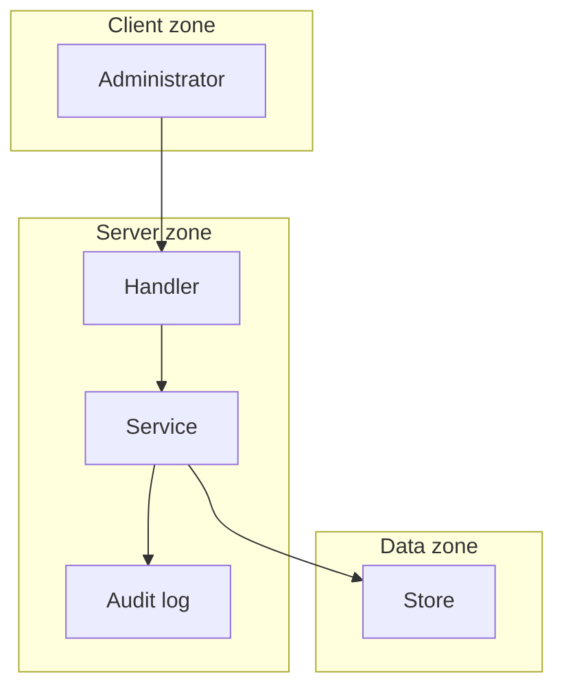

## Context

Path sets are stored objects at four scopes. The fact producer reads the changed paths of a change order and computes touches and only for each in-scope set. Absent, truncated or stale data gives typed missing facts.

## Decisions

1. **Path set as a checked type.** An unexported gate.PathSet is made only by NewPathSet, which checks ID grammar, 1 to 64 patterns and the shadow rule. Saves carry a version; a stale one gives 412.
2. **Producer computes facts.** Touches and only are computed in the pkg/gate producer on a cleaned ChangedPaths value. No new tool and no custom analyzer.

## Structure

Unexported gate.PathSet with constructor gate.NewPathSet; fact input is gate.ChangedPaths built only from a cleaned path list. Gates reference sets by stable ID.

## Risks

- Glob dialect drift between docs and code.
- Truncated path lists read as complete.

## Layers (defense in depth)

| Layer | Guard | Hostile test |
| --- | --- | --- |
| port adapter | Checks ID, pattern count, shadow rule and serializes concurrent saves. | Save 0 patterns, 65 patterns, a bad ID and a reused wider ID; each is refused. Race two saves of one ID. |
| service | Checks the grant on the scope object and writes an audit entry, with a denial entry on 403. | Read, list and write with no grant; each gives 403 and a denial entry. |
| HTTP handler | Checks size caps and If-Match, and maps missing or truncated paths to available false. | Send an oversize document and a stale If-Match; each is refused. |

## Diagrams

After this change:

Modules that the change touches, and their imports on main:

New imports of this change (each one allowed by the module rules):

- `internal/api/route` imports `pkg/gate`

## Quality attributes

| Attribute | Target | Unit | Scope |
| --- | --- | --- | --- |
| fail-closed on missing | 100 | percent refusals | built-in template that needs path facts with no path list |

## Threat model

Data flow and trust boundaries:

| Boundary | STRIDE | Threat | Layer | Guard | Hostile test |
| --- | --- | --- | --- | --- | --- |
| HTTP boundary | T | A caller sends oversize patterns or tampered paths. | boundary check | Reject unauthenticated requests before the body is parsed. | Send a save with no credential; expect 401. |
| HTTP boundary | T | A caller sends oversize patterns or tampered paths. | encode or contain | Clean each changed path and match patterns with a glob matcher only; patterns never reach a shell or SQL text, and store writes use placeholders. | Send paths with dot-dot, backslash and absolute forms and a pattern with SQL text; expect cleaned paths, no escape and no injection. |
| HTTP boundary | T | A caller sends oversize patterns or tampered paths. | limit | Check pattern size, count and If-Match. | Send 65 patterns and an oversize document; expect 400. |
| HTTP boundary | T | A caller sends oversize patterns or tampered paths. | authorize at point of use | Check the grant on the scope before storage. | Save with no grant; expect 403. |
| HTTP boundary | T | A caller sends oversize patterns or tampered paths. | fail closed | Answer 503 on store errors and store nothing. | Break the store during a save; expect no set on read. |

## Contracts

**gate.PathSet**

- Invariant: ID matches the gate ID grammar.
- Invariant: Pattern count stays 1 to 64.
- Invariant: A narrower scope never reuses a wider scope ID.
- `NewPathSet`: pre: ID and patterns given. Post: Returns a PathSet or gate.ErrInvalid.

## Failure modes

| Step | Failure | Retry | State after |
| --- | --- | --- | --- |
| Compute path facts | Set deleted between plan and evaluation. | Plan again. | Path facts carry available false. |
