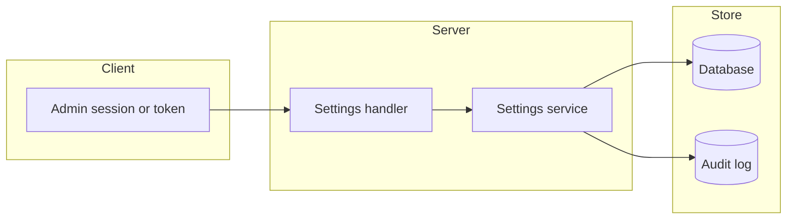

## Context

One settings registry serves both scopes. Each key holds type, default, validation, sensitive mark, weaker direction and action.

## Decisions

1. **One resource per scope.** GET returns value, source, default, locked flag and one revision. PATCH uses JSON Merge Patch with an expected revision and applies all or none.
2. **Fresh step.** One weaker key makes the whole PATCH need a fresh step. A longer session limit is weaker. An access token never gives the step.
3. **Idempotency and audit.** A PATCH needs an Idempotency-Key. A replay with the same body answers the stored result; the same key with another body is refused. Audit entries are written in the same transaction and mask sensitive values.
4. **Temporary administrator session limit.** Owner decision, 13 Nov 2026 (queue P12, provisional). The key tempadmin.session-limit holds a duration from 1 minute to 24 hours, default 1 hour, for the installation. A new record ends at create time plus the shorter of the limit and the token policy maximum. The create writes an audit entry that names the limit. A stored value outside the range fails closed with an audit entry. An existing record keeps its end time.
5. **Host reset.** The reset option deletes the stored limit. It refuses in recovery mode 3, needs a reason, obeys the off switch and writes an audit entry with the reason.

## Structure

The unexported settingsRegistry has only NewSettingsRegistry as constructor. The unexported tempAdminLimit has only ParseTempAdminLimit, which checks the range of 1 minute to 24 hours.

## Risks

- A wrong weaker mark skips the fresh step.
- A bad stored duration blocks creation; the reset option helps.

## Layers (defense in depth)

| Layer | Guard | Hostile test |
| --- | --- | --- |
| HTTP handler | Checks the action, the Idempotency-Key, keys, locks and the fresh step. Defense in depth: the service checks too. | PATCH with no key header, an unknown key, a locked key and a weaker value with a token: each is refused. |
| service | Applies all or none, checks the revision and writes audit entries. | A PATCH with an invalid second key and a PATCH with a failed audit write change nothing. |
| port adapter | Keeps declared keys only. The creator reads the limit through ParseTempAdminLimit. | An out-of-range limit row inserted directly makes the creator refuse. |

## Diagrams

Modules that the change touches, and their imports on main:

## Quality attributes

| Attribute | Target | Unit | Scope |
| --- | --- | --- | --- |
| settings read latency | 200 | ms at p95 | GET of one scope with 100 settings |
| settings patch latency | 500 | ms at p95 | PATCH of 10 keys on one scope |

## Threat model

Data flow and trust boundaries:

| Boundary | STRIDE | Threat | Layer | Guard | Hostile test |
| --- | --- | --- | --- | --- | --- |
| Client to Server | E | A caller lowers security without a fresh step, or with an access token. | authorize at point of use | The service requires a fresh session step for each weaker key and refuses tokens. | TestSettingsPatchFreshStep sends a weaker patch with a token and with a stale session. |
| Client to Server | E | A caller lowers security without a fresh step, or with an access token. | fail closed | An unknown weaker mark denies the patch. | A key with no mark is refused in TestSettingsPatchRefusals. |
| Server to Store | T | A stored limit is changed to a bad value outside the API. | boundary check | ParseTempAdminLimit checks the range at use. | TestTempAdminSessionLimit inserts a row of 48 hours and the creator refuses. |
| Server to Store | I | An audit entry shows a sensitive value. | encode or contain | The audit writer masks sensitive keys. | TestSettingsPatchRefusals checks the mask in the entry. |
| Client to Server | R | A change leaves no record. | fail closed | The audit entry shares the transaction; a failed write fails the patch. | TestSettingsPatchAtomic fails the audit write and sees no change. |

## Failure modes

| Step | Failure | Retry | State after |
| --- | --- | --- | --- |
| PATCH write | The audit write or a second key fails. | The client repeats the patch with the same Idempotency-Key. | No key changed and the revision did not move. |
| Create temporary administrator | The stored limit is outside the range. | The operator runs the reset option or a null patch, then creates again. | No record exists; an audit entry names the refusal. |
| Host reset | The mode is 3 or no reason is given. | The operator gives a reason in a mode that allows recovery. | The stored limit is unchanged. |
