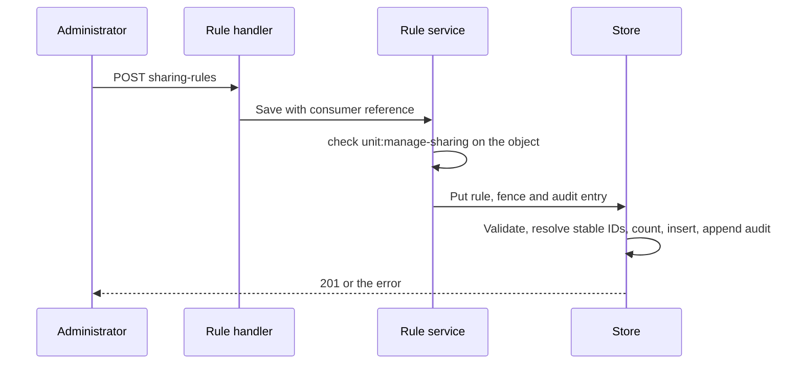
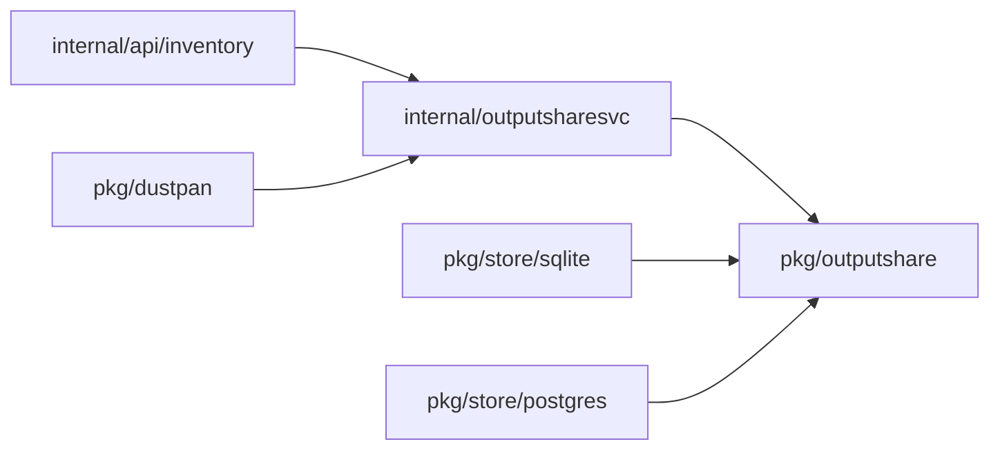
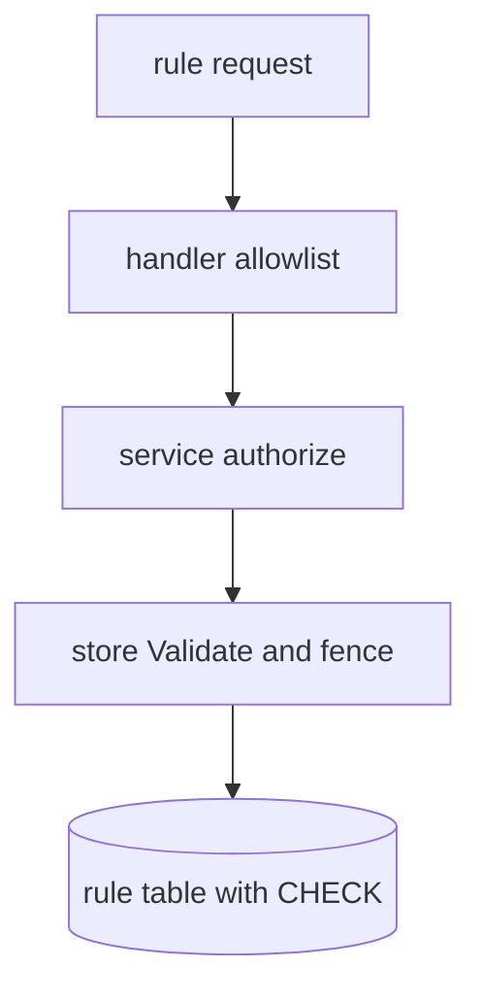

## Context

On main, the setting of a namespace has its port, its column, its service and its route. The port of the rules, `outputshare.Store`, is declared with its contract and its conformance cases, and no adapter implements it. This change adds the adapters, the table, the first rule of a new unit, the service of the rules and the routes. It does not change the setting route and it does not change the checker (the change `output-sharing` reads the stored rules).

## Decisions

1. **The setting stays on the output-sharing route.** ADR 273 decision 10 names `GET` and `PUT` on `/api/dustpan/v1/namespaces/{namespace}/output-sharing`, and main serves them (`internal/api/inventory/outputsharing.go:49`). The generic settings API has no key for it, and #897 leaves per-feature keys to each feature. A second path for one value would give two writers for one column. No change to the setting route, its body or its service.
2. **The rules use separate paths.** ADR 273 decision 10 gives the routes of a unit, and says that a collection and a namespace have the same shape. The rows are in the route table below. The routes are in the inventory adapter beside the setting routes, and the rule service is a second type in `internal/outputsharesvc`, built over `outputshare.Store`.
3. **The rule table and the new-unit rule are SQL.** One table `output_sharing_rules` in the baseline of each dialect, edited in place, in name order (ADR 322 decision 1). The unit and workspace creates write the first rule in the transaction that makes the unit, when the setting is `namespace`, as ADR 273 decision 4 says. The write is not a port of the SDK.
4. **Rules by stable ID.** A producer, and a consumer in the producer namespace, are stored by stable ID (`Rule.Validate` in `pkg/outputshare/outputshare.go`). A consumer of another namespace is stored by name and matches by name, as ADR 273 decision 3 says.
5. **The server makes the rule ID** with `ident.NewID` (like the function `NewID` in `internal/ident/ident.go`), so a caller cannot choose it.
6. **Each write has its audit entry in its transaction**, as the setting has (`internal/outputsharesvc/outputsharesvc.go:96`). The entry names the actor, the producer, the consumer, the action `unit:manage-sharing`, and the rule ID.
7. **No job-token read here.** The checker keeps its denial of a read by a job (`internal/outputsharesvc/checker.go:226`) until the change `output-sharing` lands. A rule saved by this change gives no read yet. The guide says so.

## Routes

| Route | Action and object | Answer |
| --- | --- | --- |
| `GET /namespaces/{namespace}/units/{unit_id}/sharing-rules` | `unit:read-access` on the unit | 200, rules ordered by ID |
| `POST /namespaces/{namespace}/units/{unit_id}/sharing-rules` | `unit:manage-sharing` on the unit | 201 with the rule |
| `DELETE /namespaces/{namespace}/units/{unit_id}/sharing-rules/{rule_id}` | `unit:manage-sharing` on the unit | 204 |
| `POST /namespaces/{namespace}/collections/{collection}/sharing-rules` | `unit:manage-sharing` on the collection | 201 |
| `DELETE /namespaces/{namespace}/collections/{collection}/sharing-rules/{rule_id}` | `unit:manage-sharing` on the collection | 204 |
| `POST /namespaces/{namespace}/sharing-rules` | `unit:manage-sharing` on the namespace | 201 |
| `DELETE /namespaces/{namespace}/sharing-rules/{rule_id}` | `unit:manage-sharing` on the namespace | 204 |
| `GET` on a collection or a namespace | parked (no decided action) | not served |

The body of a POST is `{"consumer": "<reference>"}`: a unit, a collection or a namespace reference. The handler resolves a consumer of the producer namespace to its stable ID. It does not resolve a consumer of another namespace. The error map: `ErrInvalid` 400, `ErrUnknownObject` 404, `ErrNotFound` 404, `ErrAlreadyExists` 409, `ErrLimit` 409, `namespace.ErrFenced` 409 with its existing code.

## Structure

The service keeps `outputshare.Store` as its only port, and takes `Authorizer` and `namespace.Store` as the setting service does. The new-unit write is a function inside each SQL adapter, called by `CreateStack`, `CreateStackPlaced`, `CreateWorkspace` and `CreateWorkspacePlaced` after the setting read in the same transaction. A rule that the store reads and that fails `Rule.Validate` never matches `Find`, so a bad row denies.

## Risks

- A unit made with a setting that fails `Default.Validate` must refuse the create and write nothing (suite case "new unit: a setting that fails Validate refuses the create and writes nothing").
- A purge that leaves a rule of a purged unit would let a new unit with the same name match a stale rule of another namespace. The purge removes the rules of the unit in the same transaction.
- Both tool stores and both dialects must seed the same rule. The conformance suite runs the same cases on each.

## Diagrams

After this change:

Modules that the change touches, and their imports on main:

## Quality attributes

| Attribute | Target | Unit | Scope |
| --- | --- | --- | --- |
| rule list size | 100 | rules at most for each producer | `outputshare.MaxRulesPerProducer` (`pkg/outputshare/outputshare.go:81`) |
| new-unit atomicity | 100 | percent of faulted creates that leave no unit, no rule and no audit entry | the fault case of the conformance suite on both dialects |

## Threat model

Data flow and trust boundaries:

| Boundary | STRIDE | Threat | Layer | Guard | Hostile test |
| --- | --- | --- | --- | --- | --- |
| HTTP adapter | T | A request names a principal, a whole other namespace, an unknown field, a second JSON value or an oversize body as the consumer. | boundary check | Decode with an allowlist of object kinds and a body limit. | A table of hostile bodies sent to the handler gives 400 and stores no rule. |
| HTTP adapter | E | A caller with `unit:read-access` saves a rule. | authorize at point of use | The route row declares `unit:manage-sharing` on the object. | A caller with only `unit:read-access` gets 403, and the store stays empty. |
| Service | E | A caller with `unit:manage-sharing` on unit A saves or removes a rule of unit B. | authorize at point of use | The service checks the action on the producer of the call. | The service called with a grant on a sibling unit denies. |
| Service | E | A removal by rule ID reaches a rule of another producer. | contain | The store binds `Get` and `Delete` to the producer of the route. | `Delete` with the ID of a rule of another producer returns `ErrNotFound` and changes nothing. |
| Service | R | A rule change leaves no record. | fail closed | A failed audit append fails the write. | A store fault on the audit append leaves no rule. |
| Store | T | A rule names a unit with a name and a stable ID that point to different objects. | boundary check | `Put` checks that each object exists and that name and ID match. | `Put` returns `ErrUnknownObject` and changes nothing. |
| Store | T | A consumer of another namespace carries a stable ID, or names a whole namespace. | boundary check | `Rule.Validate` at each write. | `Put` returns `ErrInvalid`. |
| Store | D | A producer saves rules without limit. | limit | Count the rules of the producer in the transaction of the write. | The 101st rule returns `ErrLimit`. |
| Store | E | A stale fence or the fence of another namespace writes a rule. | authorize at point of use | The fence check in the transaction. | `Put` and `Delete` with a stale fence return `namespace.ErrFenced`. |
| Table | T | A row of another version or a restore holds a rule that fails `Validate`. | fail closed | `Find` never matches a row that fails `Validate`, and the table CHECKs hold the kinds. | A row written with no `Validate` never matches. |

## Contract

**outputShareRule**

- Invariant: A rule names a unit, a collection or a namespace as producer and as consumer. It never names a principal or a whole other namespace.
- Invariant: A producer, and a consumer of the producer namespace, have their stable ID. A consumer of another namespace has none.
- `Put`: pre: the fence is current and the rule is valid. Post: the rule and its audit entry are stored in one transaction, or nothing is stored.
- New unit: pre: the setting is `namespace`. Post: the unit, its one rule that names its namespace and the audit entry of that rule commit together, or none commits.

## Failure modes

| Step | Failure | Retry | State after |
| --- | --- | --- | --- |
| Save a rule | The audit append fails. | The caller sends the request again. | No rule. |
| Make a unit with setting `namespace` | A fault comes between the rule write and the commit. | The caller sends the create again. | No unit, no rule, no audit entry. |
| Remove a rule | The fence is stale. | Read the namespace and send again. | The rule stays. |
