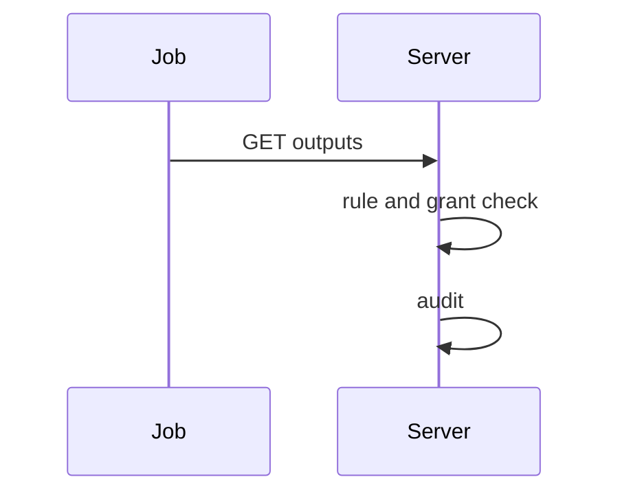
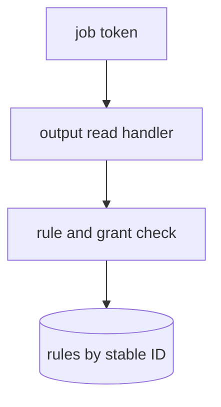

## Context

The route, the actions and the settings resource exist on main. The change adds the setting, the rules by scope and the read check.

## Decisions

1. **Rules by stable ID.** A rule stores the stable unit, collection or namespace ID of its target, never a name.
2. **Check at read, fail closed.** Each output read checks the rule and the starter grant. Any missing rule, error or deleted target denies and writes an audit entry.

## Structure

An unexported rule type with a constructor that checks the producer, the target scope, the stable ID and the same-namespace invariant.

## Risks

- A collection re-created with the same name must not inherit sharing.

## Diagrams

After this change:

## Quality attributes

| Attribute | Target | Unit | Scope |
| --- | --- | --- | --- |
| deny correctness | 100 | percent of reads without a naming rule denied | Output reads across units |

## Threat model

Data flow and trust boundaries:

| Boundary | STRIDE | Threat | Layer | Guard | Hostile test |
| --- | --- | --- | --- | --- | --- |
| Service boundary: sharing check | E | A job keeps read access after its rule or grant is removed. | boundary check | Reject deleted or foreign units. | Read outputs of a deleted producer and expect deny. |
| Service boundary: sharing check | E | A job keeps read access after its rule or grant is removed. | encode or contain | Match by stable ID. | Re-create a collection with the old name and expect deny. |
| Service boundary: sharing check | E | A job keeps read access after its rule or grant is removed. | limit | Cap denial audit writes per producer. | Flood denied reads and expect a bounded log. |
| Service boundary: sharing check | E | A job keeps read access after its rule or grant is removed. | authorize at point of use | Check rule and starter grant at each read. | Remove the grant mid-job and expect deny. |
| Service boundary: sharing check | E | A job keeps read access after its rule or grant is removed. | fail closed | Deny on store error. | Inject a store error and expect deny. |

## Contracts

**outputSharingRule**

- Invariant: Producer and target are in one namespace.
- Invariant: Target is a stable ID.
- `readOutputs`: pre: Job token is valid.. Post: Allowed only with a naming rule and unit:read-outputs of the starter..

## Failure modes

| Step | Failure | Retry | State after |
| --- | --- | --- | --- |
| Read outputs | Rule removed while a read is in flight. | No retry of the denied read. | Read denied and audited. |
