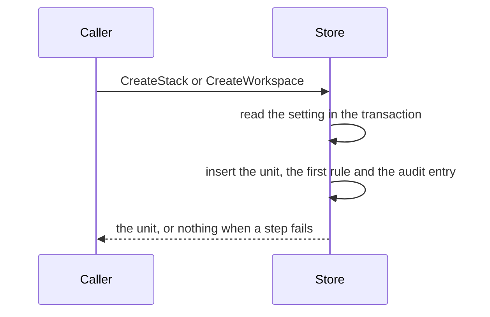
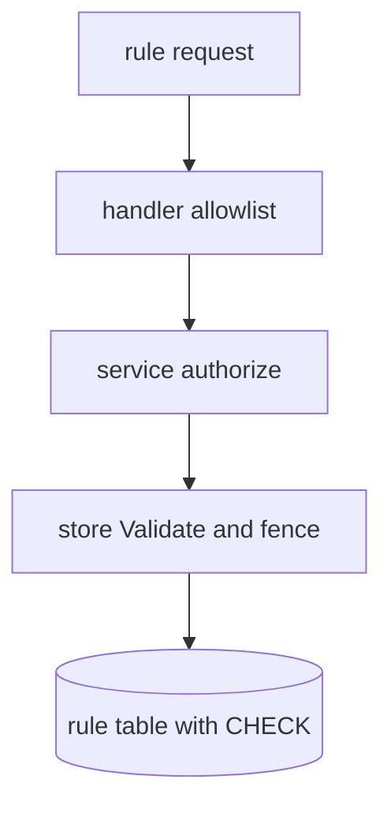

## Context

On main, the setting of a namespace has its port, its column, its service and its route, and the SQL adapters of `outputshare.Store` and the table `output_sharing_rules` exist (part 1). This change adds what is left in the stores: the first rule of a new unit, and the removal of the rules of a purged unit or collection. It does not add a service or a route (the change `add-output-sharing-rules-api` owns them), it does not change the setting route and it does not change the checker (the change `output-sharing` reads the stored rules).

## Decisions

1. **The new-unit rule and the purge are SQL.** The table `output_sharing_rules` is on main since part 1. The unit and workspace creates write the first rule in the transaction that makes the unit, when the setting is `namespace`, as ADR 273 decision 4 says. The write is not a port of the SDK.
2. **Rules by stable ID, always.** The producer and the consumer of a rule are stored by stable ID, never by name (ADR 391, owner, 2026-11-20: "Stable ID always. No entities should be keyed by name."). A consumer in the producer namespace is resolved to its ID by the save, which checks that the unit or collection exists. A consumer in another namespace is stored as the ID of that namespace plus the unit or collection ID that the caller gives. The save checks the format of that ID with an allowlist (`Rule.Validate`) and does not look it up, so the answer does not tell whether the object exists (ADR 273 decision 3 and ADR 220 decision 11 stay). A rename, or a delete and make again, in any namespace never matches a rule by name. The table keeps no name of a consumer. How a person learns the ID of an object of another namespace, and how the body of the route names it, are decided in the change `add-output-sharing-rules-api`.
3. **Each write has its audit entry in its transaction**, as the setting has (`internal/outputsharesvc/outputsharesvc.go:96`). The entry names the actor, the producer, the consumer, the action `unit:manage-sharing`, and the rule ID.
## Structure

The new-unit write is a function inside each SQL adapter, called by `CreateStack`, `CreateStackPlaced`, `CreateWorkspace` and `CreateWorkspacePlaced` after the setting read in the same transaction. The purge calls the removal queries in the transaction of the purge. A rule that the store reads and that fails `Rule.Validate` never matches `Find`, so a bad row denies.

## Risks

- A unit made with a setting that fails `Default.Validate` must refuse the create and write nothing (suite case "new unit: a setting that fails Validate refuses the create and writes nothing").
- A purge that leaves a rule of a purged unit would leave a stale rule. The purge removes, in the same transaction, each rule that names the unit by stable ID, as producer in its namespace or as consumer by its namespace and ID, in any producer namespace (`DeleteOutputSharingRulesOfUnit`); a rule that names the same ID in another namespace stays. The delete of a collection does the same for the ID of the collection (`DeleteOutputSharingRulesOfCollection`). Both queries return the namespace and ID of each rule that they remove, and the audit entry of the purge or of the delete lists them in one change with the key `output-sharing-rules`, so an automatic removal leaves a record. A new index on `(consumer_namespace, consumer_id)` keeps the purge from scanning the table.
- Both tool stores and both dialects must seed the same rule. The conformance suite runs the same cases on each.

## Diagrams

After this change:

## Quality attributes

| Attribute | Target | Unit | Scope |
| --- | --- | --- | --- |
| new-unit atomicity | 100 | percent of faulted creates that leave no unit, no rule and no audit entry | the fault case of the conformance suite on both dialects |

## Threat model

Data flow and trust boundaries:

| Boundary | STRIDE | Threat | Layer | Guard | Hostile test |
| --- | --- | --- | --- | --- | --- |
| Store | T | A producer names a unit with a name and a stable ID that point to different objects. | boundary check | `Put` checks that the producer exists and that name and ID match, and that a consumer of the producer namespace exists by ID. | `Put` returns `ErrUnknownObject` and changes nothing. |
| Store | T | A consumer has an ID with a byte outside the allowlist, a bad length, a bad kind or a bad namespace, or names a whole other namespace. | boundary check | `Rule.Validate` at each write, and `CheckPut` in the store. | `Put` returns `ErrInvalid` for each value of a table of hostile IDs; `TestRuleValidate` and `TestCheckPutRefusesHostileConsumers` send the same values to each layer alone. |
| Store | E | A deleted and made again unit or collection, in any namespace, gets the rule of the old one. | contain | A rule matches the stable ID only, and the purge removes each rule that names the ID. | The suite cases of the purge of a unit and of the delete of a collection in another namespace; a new object with the old name never matches. |
| Store | I | A list returns the rules of another producer, or rules that fail `Validate`. | contain, fail closed | `List` filters by the producer of the call and skips a row that fails `Validate`. | `List` of one collection returns no rule of a sibling collection or of a unit; a row written with no `Validate` is not listed. |
| Store | D | A producer saves rules without limit. | limit | Count the rules of the producer in the transaction of the write. | The 101st rule returns `ErrLimit`. |
| Store | E | A stale fence or the fence of another namespace writes a rule. | authorize at point of use | The fence check in the transaction. | `Put` and `Delete` with a stale fence return `namespace.ErrFenced`. |
| Table | T | A row of another version or a restore holds a rule that fails `Validate`. | fail closed | `Find` never matches a row that fails `Validate`, the table CHECKs hold the kinds and the non-empty ID of a unit or collection consumer, and the restore checks the ID format. | A row written with no `Validate` never matches; `TestSharingRuleTableRefusesAnotherKind` and the value check of the backup test refuse the hostile rows. |

## Contract

**outputShareRule**

- Purge: pre: a unit or a collection is purged. Post: no rule names that namespace and stable ID as its consumer or producer, and the audit entry lists the removed rules.
- New unit: pre: the setting is `namespace`. Post: the unit, its one rule that names its namespace and the audit entry of that rule commit together, or none commits.

## Failure modes

| Step | Failure | Retry | State after |
| --- | --- | --- | --- |
| Make a unit with setting `namespace` | A fault comes between the rule write and the commit. | The caller sends the create again. | No unit, no rule, no audit entry. |
