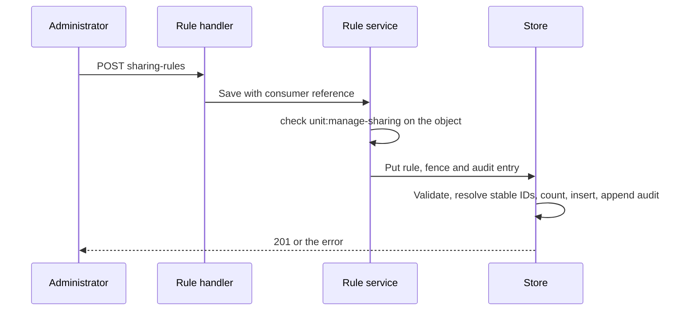
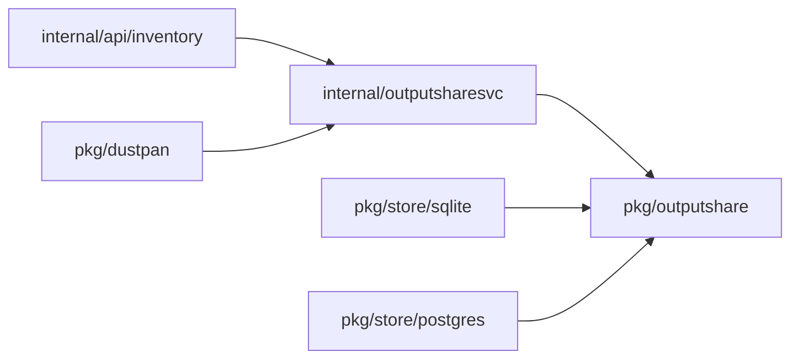
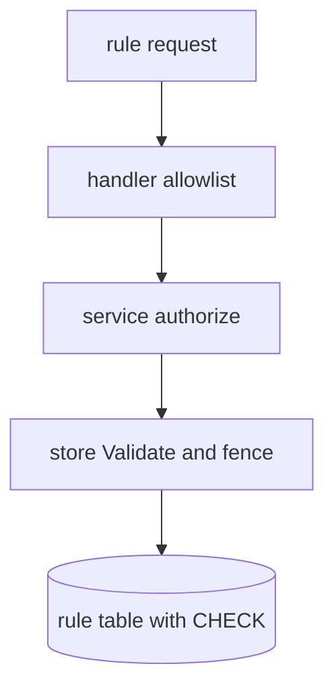

## Context

On main, the setting of a namespace has its port, its column, its service and its route. The port of the rules, `outputshare.Store`, is declared with its contract and its conformance cases, and no adapter implements it. This change adds the adapters, the table, the first rule of a new unit, the service of the rules and the routes. It does not change the setting route and it does not change the checker (the change `output-sharing` reads the stored rules).

## Decisions

1. **The setting stays on the output-sharing route.** ADR 273 decision 10 names `GET` and `PUT` on `/api/dustpan/v1/namespaces/{namespace}/output-sharing`, and main serves them (`internal/api/inventory/outputsharing.go:49`). The generic settings API has no key for it, and #897 leaves per-feature keys to each feature. A second path for one value would give two writers for one column. No change to the setting route, its body or its service.
2. **The rules use separate paths.** ADR 273 decision 10 gives the routes of a unit, and says that a collection and a namespace have the same shape. The rows are in the route table below. Each list route mirrors `unit:read-access` for its own object kind: `collection:read-access` for a collection and `namespace:read-access` for a namespace (owner, 2026-11-20; ADR 273 decision 10, "the same shape"). A list route resolves its object from the path, as the save and the removal do, and declares the action on that object, so a grant on a unit never lists the rules of its collection or namespace. The routes are in the inventory adapter beside the setting routes, and the rule service is a second type in `internal/outputsharesvc`, built over `outputshare.Store`.
3. **The rule table and the new-unit rule are SQL.** One table `output_sharing_rules` in the baseline of each dialect, edited in place, in name order (ADR 322 decision 1). The unit and workspace creates write the first rule in the transaction that makes the unit, when the setting is `namespace`, as ADR 273 decision 4 says. The write is not a port of the SDK.
4. **Rules by stable ID, always.** The producer and the consumer of a rule are stored by stable ID, never by name (ADR 391, owner, 2026-11-20: "Stable ID always. No entities should be keyed by name."). A consumer in the producer namespace is resolved to its ID by the save, which checks that the unit or collection exists. A consumer in another namespace is stored as the ID of that namespace plus the unit or collection ID that the caller gives. The save checks the format of that ID with an allowlist (`Rule.Validate`) and does not look it up, so the answer does not tell whether the object exists (ADR 273 decision 3 and ADR 220 decision 11 stay). A rename, or a delete and make again, in any namespace never matches a rule by name. The table keeps no name of a consumer. How a person learns the ID of an object of another namespace, and how the body of the route names it, are decided in the API part of this change.
5. **The server makes the rule ID** with `ident.NewID` (like the function `NewID` in `internal/ident/ident.go`), so a caller cannot choose it.
6. **Each write has its audit entry in its transaction**, as the setting has (`internal/outputsharesvc/outputsharesvc.go:96`). The entry names the actor, the producer, the consumer, the action `unit:manage-sharing`, and the rule ID.
7. **No job-token read here.** The checker keeps its denial of a read by a job (`internal/outputsharesvc/checker.go:226`) until the change `output-sharing` lands. A rule saved by this change gives no read yet. The guide says so.

## Routes

| Route | Action and object | Answer |
| --- | --- | --- |
| `GET /namespaces/{namespace}/units/{unit_id}/sharing-rules` | `unit:read-access` on the unit | 200, rules ordered by ID |
| `POST /namespaces/{namespace}/units/{unit_id}/sharing-rules` | `unit:manage-sharing` on the unit | 201 with the rule |
| `DELETE /namespaces/{namespace}/units/{unit_id}/sharing-rules/{rule_id}` | `unit:manage-sharing` on the unit | 204 |
| `GET /namespaces/{namespace}/collections/{collection}/sharing-rules` | `collection:read-access` on the collection (owner, 2026-11-20) | 200, rules ordered by ID |
| `POST /namespaces/{namespace}/collections/{collection}/sharing-rules` | `unit:manage-sharing` on the collection | 201 |
| `DELETE /namespaces/{namespace}/collections/{collection}/sharing-rules/{rule_id}` | `unit:manage-sharing` on the collection | 204 |
| `GET /namespaces/{namespace}/sharing-rules` | `namespace:read-access` on the namespace (owner, 2026-11-20) | 200, rules ordered by ID |
| `POST /namespaces/{namespace}/sharing-rules` | `unit:manage-sharing` on the namespace | 201 |
| `DELETE /namespaces/{namespace}/sharing-rules/{rule_id}` | `unit:manage-sharing` on the namespace | 204 |

The body of a POST is `{"consumer": "<reference>"}`: a unit, a collection or a namespace reference. The handler resolves a consumer of the producer namespace to its stable ID. It does not resolve a consumer of another namespace. The error map: `ErrInvalid` 400, `ErrUnknownObject` 404, `ErrNotFound` 404, `ErrAlreadyExists` 409, `ErrLimit` 409, `namespace.ErrFenced` 409 with its existing code.

## Structure

The service keeps `outputshare.Store` as its only port, and takes `Authorizer` and `namespace.Store` as the setting service does. The new-unit write is a function inside each SQL adapter, called by `CreateStack`, `CreateStackPlaced`, `CreateWorkspace` and `CreateWorkspacePlaced` after the setting read in the same transaction. A rule that the store reads and that fails `Rule.Validate` never matches `Find`, so a bad row denies.

## Risks

- A unit made with a setting that fails `Default.Validate` must refuse the create and write nothing (suite case "new unit: a setting that fails Validate refuses the create and writes nothing").
- A purge that leaves a rule of a purged unit would leave a stale rule. The purge removes, in the same transaction, each rule that names the unit by stable ID, as producer in its namespace or as consumer by its namespace and ID, in any producer namespace (`DeleteOutputSharingRulesOfUnit`); a rule that names the same ID in another namespace stays. The delete of a collection does the same for the ID of the collection (`DeleteOutputSharingRulesOfCollection`). Both queries return the namespace and ID of each rule that they remove, and the audit entry of the purge or of the delete lists them in one change with the key `output-sharing-rules`, so an automatic removal leaves a record. A new index on `(consumer_namespace, consumer_id)` keeps the purge from scanning the table.
- Both tool stores and both dialects must seed the same rule. The conformance suite runs the same cases on each.

## Diagrams

After this change:

Modules that the change touches, and their imports on main:

## Quality attributes

| Attribute | Target | Unit | Scope |
| --- | --- | --- | --- |
| rule list size | 100 | rules at most for each producer | `outputshare.MaxRulesPerProducer` (`pkg/outputshare/outputshare.go:81`) |
| new-unit atomicity | 100 | percent of faulted creates that leave no unit, no rule and no audit entry | the fault case of the conformance suite on both dialects |

## Threat model

Data flow and trust boundaries:

| Boundary | STRIDE | Threat | Layer | Guard | Hostile test |
| --- | --- | --- | --- | --- | --- |
| HTTP adapter | T | A request names a principal, a whole other namespace, an unknown field, a second JSON value or an oversize body as the consumer. | boundary check | Decode with an allowlist of object kinds and a body limit. | A table of hostile bodies sent to the handler gives 400 and stores no rule. |
| HTTP adapter | I | A caller with `unit:read-access` on a unit lists the rules of its collection or namespace, or a caller with `collection:read-access` lists the rules of the namespace, or the reverse. | authorize at point of use | Each list route row declares the read action of its own object kind and resolves that object from the path. | A caller with one read action on the wrong object kind gets 403 on each list route, and a caller with no grant gets 403. The test fails when the action of a row is changed to another kind. |
| HTTP adapter | E | A caller with `unit:read-access` saves a rule. | authorize at point of use | The route row declares `unit:manage-sharing` on the object. | A caller with only `unit:read-access` gets 403, and the store stays empty. |
| Service | I | A caller with a read action on collection A, or on a namespace, lists the rules of another collection or namespace. | authorize at point of use | `List` checks the read action of the kind of the producer on the producer of the call. | The service called with `collection:read-access` on a sibling collection, or with `namespace:read-access` on another namespace, denies and lists nothing. The test fails when the check is removed. |
| Service | E | A caller with `unit:manage-sharing` on unit A saves or removes a rule of unit B. | authorize at point of use | The service checks the action on the producer of the call. | The service called with a grant on a sibling unit denies. |
| Service | E | A removal by rule ID reaches a rule of another producer. | contain | The store binds `Get` and `Delete` to the producer of the route. | `Delete` with the ID of a rule of another producer returns `ErrNotFound` and changes nothing. |
| Service | R | A rule change leaves no record. | fail closed | A failed audit append fails the write. | A store fault on the audit append leaves no rule. |
| Store | T | A producer names a unit with a name and a stable ID that point to different objects. | boundary check | `Put` checks that the producer exists and that name and ID match, and that a consumer of the producer namespace exists by ID. | `Put` returns `ErrUnknownObject` and changes nothing. |
| Store | T | A consumer has an ID with a byte outside the allowlist, a bad length, a bad kind or a bad namespace, or names a whole other namespace. | boundary check | `Rule.Validate` at each write, and `CheckPut` in the store. | `Put` returns `ErrInvalid` for each value of a table of hostile IDs; `TestRuleValidate` and `TestCheckPutRefusesHostileConsumers` send the same values to each layer alone. |
| Store | E | A deleted and made again unit or collection, in any namespace, gets the rule of the old one. | contain | A rule matches the stable ID only, and the purge removes each rule that names the ID. | The suite cases of the purge of a unit and of the delete of a collection in another namespace; a new object with the old name never matches. |
| Store | I | A list returns the rules of another producer, or rules that fail `Validate`. | contain, fail closed | `List` filters by the producer of the call and skips a row that fails `Validate`. | `List` of one collection returns no rule of a sibling collection or of a unit; a row written with no `Validate` is not listed. |
| Store | D | A producer saves rules without limit. | limit | Count the rules of the producer in the transaction of the write. | The 101st rule returns `ErrLimit`. |
| Store | E | A stale fence or the fence of another namespace writes a rule. | authorize at point of use | The fence check in the transaction. | `Put` and `Delete` with a stale fence return `namespace.ErrFenced`. |
| Table | T | A row of another version or a restore holds a rule that fails `Validate`. | fail closed | `Find` never matches a row that fails `Validate`, the table CHECKs hold the kinds and the non-empty ID of a unit or collection consumer, and the restore checks the ID format. | A row written with no `Validate` never matches; `TestSharingRuleTableRefusesAnotherKind` and the value check of the backup test refuse the hostile rows. |

## Contract

**outputShareRule**

- Invariant: A rule names a unit, a collection or a namespace as producer and as consumer. It never names a principal or a whole other namespace.
- Invariant: A rule keeps its producer and its consumer by stable ID and never by name. A consumer of another namespace is that namespace plus an ID with a valid format.
- Purge: pre: a unit or a collection is purged. Post: no rule names that namespace and stable ID as its consumer or producer, and the audit entry lists the removed rules.
- `Put`: pre: the fence is current and the rule is valid. Post: the rule and its audit entry are stored in one transaction, or nothing is stored.
- New unit: pre: the setting is `namespace`. Post: the unit, its one rule that names its namespace and the audit entry of that rule commit together, or none commits.

## Failure modes

| Step | Failure | Retry | State after |
| --- | --- | --- | --- |
| Save a rule | The audit append fails. | The caller sends the request again. | No rule. |
| Make a unit with setting `namespace` | A fault comes between the rule write and the commit. | The caller sends the create again. | No unit, no rule, no audit entry. |
| Remove a rule | The fence is stale. | Read the namespace and send again. | The rule stays. |
