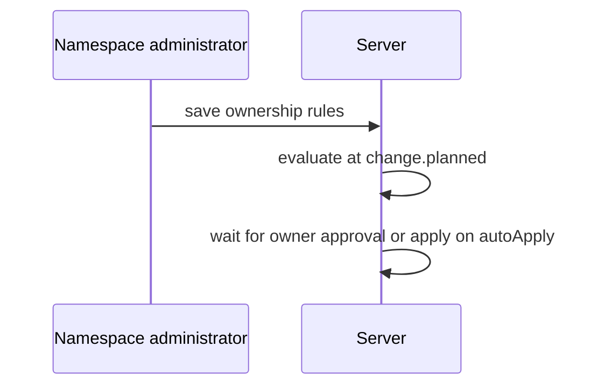

## Context

Ownership evaluation runs at change.planned in the gate engine over stored rules and path sets. Each matched enforce rule adds one requirement. An optional unless body on the rule, pending the owner decision, can excuse that requirement by operation source.

## Decisions

1. **One requirement per matched rule.** Match by unit scope and by overlap of named path sets with the touched paths. An unreadable path set fails closed to no match and is recorded.
2. **Unless excuses one requirement.** A true unless excuses only that requirement. A warn, an unless error, a timeout or an unknown operationSource sets autoApply false. The apply recheck only adds requirements.

## Structure

An unexported ownershipMatcher, made only by newOwnershipMatcher, which checks rule IDs, globs, groups and path set references.

## Risks

- A broad glob adds surprise approvals; the record names the rule and path set.
- An unless body that reads a missing fact fails closed.

## Diagrams

After this change:



## Quality attributes

| Attribute | Target | Unit | Scope |
| --- | --- | --- | --- |
| ownership evaluation latency | 500 | ms | change.planned evaluation with 256 ownership rules |

## Threat model

Data flow and trust boundaries:

```mermaid
An administrator saves rules; a plan starts; the gate engine evaluates ownership; a runner applies on approval or autoApply.
```

| Boundary | STRIDE | Threat | Layer | Guard | Hostile test |
| --- | --- | --- | --- | --- | --- |
| Ownership rule save | E | A crafted rule widens auto-apply. | boundary check | Check ID, glob and condition size at save. | Save an oversized condition; the save fails with gate.limit. |
| Ownership rule save | E | A crafted rule widens auto-apply. | authorize at point of use | Require namespace:manage-gates on the scope. | Save with a read grant only; the server answers 403. |
| Ownership rule save | E | A crafted rule widens auto-apply. | fail closed | An unless error sets autoApply false. | Evaluate an unknown fact; the apply waits. |

## Failure modes

| Step | Failure | Retry | State after |
| --- | --- | --- | --- |
| Evaluate unless at change.planned | Unknown fact or Cedar timeout | No retry | The change stays in approval wait with autoApply false. |
| Apply after plan | A path set or rule is deleted while the plan waits | The recheck adds requirements from stored rules | The plan record stays and a recorded requirement waits for approval. |
