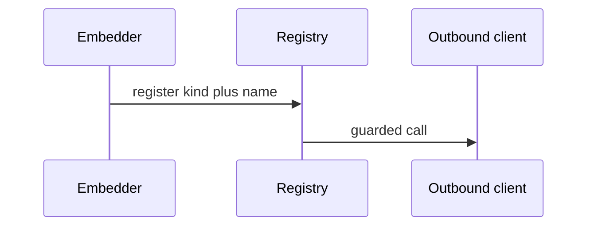
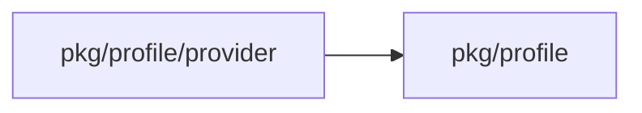
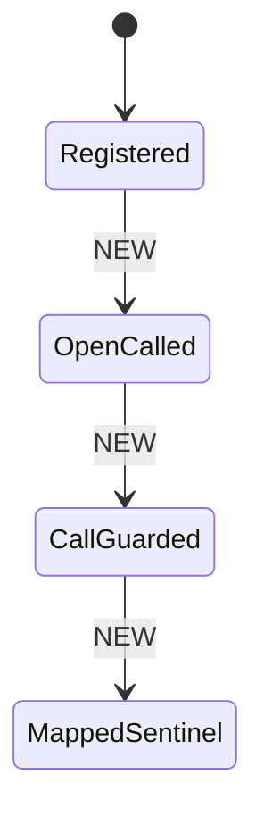
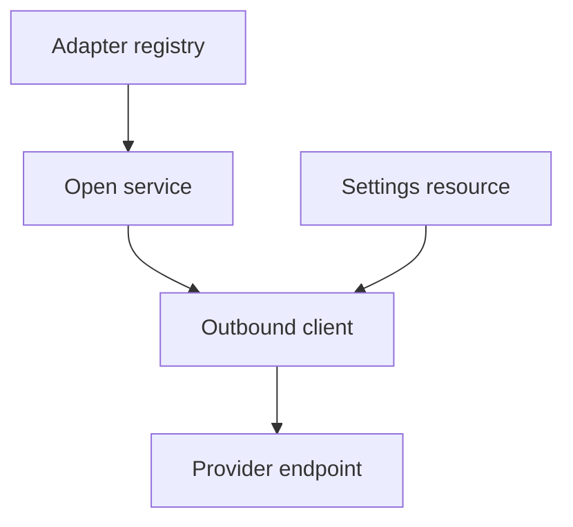

## Context

Profile open calls provider blocks for login, secrets and outputs. Each adapter talks to an outside remote. One port, one suite and one guarded client keep each adapter inside the same safety rules.

## Decisions

1. **Ports and suites.** Add Provider, Rotator and TokenSource with Spec in pkg/profile/provider, use the sentinels of pkg/profile, and add RunRotator to providertest.
2. **Registry by kind and name.** Add a registry in the wiring that refuses a duplicate pair at start. An unknown pair fails with ErrInvalid at save and at open.
3. **One guarded outbound client.** Route each call through egresshttp with NoRedirect, HTTPSOnly, pinned dial guard, 1 MiB read limit, 256 KiB request limit, 10 second default timeout with 30 second maximum, and at most 16 parallel calls per host per server process.

## Structure

Unexported type providerRegistry with constructor newProviderRegistry, which checks duplicate kind plus name pairs; only the constructor makes the map, so a duplicate cannot start.

## Risks

- A new adapter uses http.DefaultClient.
- A duplicate pair shadows the first adapter.
- A secret value reaches the job log through an unmasked message.

## Layers (defense in depth)

| Layer | Guard | Hostile test |
| --- | --- | --- |
| port adapter | Spec and Check refuse a plain literal for a secret input. | Save a block with a plain secret literal; the save fails with ErrInvalid and no network use. |
| service | The service maps remote errors to sentinels, caps messages at 200 characters and masks secret inputs. | Drive the fake to return denied, missing, 5xx, timeout and oversize answers; each maps to its sentinel and no secret is stored. |
| HTTP handler | The client refuses link-local, loopback and unlisted private addresses at dial and follows no cross-host redirect. | Dial 169.254.169.254, 127.0.0.1 and an unlisted 10.x host, then a redirect and a rebinding answer; each fails with ErrUnavailable. |

## Diagrams

After this change:

Modules that the change touches, and their imports on main:

States on main in the touched packages:

States and transitions after this change:

## Quality attributes

| Attribute | Target | Unit | Scope |
| --- | --- | --- | --- |
| timeout | 10 default and 30 maximum | seconds | one provider call |
| answer size | 1 | MiB | one provider call |
| request size | 256 | KiB | one provider call |
| parallel calls | 16 | calls | one host per server process |

## Threat model

Data flow and trust boundaries:

| Boundary | STRIDE | Threat | Layer | Guard | Hostile test |
| --- | --- | --- | --- | --- | --- |
| Server process to remote system | E | A crafted block reaches a private address or sends a credential to another host. | boundary check | HTTPS only, no redirect and pinned dial guard. | Send a cross-host redirect and a rebinding answer; each dial fails. |
| Server process to remote system | E | A crafted block reaches a private address or sends a credential to another host. | encode or contain | Mask secret inputs in stored messages and the job log. | Return error text with a secret value; stored text holds the mask. |
| Server process to remote system | E | A crafted block reaches a private address or sends a credential to another host. | limit | Cap the answer at 1 MiB and parallel calls at 16 per host. | Send an oversize answer and a 17th call; each is bounded. |
| Server process to remote system | E | A crafted block reaches a private address or sends a credential to another host. | authorize at point of use | Check the allow list for the namespace of the call at dial time. | Call a listed host from an unlisted namespace; the call fails. |
| Server process to remote system | E | A crafted block reaches a private address or sends a credential to another host. | fail closed | Refuse unlisted addresses with ErrUnavailable. | Redirect to an unlisted host; the call fails closed. |

## Contracts

**ProviderRegistry**

- Invariant: One entry per kind plus name pair.
- `Register`: pre: The pair is not registered.. Post: The pair maps to the adapter..
- `Lookup`: pre: A block names a pair.. Post: The adapter answers or ErrInvalid reports an unknown pair..

## Failure modes

| Step | Failure | Retry | State after |
| --- | --- | --- | --- |
| Server start with registry | Duplicate kind plus name pair. | Remove one registration and start again. | Server stopped before any open. |
| Guarded provider call | Remote answers 5xx or times out. | Open again; the server makes no automatic retry. | Open failed with ErrUnavailable and no partial values stored. |
