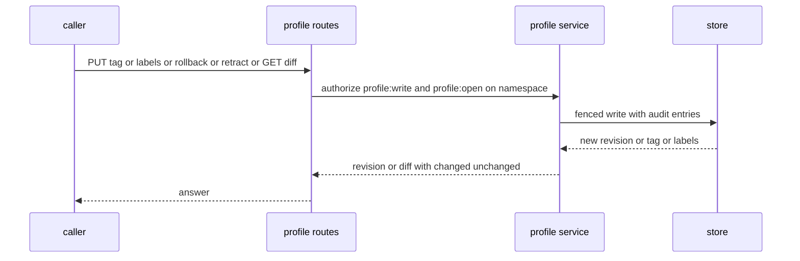
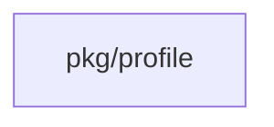
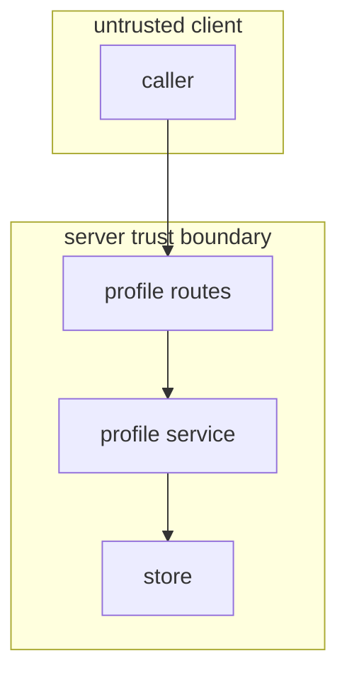

## Context

Profiles slice 1 stores revisions only. This slice adds tags, labels, rollback, retract and diff on the same store and routes.

## Decisions

1. **Store tags and labels with revisions.** Keep tags, labels, retraction marks and reasons in SQL beside revisions so one fenced transaction can move tags, mark retraction and append audit entries. No new tool and no new analyzer.
2. **Separate profile resolve from revision resolve.** Resolve the profile by namespace plus name or prf- ID at the route, then resolve the revision selector by number or tag including latest inside pkg/profile. The stored tag row keys on the stable prf- ID so a rename keeps tags and grants. This slice checks profile actions on the namespace object until #1008 ships the profile object.

## Structure

Unexported tag and label checks inside pkg/profile with constructor-checked value types; only the store constructor makes a valid tag name, label set, reason and diff request.

## Risks

- A tag move that is a routing change without profile:open leaks a secret path.
- Diff with showSecrets without profile:open reveals secret values.

## Layers (defense in depth)

| Layer | Guard | Hostile test |
| --- | --- | --- |
| boundary check | Allowlist tag name, label keys and values, reason length and revision selector at handler and service | Send bad tag name, 33rd tag, bad %2F path and overlong reason directly to the route; each is refused |
| encode or contain | SQL placeholders only; audit entries and logs never hold secret values; diff compares inside the server and answers only changed or unchanged | Save a secret then send SQL metacharacters in a tag; store stays intact and logs hold no plain text |
| limit | 32-tag cap, 32-label cap, reason at most 500 characters and diff bounded to two revisions | Exceed each cap with a hostile client; server refuses with profile.limit or profile.invalid |
| authorize at point of use | Check profile:read or profile:write on the namespace at point of use; routing moves, rollbacks and showSecrets diffs also need profile:open | Call each route with an access token that lacks the grant; server refuses |
| fail closed | Fail closed on unknown selector, retracted revision or stale write with profile.not-found or profile.conflict and write the audit refusal | Open a retracted revision and retract the newest revision; both are refused |

## Diagrams

After this change:

Modules that the change touches, and their imports on main:

## Quality attributes

| Attribute | Target | Unit | Scope |
| --- | --- | --- | --- |
| latency | p95 under 300ms on sqlite for one profile | ms | tag, label, rollback, retract and diff routes |
| storage growth | under 5KB per tag or label set change | bytes | tags and labels rows per namespace |

## Threat model

Data flow and trust boundaries:

| Boundary | STRIDE | Threat | Layer | Guard | Hostile test |
| --- | --- | --- | --- | --- | --- |
| client to server | T | Tampering with tags, labels, rollback or retract to point a unit at a hostile revision | boundary check | Allowlist tag name, label keys and values, reason length and revision selector at handler and service | Send bad tag name, 33rd tag, bad %2F path and overlong reason directly to the route; each is refused |
| client to server | T | Tampering with tags, labels, rollback or retract to point a unit at a hostile revision | encode or contain | SQL placeholders only; audit entries and logs never hold secret values | Save a secret then send SQL metacharacters in a tag; store stays intact and logs hold no plain text |
| client to server | T | Tampering with tags, labels, rollback or retract to point a unit at a hostile revision | limit | 32-tag cap, 32-label cap, reason at most 500 characters and diff bounded to two revisions | Exceed each cap with a hostile client; server refuses with profile.limit or profile.invalid |
| client to server | T | Tampering with tags, labels, rollback or retract to point a unit at a hostile revision | authorize at point of use | Check profile:read or profile:write on the namespace at point of use; routing moves, rollbacks and showSecrets diffs also need profile:open | Call each route with an access token that lacks the grant; server refuses |
| client to server | T | Tampering with tags, labels, rollback or retract to point a unit at a hostile revision | fail closed | Fail closed on unknown selector, retracted revision or stale write with profile.not-found or profile.conflict and write the audit refusal | Open a retracted revision and retract the newest revision; both are refused |
| server to reader | I | Disclosure of secret values through diff answers | boundary check | Diff defaults to no secret values; showSecrets needs profile:open | Request diff with showSecrets without profile:open; server refuses without values |
| server to reader | I | Disclosure of secret values through diff answers | encode or contain | Diff opens the data key, compares SHA-256 only inside the server, and never answers hash or plain text | Diff two revisions with equal secrets; answer shows unchanged with no value and no hash |
| server to reader | I | Disclosure of secret values through diff answers | limit | Diff answers at most two revisions in one call | Request a diff across many revisions; server refuses the oversize request |
| server to reader | I | Disclosure of secret values through diff answers | authorize at point of use | Check profile:read for plain diff and profile:open for showSecrets diff at point of use | Request each diff form without the grant; server refuses |
| server to reader | I | Disclosure of secret values through diff answers | fail closed | Fail closed when a diff operand is retracted or unknown | Diff a retracted revision; server refuses with profile.conflict |

## Contracts

**Profile**

- Invariant: Revision numbers increase by 1 and never change.
- Invariant: Tag latest always names the newest revision that is not retracted.
- Invariant: At most 32 tags besides latest per profile.
- Invariant: Labels count is 0 to 32 pairs per profile.
- Invariant: A retracted revision is never opened or imported.
- Invariant: No change rule exists in this slice, so rollback saves directly.
- `SetTag`: pre: Caller holds profile:write on the namespace; when move is a routing change caller also holds profile:open.; Target revision exists and is not retracted.; Tag name is not latest and does not read as a revision number.. Post: Tag names the target revision and audit entry holds revision before and after..
- `SetLabels`: pre: Caller holds profile:write on the namespace.; Each key and value meets the allowlist and the set holds at most 32 pairs.. Post: Profile holds the new label set as a full replacement and audit entry records the change..
- `Retract`: pre: Reason of 1 to 500 characters is present; target is not the newest revision; target is not already retracted; replacement exists and is not retracted.. Post: Revision is marked retracted and its tags move to the replacement.; Latest still names the newest revision that is not retracted..

**ProfileRevision**

- Invariant: A revision never changes after creation.
- Invariant: Rollback creates a new revision with the document of an earlier revision.
- `DiffRevisions`: pre: Both revisions exist in the same profile and neither is retracted.; Caller holds profile:read; with showSecrets caller also holds profile:open.. Post: Answer lists changed and unchanged per path with no secret value and no hash value..
- `SaveRollback`: pre: Source revision exists and is not retracted; save names the newest revision read; routing-change rule checked.. Post: New revision holds the copied document with new number, principal and time..
