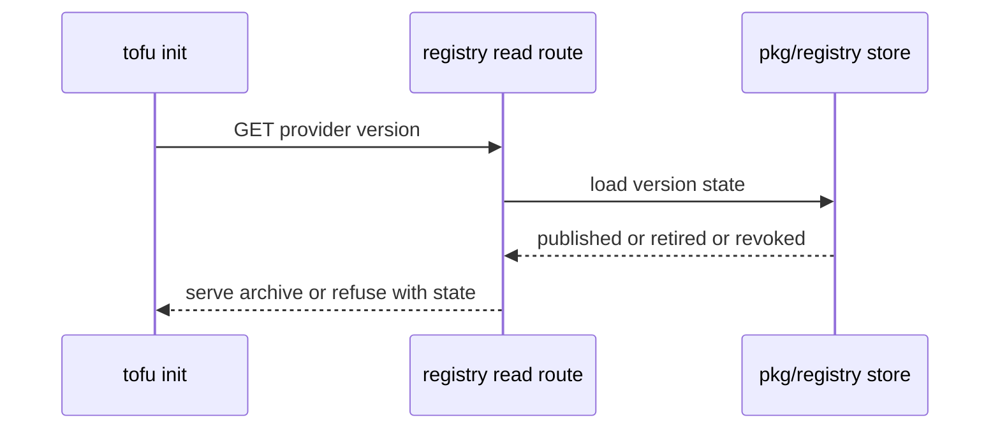
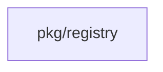
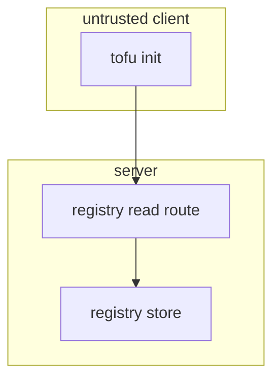

## Context

Registry versions are stored per namespace in pkg/registry. Reads serve providers and modules through the tools own protocols. This change adds one stored state per version and filters reads by that state.

## Decisions

1. **Stored life cycle state per version.** Add one stored state per provider and module version with values published, retired, and revoked. Default is published for existing rows in the baseline. Allowed moves are published to retired, published to revoked, retired to revoked, and retired to published. Revoked is terminal. The state change and its audit entry commit in one transaction with a compare-and-set on the old state. Revoked versions stay stored as records but no read path serves them. List and resolution paths hide retired versions from new resolution and hide revoked versions from all reads.
2. **State change path and revoked refusal.** The state change runs through PUT on the existing provider and module version routes with an allowlist body of state and reason. The constructor in pkg/registry accepts only published, retired, and revoked. The store filter and the download route each refuse revoked alone. Archive blobs, signed download URLs, SHA256SUMS, and lock-file hashes resolve through the same filtered read. A revoked row and a missing row share code registry.not-found on the wire; the message names the revoked state for a revoked row so a person knows why the install failed.

## Structure

A constructor in pkg/registry makes each version state valid. Only the constructor can make a value, and it rejects unknown states.

## Risks

- A client cache can still install a revoked archive it already holds.
- An install in flight when revoke commits finishes with the old read; the next install is refused.
- A restored backup holds the stored state at backup time; a later revoke needs a new change.

## Layers (defense in depth)

| Layer | Guard | Hostile test |
| --- | --- | --- |
| boundary check | Store filter drops revoked rows and drops retired rows from unpinned resolution. | Hostile store read for a revoked version returns not found even when the download route check is removed. |
| fail closed | Download and resolution route refuses revoked with registry.not-found and refuses unpinned retired. | Hostile route request for a revoked archive is refused even when the store filter is removed. |

## Diagrams

After this change:

Modules that the change touches, and their imports on main:

New imports of this change (each one allowed by the module rules):

- `internal/api/tfe` imports `pkg/registry`

## Quality attributes

| Attribute | Target | Unit | Scope |
| --- | --- | --- | --- |
| latency | 5 | ms | registry version read per install request |

## Threat model

Data flow and trust boundaries:

| Boundary | STRIDE | Threat | Layer | Guard | Hostile test |
| --- | --- | --- | --- | --- | --- |
| registry read boundary | T | A caller installs a revoked provider or module archive. | boundary check | Allowlist of state values published, retired, revoked at the boundary. | Send an unknown state string directly to the route and check rejection. |
| registry read boundary | T | A caller installs a revoked provider or module archive. | encode or contain | Serve only through the filtered read that joins version state. | Request the archive path directly for a revoked version and check 404. |
| registry read boundary | T | A caller installs a revoked provider or module archive. | limit | Reason limit of 500 characters; no added round trip beyond the same store read. | Send a reason of 501 characters and check rejection. |
| registry read boundary | T | A caller installs a revoked provider or module archive. | authorize at point of use | Check the NEW action registry:manage-versions on the namespace at the point of use. | Call the state change without the grant and check denial. |
| registry read boundary | T | A caller installs a revoked provider or module archive. | fail closed | Unknown state and missing row deny closed with registry.not-found or the NEW error code registry.lifecycle-illegal and write an audit entry. | Request a missing version and check denied closed with audit entry. |

## Contracts

**registry release**

- Invariant: Each provider and module version has one life cycle state: published, retired, or revoked.
- Invariant: A revoked version is never served on any read, resolution, or download path.
- Invariant: A retired version stays stored and installable only for an exact pinned version request.
- Invariant: A version reference uses the stable version ID, never the version string alone.
- `retireVersion`: pre: Version exists and state is published.. Post: Version state is retired and the change and its audit entry commit in one transaction..
- `revokeVersion`: pre: Version exists and state is published or retired.. Post: Version state is revoked and no install path serves it..

## Failure modes

| Step | Failure | Retry | State after |
| --- | --- | --- | --- |
| State change with compare-and-set | Second writer loses compare-and-set on old state. | Caller re-reads the version state and sends the change again. | First change stays; second change writes nothing. |
| State change and audit commit | Audit write fails in the same transaction. | Caller sends the state change again after re-read. | State change rolls back; version keeps old state. |
