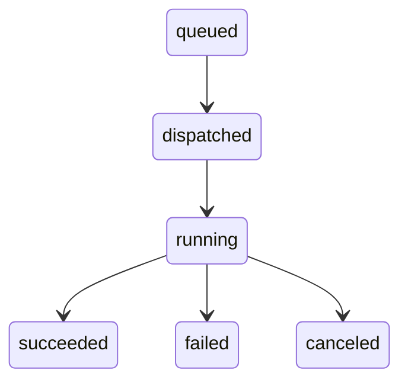

## Context

The plan phase runs the tool plan, then proposed scanner steps on the saved plan file. Nothing runs until the RFC is accepted.

## Decisions

1. **The change is RFC-first.** This change writes one RFC file, NEW docs/rfc/0391-scanner-steps-in-the-plan-phase.md. It proposes scanner steps as launcher steps with no tool credential, fixed at job start from the unit settings, and the fact group scannerFindings with an available flag. Build tasks follow after the owner accepts it.
2. **The RFC owns the fact-group rule.** The RFC owns the rule for adding a fact group with an available flag in a new minor version of the plan schema. The cost-gates research note and the change-ticket spike doc reference that rule. The proposed scannerFindings group holds no Group-typed attribute.

## Structure

The proposed job spec type is unexported and holds only scanner steps that its constructor fixes at job start, so a later settings edit cannot change a running job.

## Risks

- Step shape without the accepted RFC drifts from the launcher contract.
- Fact shape without the accepted schema version drifts from gate checks.

## Diagrams

States and transitions after this change:

## Quality attributes

| Attribute | Target | Unit | Scope |
| --- | --- | --- | --- |
| none affected | This change writes an RFC only and changes no behavior. |  |  |

## Failure modes

| Step | Failure | Retry | State after |
| --- | --- | --- | --- |
| Plan phase runs scanner step after the plan. | Scanner exits non-zero. | No retry in the same phase. A new job start runs the plan and scanner again. | Job failed. No stored plan is made for apply. |
| Launcher runs scanner step with its deadline. | Scanner times out or the job is canceled during the scanner. | Claim expiry lets another runner re-run the phase once. Step records stop a repeated change. | Job running or failed. Scanner fact available is false. |
| Runner reports scanner output to the server. | Scanner report missing, over limit, or unreadable. | No retry in the same phase. A new job start runs the scanner again. | Job failed. Scanner fact available is false and the gate fails closed. |
