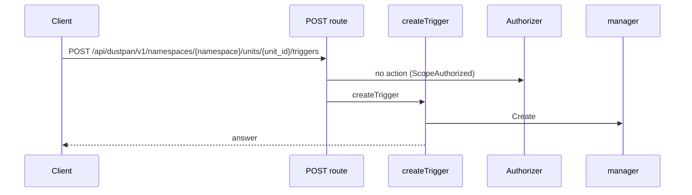
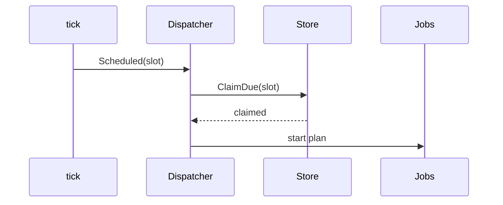
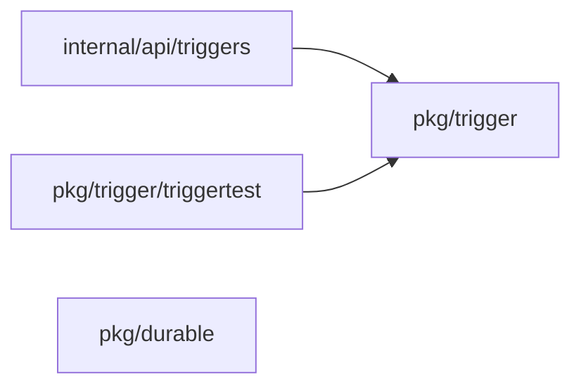
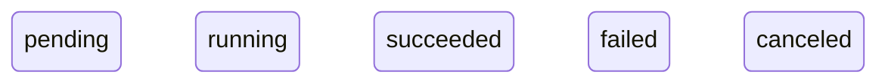
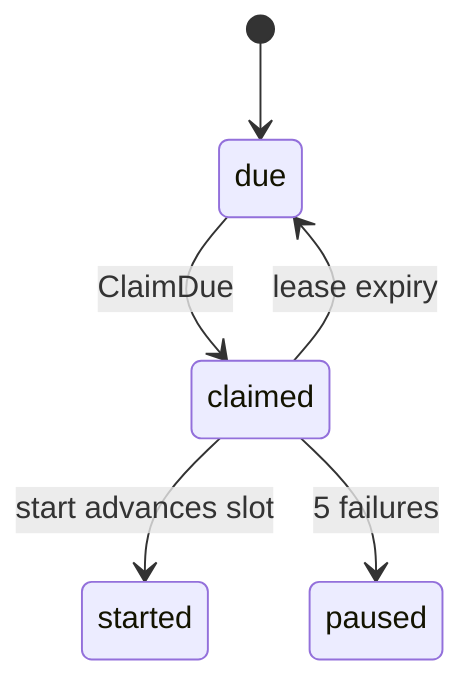

## Context

Several server processes share one store. A double start in one period must be impossible by structure, and missed slots after an outage collapse into one run. Dispatcher.Scheduled exists with a harness; this change adds the slot check. pkg/cron is new.

## Decisions

1. **One conditional claim with a lease owns the slot.** ClaimDue is one conditional store update that claims one slot with a 2 minute lease. A successful start advances the next slot to Next of the claimed slot. A failed start lets the lease expire, and the slot returns to due.
2. **Extend Dispatcher.Scheduled.** It checks the slot with cron Next and returns ErrInvalid for a foreign slot. It pauses the trigger after 5 consecutive start failures and sends a notification. The tick time is the single time source.
3. **New cron package.** pkg/cron holds the parser, Next, presets and spread. Save refuses a gap below one hour and an expression that never runs.

## Structure

An unexported claimed-slot type in the trigger store adapter. Only its constructor makes a value, and the constructor checks the slot with cron Next before the update.

## Risks

- Two instances claim one slot if the update is not atomic.
- A burst of catch-up runs if missed slots do not collapse.
- A foreign slot starts a job if the slot check is skipped.

## Diagrams

Today: `POST /api/dustpan/v1/namespaces/{namespace}/units/{unit_id}/triggers` on main (from the route table and the handler body, route row internal/api/triggers/routes.go:97, handler internal/api/triggers/serve.go:171).



After this change:



Modules that the change touches, and their imports on main:



New imports of this change (each one allowed by the module rules):

- `pkg/trigger` imports `pkg/cron`
- `internal/api/triggers` imports `pkg/trigger`

States on main in the touched packages:



States and transitions after this change:



## Quality attributes

| Attribute | Target | Unit | Scope |
| --- | --- | --- | --- |
| reliability | 1 | plan job per period | one schedule trigger across two server processes |
| recovery | 1 | catch-up job | one trigger after an outage |
| timeliness | 1 | tick per minute | trigger.schedule |

## Threat model

Data flow and trust boundaries:

```mermaid
Tick -> Dispatcher.Scheduled -> trigger.Store ClaimDue -> job service; the attacker controls the slot and the saved frequency.
```

| Boundary | STRIDE | Threat | Layer | Guard | Hostile test |
| --- | --- | --- | --- | --- | --- |
| API and tick input | T | A caller forces extra runs with a foreign slot or a sub-hour frequency. | boundary check | Save allows presets and 5-field UTC cron, and refuses sub-hour and never-run. | Save lists and steps below one hour; each is refused. |
| API and tick input | T | A caller forces extra runs with a foreign slot or a sub-hour frequency. | encode or contain | ClaimDue checks the slot with Next and uses placeholders. | Send a non-slot value straight to ClaimDue; it claims nothing. |
| API and tick input | T | A caller forces extra runs with a foreign slot or a sub-hour frequency. | authorize at point of use | The tick uses the stored grant and the last-saver check. | Tick with a revoked grant; nothing starts and a record is written. |

## Contracts

**trigger**

- Invariant: One slot of one trigger starts at most one plan job.
- Invariant: Missed slots collapse to the latest slot.
- Invariant: The trigger holds the stable unit ID.
- `ClaimDue`: pre: The trigger exists and is enabled.; The slot is UTC milliseconds.. Post: One caller holds the slot.; A foreign slot claims nothing and returns invalid..
- `Scheduled`: pre: The slot passes the Next check.. Post: A held claim starts one plan job with source kind schedule.; A refused start writes a record..

## Failure modes

| Step | Failure | Retry | State after |
| --- | --- | --- | --- |
| ClaimDue | Two instances claim one slot. | The loser starts nothing. | One claim, one job. |
| Start | The instance stops after the claim. | The lease expires after 2 minutes and the next tick retries. | The slot is due again with a record. |
| Tick | An outage misses periods. | The tick claims the latest missed slot only. | One catch-up job. |
