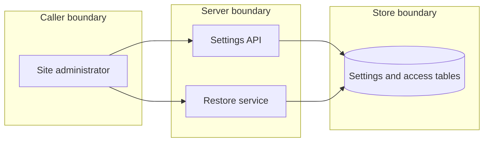

## Context

Restore must not replace the access tables by default. An installation setting widens server:restore only when a caller turns it on through the settings API, with each change on record and the two-path guard intact.

## Decisions

1. **API-only key in generic settings.** The setting is a stored installation boolean, default false, with no flag, env or file layer. The change path is PATCH /api/dustpan/v1/settings, gated on server:manage-settings plus server:restore-access with a fresh session step. This writer rule is provisional until the owner reviews it.
2. **Snapshot read at apply time.** The restore apply step reads the stored value once at the start of the apply transaction. A read failure or unknown text fails closed. The two-path check runs in the same write transaction.

## Structure

An unexported restoreAccessSetting value made only by a constructor that maps empty to false and accepts only true or false. Any other text returns an error and the caller fails closed.

## Risks

- An operator turns the setting on and forgets it.
- A wide restore path stays open while the setting is on.

## Layers (defense in depth)

| Layer | Guard | Hostile test |
| --- | --- | --- |
| settings API | Both actions plus fresh session step | Change with an access token only gets 403 |
| restore service | Snapshot value, fail closed | Stored text maybe leaves the access tables unchanged |
| store transaction | Two-path count in the write transaction | Concurrent disable gets 409 |

## Quality attributes

| Attribute | Target | Unit | Scope |
| --- | --- | --- | --- |
| Added latency of the setting read at restore start | 5 | milliseconds at p95 | one restore apply |

## Threat model

Data flow and trust boundaries:

| Boundary | STRIDE | Threat | Layer | Guard | Hostile test |
| --- | --- | --- | --- | --- | --- |
| Caller boundary | E | A caller with only server:restore turns the setting on to widen restore. | authorize at point of use | Settings API needs both actions and a fresh session step | A caller with only server:restore gets 403 on the change |
| Store boundary | T | A stored value of unknown text widens restore. | fail closed | Constructor accepts only true or false | Stored text maybe refuses the access-table part |
| Server boundary | R | A change or widened restore leaves no record. | limit | Audit entry with old and new value, and a restore entry | A saved change with no audit entry fails the test |
