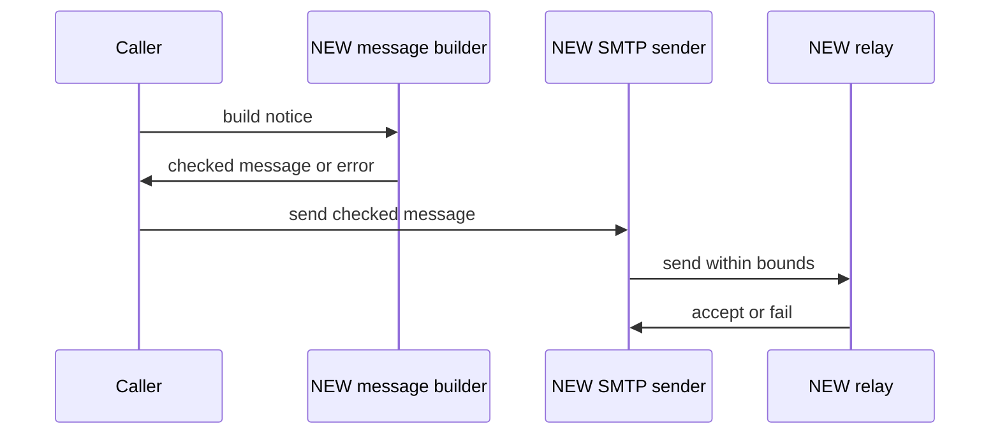
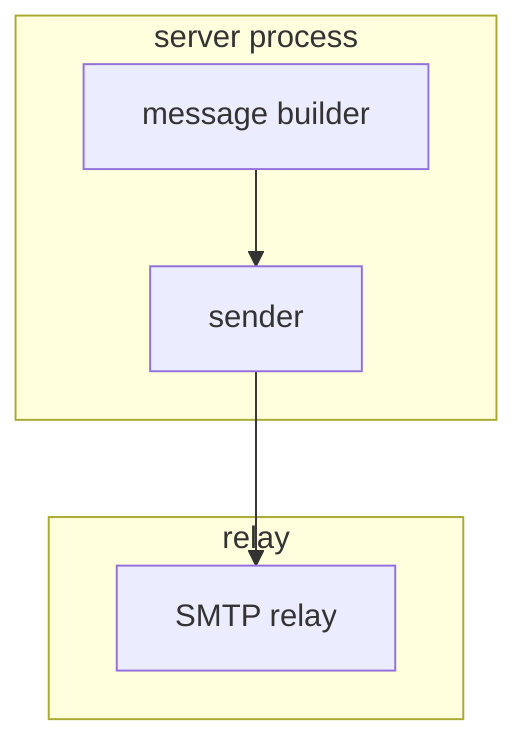

## Context

Message safety sits between the notification content and the SMTP relay. Transport rules and settings visibility stay in the other two parts.

## Decisions

1. **Refuse and encode at build time.** Refuse control characters and line breaks in address headers and subject, encode the body as quoted-printable UTF-8 text only with RFC 2047 encoded words for the subject, and enforce 50 recipients and 1 MB bounds before send. A refused or failed send sends nothing, drops the notice, and records the refusal.

## Structure

The NEW unexported type message with its NEW constructor buildMessage makes unsafe mail unbuildable: the constructor checks headers, encodes the body, and checks bounds, so no send path skips it.

## Risks

- Bounds that are too low block large but valid notices.
- Error text may leak addresses when it repeats input.

## Layers (defense in depth)

| Layer | Guard | Hostile test |
| --- | --- | --- |
| boundary check | Header allowlist refuses CR, LF, and non-printable characters in addresses, display names, and subject. | Send a subject with CRLF and Bcc injection and show the build refuses it. |
| encode or contain | Body uses quoted-printable UTF-8 text encoding with no HTML and no remote load; subject uses RFC 2047 encoded words. | Send HTML with an image tag and show the mail arrives as plain text with no fetch. |
| limit | At most 50 recipients and at most 1 MB per send, plus a 10 second dial and send timeout, cap each send. | Send over the recipient and size bounds and show the send refuses before dial. |
| authorize at point of use | Send uses the configured installation sender identity only and never a caller-supplied sender. | Offer another sender and show the send keeps the configured sender. |
| fail closed | Unknown address shape, encode failure, or send failure denies and maps to a NEW error code with no secret or full relay reply in text. | Force a recipient and credential failure and show each maps to its own error with no secret in text. |

## Diagrams

After this change:

## Quality attributes

| Attribute | Target | Unit | Scope |
| --- | --- | --- | --- |
| latency | 200 | ms | per notification send |

## Threat model

Data flow and trust boundaries:

| Boundary | STRIDE | Threat | Layer | Guard | Hostile test |
| --- | --- | --- | --- | --- | --- |
| notice content to message builder | I | Header injection adds Bcc or changes the message. | boundary check | Header allowlist refuses CR LF and controls. | Inject CRLF Bcc into subject and show refusal. |
| notice content to message builder | I | Header injection adds Bcc or changes the message. | encode or contain | Quoted-printable text-only body with no HTML. | Inject HTML image and show plain text only. |
| notice content to message builder | I | Header injection adds Bcc or changes the message. | limit | 50 recipient and 1 MB bounds enforced. | Exceed bounds and show refusal before dial. |
| notice content to message builder | I | Header injection adds Bcc or changes the message. | authorize at point of use | Send uses configured installation sender only. | Offer another sender and show the configured sender is kept. |
| notice content to message builder | I | Header injection adds Bcc or changes the message. | fail closed | Build failure denies with NEW error code and no secret. | Force encode failure and show denial with no secret. |
| sender to relay | S | Spoofed sender or recipient tricks the relay. | boundary check | Recipient shapes checked against allowlist before send. | Send malformed recipient and show refusal. |
| sender to relay | S | Spoofed sender or recipient tricks the relay. | encode or contain | Addresses encoded per RFC with no raw controls on wire. | Send display name with CRLF and show encoded refusal. |
| sender to relay | S | Spoofed sender or recipient tricks the relay. | limit | 10 second dial and send timeouts bound each attempt. | Stall the relay and show timeout. |
| sender to relay | S | Spoofed sender or recipient tricks the relay. | authorize at point of use | Send uses installation sender identity only. | Spoof another sender and show refusal. |
| sender to relay | S | Spoofed sender or recipient tricks the relay. | fail closed | Relay failure maps to clear error and fails closed with redacted reply. | Refuse credentials and show credential error with no secret. |
