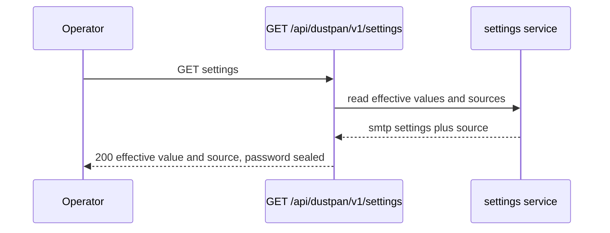
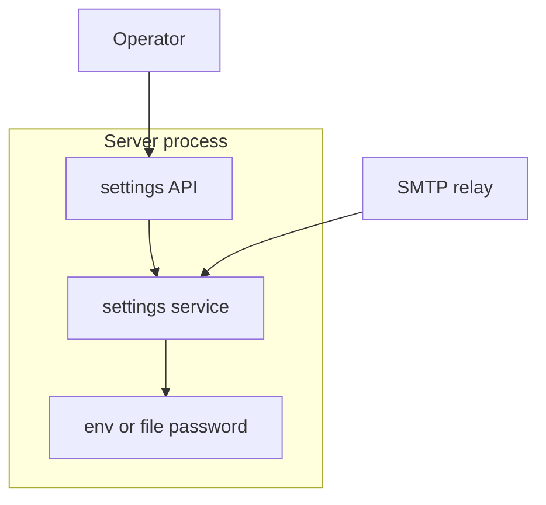

## Context

Installation SMTP settings read through the one settings resource, with password from env or file only and no database write path.

## Decisions

1. **Settings declaration over new read path.** Declare SMTP relay, sender, and plain-connection opt-in as database-visible installation settings with effective value and source; declare SMTP password as sensitive with env-or-file source only and PATCH 409 with all-or-none.
2. **Static hosted flag and bounded check.** Hosted marker is the NEW static server flag --hosted that code reads at start and never changes at runtime; when set the plain opt-in PATCH is refused and dial of plain stays refused; check uses configured relay only with 10 s timeout and 1 in flight per installation and 10 checks per minute per principal.

## Structure

Unexported smtpSettings declaration with constructor that marks password source allowlist env-or-file and blocks database source; settings resource renders effective value and source from the declaration.

## Risks

- Password leaks into GET answer or audit entry
- Hosted service accepts the plain opt-in

## Diagrams

After this change:

## Quality attributes

| Attribute | Target | Unit | Scope |
| --- | --- | --- | --- |
| latency | 250 ms p95 on dev installation | ms | GET /api/dustpan/v1/settings with SMTP keys |

## Threat model

Data flow and trust boundaries:

| Boundary | STRIDE | Threat | Layer | Guard | Hostile test |
| --- | --- | --- | --- | --- | --- |
| Server process | I | Password value leaks through settings read or audit entry | boundary check | Allowlist SMTP key names; reject unknown keys with settings.key-unknown | PATCH unknown smtp key is rejected and changes nothing |
| Server process | I | Password value leaks through settings read or audit entry | encode or contain | Password never rendered; sealed marker only in GET and audit | GET and audit export contain no password bytes |
| Server process | I | Password value leaks through settings read or audit entry | limit | Password from env-or-file allowlist only; PATCH database value 409 | PATCH password value is refused |
| Server process | I | Password value leaks through settings read or audit entry | authorize at point of use | installation:manage-settings checked at point of use for PATCH and check | Caller without grant is refused |
| Server process | I | Password value leaks through settings read or audit entry | fail closed | Missing or invalid opt-in reads off; hosted service refuses on | Missing value and hosted on-value both stay off |
| Server process | S | Connection check probes an internal host chosen by the caller | boundary check | Check dials only configured relay host; no caller address field | Check request with internal address still dials configured relay |
| Server process | S | Connection check probes an internal host chosen by the caller | encode or contain | Relay host is parsed and resolved at dial with 10 s timeout | Slow relay aborts at 10 s |
| Server process | S | Connection check probes an internal host chosen by the caller | limit | At most 1 check in flight per installation and 10 checks per minute per principal | 11th check in a minute is refused |
| Server process | S | Connection check probes an internal host chosen by the caller | authorize at point of use | installation:manage-settings checked at point of use for the NEW check | Caller without grant is refused |
| Server process | S | Connection check probes an internal host chosen by the caller | fail closed | Dial error fails closed with address, setting, and fix call and no message sent | Unreachable relay reports refused and sends nothing |

## Contracts

**Installation settings**

- Invariant: SMTP password never stored in database and never rendered in GET or audit
- Invariant: Plain opt-in effective value is off when missing, invalid, or hosted
- `ReadEffective`: pre: Caller holds installation:manage-settings or installation:read-settings. Post: Returns relay, sender, opt-in with effective value and source layer.
- `PatchSettings`: pre: Caller holds installation:manage-settings with fresh authentication when opt-in turns off to on. Post: All-or-none change; PATCH with password key refuses with 409 and changes nothing.
- `CheckSmtpConnection`: pre: Caller holds installation:manage-settings. Post: Reports reachable or refused against configured relay only and writes audit entry.
