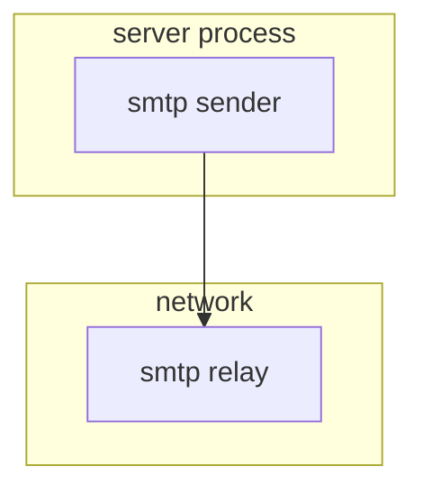

## Context

The server needs an SMTP sender that uses TLS by default and reads the plain-connections opt-in at each dial. Message safety and settings visibility are later parts.

## Decisions

1. **Read opt-in at point of use.** Read the plain-connections setting at each connection, not at start, so a change takes effect on the next dial. A read error, a missing value, or an invalid value counts as off.
2. **Fail-closed refusals with stable codes.** Support implicit TLS and STARTTLS, require the upgrade before AUTH, and refuse plain dials, STARTTLS downgrade, and plain AUTH with distinct stable codes.
3. **Loopback check on the peer address.** Check loopback against the connected IP address after resolution, not against the hostname text, so a hostname that resolves outside loopback gets no exception.

## Structure

A NEW unexported smtp sender type built only by a constructor that checks host, port, sender, and credential reference, so no sender exists without TLS-by-default state.

## Risks

- A mixed dial could send credentials in plain text before STARTTLS.

## Layers (defense in depth)

| Layer | Guard | Hostile test |
| --- | --- | --- |
| point-of-use setting check | Dial path checks TLS state and the fresh setting value before any credential is sent. | Plain server with setting off is refused and sends no AUTH. |
| certificate check | TLS config keeps system roots and server name checks with no skip flag. | Bad certificate is refused with setting on and off. |

## Quality attributes

| Attribute | Target | Unit | Scope |
| --- | --- | --- | --- |
| none affected | No new latency budget |  | SMTP dial path only, no request latency target changes |

## Threat model

Data flow and trust boundaries:

| Boundary | STRIDE | Threat | Layer | Guard | Hostile test |
| --- | --- | --- | --- | --- | --- |
| server to SMTP relay | T | Downgrade or interception of SMTP transport exposes credentials or mail. | boundary check | Allowlist host and port from stored installation settings; refuse empty or invalid values. | Invalid host is refused before dial. |
| server to SMTP relay | T | Downgrade or interception of SMTP transport exposes credentials or mail. | encode or contain | Contain the dial target by checking the connected peer IP for the loopback exception. | Hostname that resolves outside loopback gets no plain exception. |
| server to SMTP relay | T | Downgrade or interception of SMTP transport exposes credentials or mail. | limit | Dial, TLS handshake, and AUTH timeouts with fixed limits in milliseconds. | Slow relay hits the timeout. |
| server to SMTP relay | T | Downgrade or interception of SMTP transport exposes credentials or mail. | authorize at point of use | Read plain-connections value at each dial for this relay object. | Stale cached on value does not allow plain. |
| server to SMTP relay | T | Downgrade or interception of SMTP transport exposes credentials or mail. | fail closed | Refuse plain, bad certificate, and downgrade with stable codes and no credential send. | Plain server with setting off is refused. |
