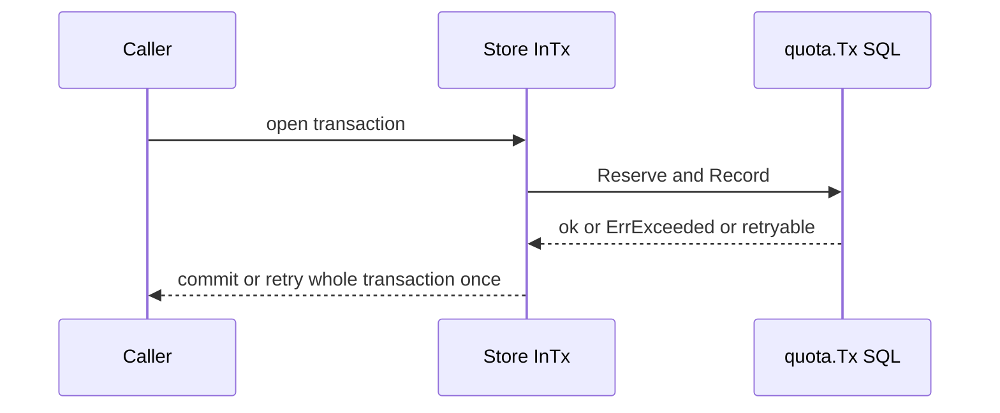
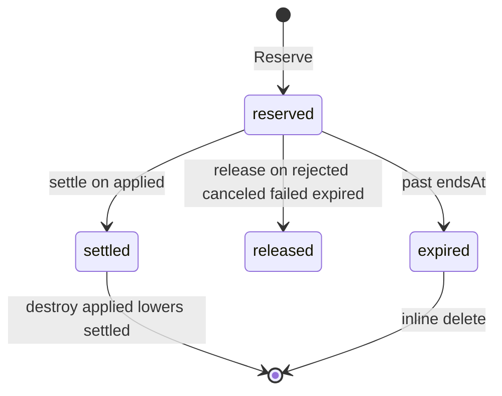

## Context

The counter port exists with an in-memory reference and a conformance suite. The SQL adapters for SQLite and PostgreSQL are missing, so submits cannot enforce units and requests limits in backed stores.

## Decisions

1. **SQL counter with dialect guards and whole-transaction retry.** Add quota tables to the baseline of each dialect in name order, with SQL queries in name order in queries.sql, and generate with sqlc. The SQL counter exposes quota.Tx inside the store transaction that the caller opened. On PostgreSQL each key row is locked with SELECT FOR UPDATE after INSERT ON CONFLICT DO NOTHING for a missing key, then one conditional UPDATE with a WHERE count plus one below max guard. On SQLite the transaction runs with BEGIN IMMEDIATE and the same conditional UPDATE guard, with no SELECT FOR UPDATE. Keys run in sorted key order. A PostgreSQL 40001 error or SQLite SQLITE_BUSY returns a retryable store error from quota.Tx, never quota.ErrExceeded; the InTx helper retries the whole transaction once, and only a limit failure returns quota.ErrExceeded. A second serialization failure returns the retryable store error.
2. **Inline expiry and submit pruning without a separate cleanup process.** Expiry and pruning are inline in the same transaction. Reserve and Record delete reservations past endsAt for the counted keys before they count, delete requests submits older than the window for the counted keys before they count, and ignore deleted rows. Release or settle of a missing or already expired row succeeds without a change. The hourly quota.reconcile of decision 9 stays out of scope.
3. **Stable IDs in stored keys with exact scope value.** Stored key columns hold the namespace ID, the blueprint ID, the rule kind, and the scope value string of decision 3 such as requester:alice. The scope value is stored as given and compared exactly, so a later blueprint version with the same kind and scope value counts the same key. Names stay labels for error text only.

## Structure

Unexported type sqlCounter with constructor newSQLCounter(store, clock) that only builds valid keys and statements; the transaction object checks the fence before each Reserve and Record.

## Risks

- Concurrent Reserve calls exceed max when the check and the insert are separate statements.
- Expired reservations keep counting when expiry is lazy only.
- Concurrent multi-key reserves deadlock when keys lock in different orders.

## Diagrams

After this change:

States and transitions after this change:

## Quality attributes

| Attribute | Target | Unit | Scope |
| --- | --- | --- | --- |
| correctness | 0 reservations above max | reservations | Reserve on SQLite and PostgreSQL adapters |
| atomicity | 0 partial submits on one failing check | submits | Record across all keys of one call |

## Failure modes

| Step | Failure | Retry | State after |
| --- | --- | --- | --- |
| Reserve | Two Reserve commits race on one key at max 1 | The InTx helper retries the whole transaction once on a 40001 or SQLITE_BUSY error; the loser gets quota.ErrExceeded when the limit fails, or the retryable store error when the retry also conflicts | 1 reservation stored, 0 over-limit rows |
| Record | Record finds one failing requests check after storing nothing yet | Caller fixes usage or limit, then resubmits; no automatic retry | 0 submits stored for all keys of the checks |
| guarded commit | Guarded transaction rolls back after Reserve | Caller resubmits the guarded write in a new transaction | 0 reservations and 0 submits from the rolled-back transaction |
| SetEnd | SetEnd races with expiry delete in the same key | The InTx helper retries the whole transaction once on a serialization failure | Reservation carries the last committed endsAt or is expired and ignored |
