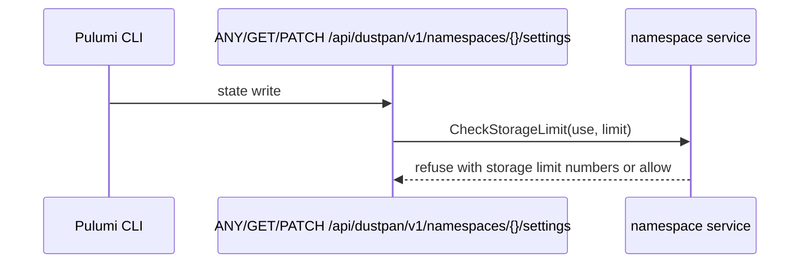

## Context

Fair-use storage cap per namespace enforced at write time with visible use against the cap.

## Decisions

1. **Enforce limits.storageBytes as a namespace-only-lower share with exemption.** Store installation limits.storageBytes set by the operator and namespace limits.storageBytes set by the namespace administrator with effective value the lower positive value and 0 meaning unlimited at that layer; keep a per-namespace byte counter updated in the fenced transaction with the namespace row locked and reconciled by a background recompute from rows plus blob sizes; enforce the NEW limit only on new writes with exempt lease renewal, checkpoints, events, log chunks, and final state write of a held lease or run; refuse with the tool error shape naming storage limit with used and limit bytes; keep deletes, reads, locks, and smaller state that lowers use allowed; expose use and effective limit on the settings resource; emit one near-limit record at 80 percent and one audit entry per minute with refusals plus an unlabeled metric.
2. **No new tooling for accounting.** No new tool and no custom analyzer; counter in the namespace row avoids a full recompute in the write path so the 5 ms budget holds; orphan blobs from a refused write are deleted by the staging-key expiry and never counted.

## Structure

Unexported storageBudget type built only by constructor CheckStorageLimit that checks limit non-negative and use non-negative.

## Risks

- Counting drift between SQL rows and blob bytes overstates or understates use.
- Concurrent writers both pass the check unless the namespace row is locked in the transaction.

## Diagrams

After this change:

## Quality attributes

| Attribute | Target | Unit | Scope |
| --- | --- | --- | --- |
| latency | Budget check adds at most 5 ms p99 | ms | namespace write transaction |

## Contracts

**namespace**

- Invariant: Effective storage limit of a namespace equals the lower positive value of installation and namespace values, with 0 meaning unlimited at that layer.
- Invariant: Writes in progress never fail on the storage share; only new writes outside a held lease or run fail.
- Invariant: Namespace use counter equals the sum of state, checkpoint, history, and artifact bytes, reconciled by background recompute.
- `CheckStorageLimit`: pre: Namespace row, fence, effective limit, and current use counter are read in the same write transaction with the namespace row locked.. Post: When use plus write size is above the effective limit and the call is not exempt work in progress then refusal names storage limit with used bytes and limit bytes.; When use is at or below the effective limit or the call is exempt then allow..

## Failure modes

| Step | Failure | Retry | State after |
| --- | --- | --- | --- |
| Fenced write checks locked namespace row and counter. | Process crashes after counter increment but before commit. | Transaction rolls back and the client retries the write as a new write. | Counter unchanged, no partial count. |
| Staged blob upload before limit check. | Write refused after blob staged under staging key. | Staging-key expiry deletes the staged blob; no client retry needed. | Staged blob deleted, use unchanged. |
| Exempt final write of a held lease or run. | Lease or run expires before final growing write commits. | Client renews the held lease or run and retries the write. | Write treated as a new write once the lease ends, and refused above the limit. |
