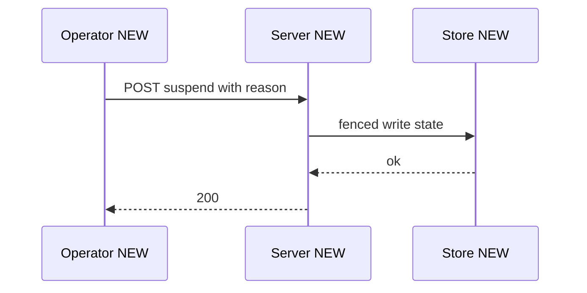
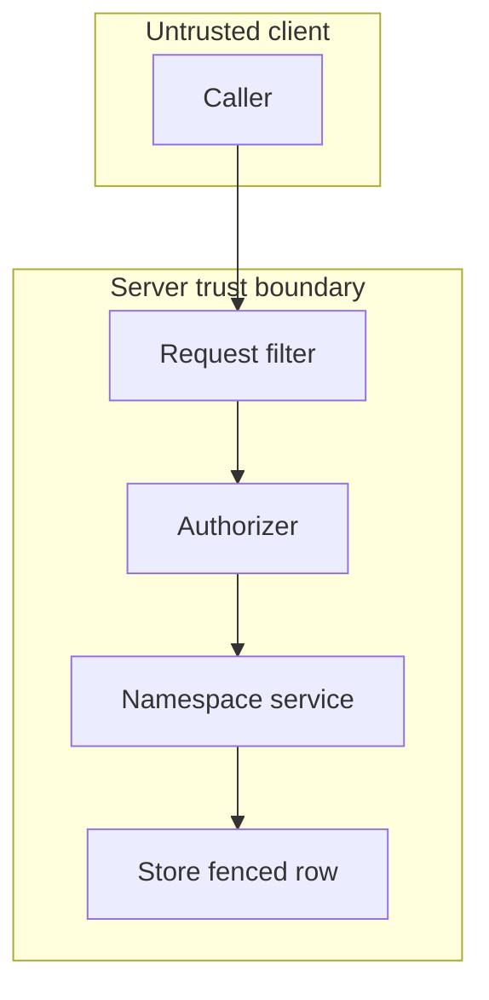

## Context

Namespace lifecycle states gate every read and write path. The fenced namespace row already loads on writes.

## Decisions

1. **State as checked type with filter plus fenced check.** Store state as an unexported namespace.State value built only by ParseState with allowlist active, suspended, disabled, deleted. Check state at the request filter for fast refusal and again in the fenced write transaction so a concurrent suspend cannot pass. This part adds only operator transitions active to suspended and suspended to active; disabled and deleted exist as values with fail-closed refusals and their timed transitions land in a later part.

## Structure

namespace.State is unexported with constructor ParseState; only the constructor makes a value and it checks the four-value allowlist.

## Risks

- Running jobs at suspend time need a safe outcome.
- Disabled and deleted need read rules without leaking existence.

## Layers (defense in depth)

| Layer | Guard | Hostile test |
| --- | --- | --- |
| boundary check | Filter rejects disallowed methods per state with error code namespace.suspended or namespace.disabled. | Call a write route against a suspended namespace and require refusal even when the filter is the only layer under test. |
| fail closed | Fenced store transaction re-reads state and fails closed on mismatch. | Suspend between filter pass and commit and require transaction refusal. |

## Diagrams

After this change:

## Quality attributes

| Attribute | Target | Unit | Scope |
| --- | --- | --- | --- |
| latency | 0 | extra database round trips | namespace fenced write path |

## Threat model

Data flow and trust boundaries:

| Boundary | STRIDE | Threat | Layer | Guard | Hostile test |
| --- | --- | --- | --- | --- | --- |
| Server trust boundary | T | Caller writes in a suspended or disabled namespace by racing suspend. | boundary check | Filter allowlists state values and the method matrix at the edge. | Send writes for each state and require allow or 409 or 403 or 404 per matrix. |
| Server trust boundary | T | Caller writes in a suspended or disabled namespace by racing suspend. | encode or contain | Error text holds state name only and no row internals. | Read refusal bodies and require no IDs beyond namespace name. |
| Server trust boundary | T | Caller writes in a suspended or disabled namespace by racing suspend. | limit | Suspend and resume accept Idempotency-Key and bound replay. | Replay the same key with a changed body and require key-mismatch refusal. |
| Server trust boundary | T | Caller writes in a suspended or disabled namespace by racing suspend. | authorize at point of use | Authorizer checks installation:suspend-namespace at point of use for SuspendNamespace and ResumeNamespace. | Call SuspendNamespace as namespace admin and require deny. |
| Server trust boundary | T | Caller writes in a suspended or disabled namespace by racing suspend. | fail closed | Store re-reads state in the fenced transaction and fails closed. | Suspend between filter pass and commit and require transaction refusal. |

## Contracts

**Namespace**

- Invariant: One state value of active, suspended, disabled or deleted.
- Invariant: Every fenced write reads state from the namespace row.
- `SuspendNamespace`: pre: Caller holds installation:suspend-namespace on the installation and gives a reason of 1 to 500 characters.. Post: State is suspended and audit entries in installation and namespace scopes hold reason and actor..
- `ResumeNamespace`: pre: Caller holds installation:suspend-namespace on the installation and gives a reason of 1 to 500 characters.. Post: State is active and audit entries in installation and namespace scopes hold reason and actor..
