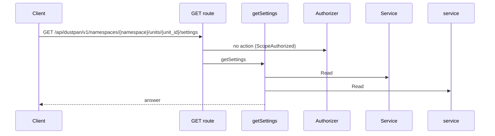
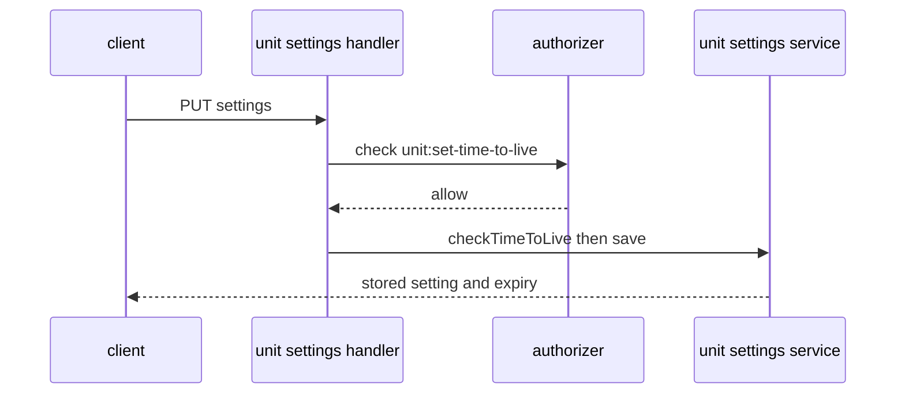

## Context

Short-lived units need an end at a date or after inactivity through a safe path. Build waits for RFC 43 to become an ADR.

## Decisions

1. **Time to live on the unit settings record.** Store two optional fields: at date and inactive-for duration. The earlier computed time wins. The API answers the computed expiry and its source.
2. **One durable claim per expired unit.** A schedule tick each 5 minutes claims each expired unit once. The destroy change order carries an Idempotency-Key and the claim checks for an open order first.
3. **Store duration, compute expiry at use.** Store the duration and compute expiry from the last finished job or final state version. Expiry writes never move the clock.
4. **Lower maximum marks, never rewrites.** A lower namespace maximum keeps stored values and marks the unit over-limit.

## Structure

The unexported type timeToLive with constructor checkTimeToLive makes an invalid or over-limit value impossible.

## Risks

- RFC 43 is discussing, so names and notice times can change.

## Diagrams

Today: `GET /api/dustpan/v1/namespaces/{namespace}/units/{unit_id}/settings` on main (from the route table and the handler body, route row internal/api/settings/routes.go:98, handler internal/api/settings/serve.go:30).

After this change:

## Quality attributes

| Attribute | Target | Unit | Scope |
| --- | --- | --- | --- |
| schedule tick interval | 300 | seconds | per installation |
| notice lead time | 24 | hours before expiry | per expiring unit |

## Contracts

**UnitSettings**

- Invariant: Stored time to live never exceeds the shortest lifetime limit.
- Invariant: Empty time to live means no expiry.
- `SaveTimeToLive`: pre: Caller holds the NEW action unit:set-time-to-live.; At date is in the future and duration is 1 hour to 365 days.. Post: Stored values equal the checked input..

## Failure modes

| Step | Failure | Retry | State after |
| --- | --- | --- | --- |
| Schedule claims an expired unit. | Tick runs twice or the server restarts after the order opened. | The next tick sees the open order and skips the unit. | One open claim and at most one destroy change order. |
