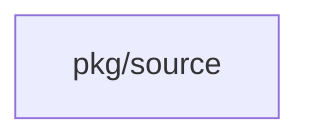
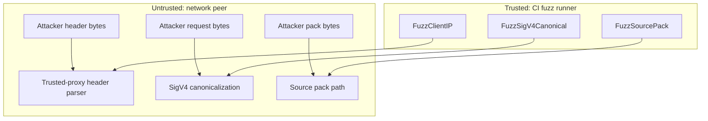

## Context

Seed-corpus tests run in CI with no sustained fuzz time over the attacker-influenced parsers named in issue #1084.

## Decisions

1. **Fuzz the three parsers now, onboard later.** Add one native Go fuzz target beside each in-scope parser and run each with a bounded fuzztime in CI on every pull request plus one nightly long run. Defer OSS-Fuzz onboarding until the repo is public.

## Structure

No new structure; each Fuzz target calls the existing parser entry point with arbitrary bytes and asserts no panic, so a bug class fix needs no new guard type.

## Risks

- Fuzz CI time grows with each target; bound each pull-request run at 60s per target and run the long run on a nightly schedule.

## Diagrams

Modules that the change touches, and their imports on main:

## Quality attributes

| Attribute | Target | Unit | Scope |
| --- | --- | --- | --- |
| CI fuzz time | 60 seconds | s | per new Fuzz target on each pull request |
| CI fuzz time | 600 seconds | s | nightly long run across all new targets |

## Threat model

Data flow and trust boundaries:

| Boundary | STRIDE | Threat | Layer | Guard | Hostile test |
| --- | --- | --- | --- | --- | --- |
| Untrusted header bytes to trusted-proxy parser | T | Attacker crafts Forwarded header bytes that panic the parser or spoof the client address. | boundary check | Fuzzer generates header bytes up to 4096 bytes and passes all bytes to the parser. | Call FuzzClientIP with 4096 bytes of separators and control bytes and expect no panic. |
| Untrusted header bytes to trusted-proxy parser | T | Attacker crafts Forwarded header bytes that panic the parser or spoof the client address. | encode or contain | Parser uses string splits on the input slice with no shell and no network. | Call FuzzClientIP with null bytes and oversize input past the parser limit and expect rejection with no panic. |
| Untrusted header bytes to trusted-proxy parser | T | Attacker crafts Forwarded header bytes that panic the parser or spoof the client address. | limit | Each pull-request run bounds the target at 60s and each input at 4096 bytes. | Run the seed corpus with the 60s bound and confirm it finishes or reports a crash. |
| Untrusted header bytes to trusted-proxy parser | T | Attacker crafts Forwarded header bytes that panic the parser or spoof the client address. | authorize at point of use | Parser result changes no grant and the fuzz run uses no credential. | Run FuzzClientIP with no network and no credential and confirm the seed corpus completes. |
| Untrusted header bytes to trusted-proxy parser | T | Attacker crafts Forwarded header bytes that panic the parser or spoof the client address. | fail closed | A crash fails the build and the author commits the crashing input as a seed. | Inject a known panicking input and confirm the build fails and the input reproduces. |
| Untrusted request bytes to SigV4 canonicalization | T | Attacker crafts canonical-request bytes that panic the SigV4 code. | boundary check | Fuzzer generates canonical-request bytes up to 4096 bytes and passes all bytes through. | Call FuzzSigV4Canonical with binary and oversize input and expect no panic. |
| Untrusted request bytes to SigV4 canonicalization | T | Attacker crafts canonical-request bytes that panic the SigV4 code. | encode or contain | Canonicalization uses string handling with no shell and no network. | Call FuzzSigV4Canonical with CRLF bytes and confirm equal inputs give equal output or rejection. |
| Untrusted request bytes to SigV4 canonicalization | T | Attacker crafts canonical-request bytes that panic the SigV4 code. | limit | Each pull-request run bounds the target at 60s and each input at 4096 bytes. | Run the seed corpus with the 60s bound and confirm it finishes or reports a crash. |
| Untrusted request bytes to SigV4 canonicalization | T | Attacker crafts canonical-request bytes that panic the SigV4 code. | authorize at point of use | Canonicalization changes no grant and the fuzz run uses no credential. | Run FuzzSigV4Canonical with no network and no credential and confirm the seed corpus completes. |
| Untrusted request bytes to SigV4 canonicalization | T | Attacker crafts canonical-request bytes that panic the SigV4 code. | fail closed | A crash fails the build and the author commits the crashing input as a seed. | Inject a known panicking input and confirm the build fails and the input reproduces. |
| Untrusted pack bytes to source pack path | T | Attacker crafts pack bytes that panic the source path or escape the checkout dir. | boundary check | Fuzzer generates pack bytes up to 4096 bytes and passes all bytes to the pack parser. | Call FuzzSourcePack with binary and oversize input and expect no panic. |
| Untrusted pack bytes to source pack path | T | Attacker crafts pack bytes that panic the source path or escape the checkout dir. | encode or contain | Target writes only under t.TempDir and starts no process. | Call FuzzSourcePack with path escape bytes and confirm no write outside the temp dir. |
| Untrusted pack bytes to source pack path | T | Attacker crafts pack bytes that panic the source path or escape the checkout dir. | limit | Each pull-request run bounds the target at 60s and each input at 4096 bytes. | Run the seed corpus with the 60s bound and confirm it finishes or reports a crash. |
| Untrusted pack bytes to source pack path | T | Attacker crafts pack bytes that panic the source path or escape the checkout dir. | authorize at point of use | Pack parse changes no grant and the fuzz run uses no credential. | Run FuzzSourcePack with no network and no credential and confirm the seed corpus completes. |
| Untrusted pack bytes to source pack path | T | Attacker crafts pack bytes that panic the source path or escape the checkout dir. | fail closed | A crash fails the build and the author commits the crashing input as a seed. | Inject a known panicking input and confirm the build fails and the input reproduces. |

## Contracts

**Fuzz corpus**

- Invariant: A crashing input becomes a committed seed in the corpus directory of its target package
- `FuzzClientIP`: pre: Input length is at most 4096 bytes. Post: No panic occurs on any input within the size limit.
- `FuzzSigV4Canonical`: pre: Input length is at most 4096 bytes. Post: No panic occurs on any input within the size limit; Canonical output is deterministic for equal input.
- `FuzzSourcePack`: pre: Input length is at most 4096 bytes. Post: No panic occurs on any input within the size limit.
