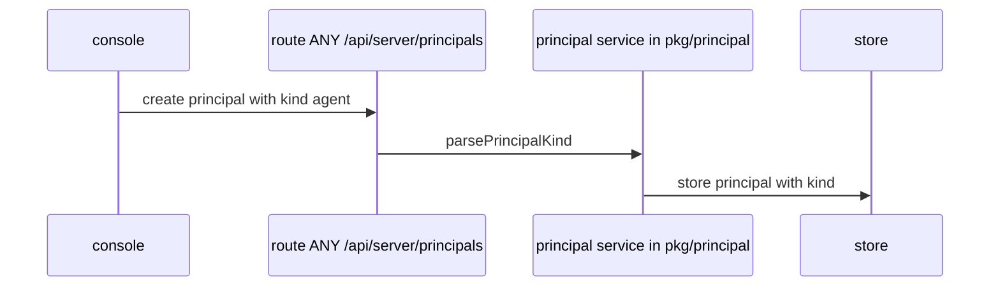
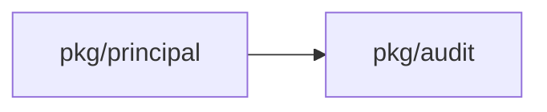
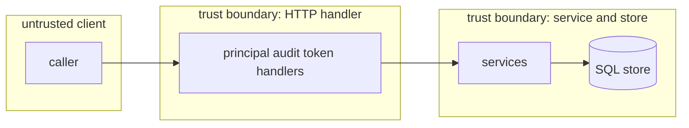

## Context

Fix stored one-way-door shapes before the first tag so later agent delegation needs no migration of shipped data. No delegation check, ceiling, or Dusty behavior lands here.

## Decisions

1. **Additive stored shapes only.** Add a stored kind field on principals with allowed values person, service, and the NEW agent kind. A create without a kind stores person. The kind is immutable after creation. Add an optional agent block on audit entries with agent subject, delegation ID, and reason. The server populates the block from the authenticated principal and its delegation on each write the server makes; API callers cannot set it. Add an optional agent key on job token records that must name an existing agent-kind principal. All three are additive and the agent kind alone grants nothing until a later change.
2. **Stable IDs, canonical hash encoding, and atomic write.** Use stable subjects and delegation IDs in stored references, never display names. Delegation ID grammar: 1 to 128 characters, charset lowercase letters, digits, and hyphen, with the NEW prefix dlg-. The hash input for the block is the length-prefixed concatenation in fixed field order agent, delegation, reason, each as 4-byte big-endian length plus UTF-8 bytes; an absent block contributes zero bytes and differs from a present block with empty reason. A create of a principal and its audit entry commit in one transaction; a hash or store failure stores neither row. A denial for a malformed block writes a plain entry with the NEW error code audit.agent-invalid and stores none of the malformed text.

## Structure

Unexported principalKind type with constructor parsePrincipalKind that accepts only person, service, and agent; unexported auditAgent struct with constructor parseAuditAgent that checks lengths and IDs; unexported jobAgentKey type with constructor parseJobAgentKey. Only each constructor makes a value.

## Risks

- Later behavior needs stricter delegation ID checks than this shape stores.
- Hash coverage change needs care so old entries still verify.

## Layers (defense in depth)

| Layer | Guard | Hostile test |
| --- | --- | --- |
| boundary check | Allowlist kinds at the boundary and reject unknown kinds with the NEW error code principal.kind-invalid. | TestCreateRejectsUnknownKind in pkg/principal/kind_hostile_test.go sends kind robot to the principal service and checks rejection. |
| encode or contain | Contain audit reason text to plain text with bounded length and reject control characters except space on write. | TestAppendRejectsControlCharactersInAgentReason in pkg/audit/agent_reason_hostile_test.go submits reason with newlines and control characters and checks rejection. |
| limit | Bound reason to 1024 characters per entry and agent subject to 256 characters per entry. | Submit an overlong reason and check rejection. |
| authorize at point of use | No authorization change in this change; existing grants still decide access. | Act as an agent-kind principal with no grant and confirm denial under current rules. |
| fail closed | Unknown kind or malformed agent data fails closed with no store write of the bad value. | Send an unknown kind and confirm denial with stored data unchanged. |

## Diagrams

After this change:

Modules that the change touches, and their imports on main:

## Quality attributes

| Attribute | Target | Unit | Scope |
| --- | --- | --- | --- |
| storage growth | 256 | bytes | per audit entry with agent block |
| latency | 50 | ms | principal create with kind check in internal/servertest |

## Threat model

Data flow and trust boundaries:

| Boundary | STRIDE | Threat | Layer | Guard | Hostile test |
| --- | --- | --- | --- | --- | --- |
| HTTP handler | S | Caller spoofs an agent kind to gain access. | boundary check | Allowlist principal kinds and reject unknown values. | Send kind robot directly to the handler and check rejection. |
| HTTP handler | S | Caller spoofs an agent kind to gain access. | encode or contain | Reject reason text with control characters on write and keep stored bytes unchanged. | Send reason with CR LF to the handler and check rejection with no store write. |
| HTTP handler | S | Caller spoofs an agent kind to gain access. | limit | Enforce 1024 characters per audit reason and 256 characters per agent subject. | Send a 2048 character reason and check rejection. |
| HTTP handler | S | Caller spoofs an agent kind to gain access. | authorize at point of use | Require existing grant on the principal object at the point of use; kind alone grants nothing. | Act as an agent-kind principal with no grant and check denial. |
| HTTP handler | S | Caller spoofs an agent kind to gain access. | fail closed | Deny on unknown kind and write no bad value to the store. | Send kind robot and check denial with stored data unchanged. |
| service and store | T | Caller tampers with stored kind, delegation, or hash to alter history. | boundary check | Revalidate kind and delegation ID in the service before the store write. | Call the service directly with kind robot and check rejection. |
| service and store | T | Caller tampers with stored kind, delegation, or hash to alter history. | encode or contain | Use SQL placeholders and stable IDs for agent and delegation references. | Send delegation ID with SQL metacharacters and check it stays a value. |
| service and store | T | Caller tampers with stored kind, delegation, or hash to alter history. | limit | Bound stored field sizes at the service with the same numeric limits. | Send an overlong agent key and check rejection before the store. |
| service and store | T | Caller tampers with stored kind, delegation, or hash to alter history. | authorize at point of use | Check existing grants in the same transaction at the point of use. | Write as an agent principal with no grant and check denial. |
| service and store | T | Caller tampers with stored kind, delegation, or hash to alter history. | fail closed | Fail closed on store or hash error with no partial write. | Force a hash error and confirm no entry or token is stored. |

## Contracts

**principal**

- Invariant: Each principal has one stable subject and one immutable kind.
- Invariant: Stored references use the stable subject, never the display name.
- `Create with kind`: pre: The kind is one of person, service, or the NEW agent kind.. Post: The stored principal carries the requested kind..

**audit entry**

- Invariant: The chain hash covers the agent block when present.
- Invariant: An absent agent block keeps the current hash and means a non-agent caller.
- Invariant: Callers never supply the agent block directly; the server populates it from auth context.
- `Append with agent block`: pre: Delegation reference is a stable ID when present.. Post: The stored entry carries agent, delegation, and reason and the chain hash covers them..

**job token**

- Invariant: Each job token record carries at most one NEW agent key.
- Invariant: Verification returns the agent key with existing claims unchanged.
- `Mint with agent key`: pre: The agent key names an existing agent-kind principal subject when present.. Post: The token record stores the NEW agent key..
