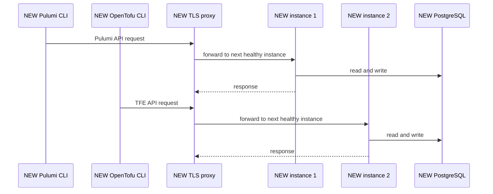

## Context

Three serve instances share one PostgreSQL database and one S3-compatible bucket behind a round-robin TLS proxy with health checks on /health/ready. No sticky session exists. This change adds only e2e harness and docs; it changes no server module and no store.

## Decisions

1. **Shared make e2e-ha harness as base for later steps.** Define make e2e-ha as the shared harness for all milestone 7 exit-test steps: three serve binaries on one PostgreSQL database, S3 service container for blob and backup target, shared registry URL key for the OpenTofu scenario, round-robin TLS proxy with active health checks on /health/ready, and proxy forwarding record. Later step changes reuse this harness with no copy.
2. **Reuse CLI scenarios through proxy with proxy-side attribution.** Run the existing milestone 1 and milestone 2 CLI scenarios unchanged through the proxy. The proxy logs the upstream instance per request from its own forwarding record. The suite asserts the record shows each of three healthy instances served at least one Pulumi request and at least one OpenTofu request, and that successive requests from one client land on different instances.
3. **Bounded void-and-rerun on instance drop.** When a health check removes an instance mid-run the run is void. The suite retries the full run at most 3 times. After 3 voids the suite fails and names the unhealthy instance and its last health-check answer. A slow start waits for /health/ready 200 before traffic starts.

## Structure

No new unexported type. The e2e proxy log is test code only. No server structure changes.

## Risks

- Proxy record misses an instance when a health check removes it mid-run; mitigation: void the run, retry at most 3 times, then fail naming the instance

## Diagrams

After this change:

## Quality attributes

| Attribute | Target | Unit | Scope |
| --- | --- | --- | --- |
| none affected | Alternation adds an e2e step only; it sets no new latency or storage target |  |  |
