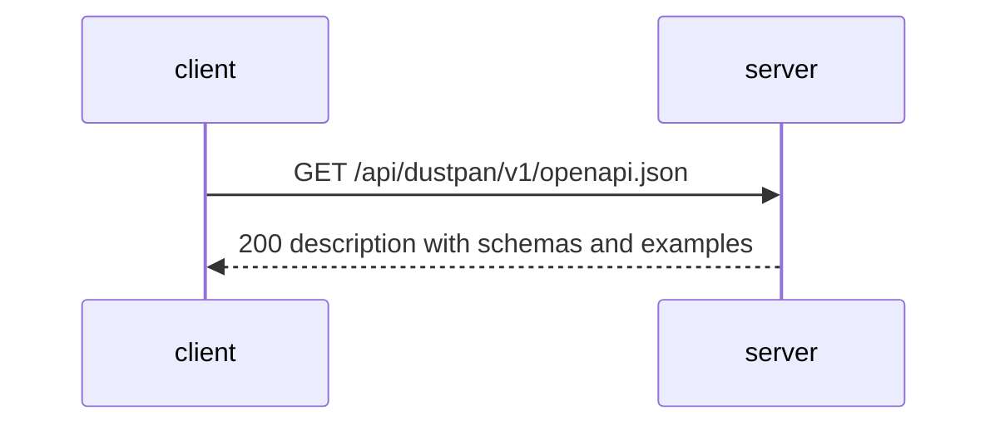

## Context

The description route GET /api/dustpan/v1/openapi.json already serves schemas. This change adds examples to the same document. Routes, operations and authorization do not change. The Pulumi and OpenTofu APIs get no examples.

## Decisions

1. **Examples stay valid by construction.** Store examples in the unexported type exampleRegistry, built only by newExampleRegistry, which validates each example against its schema including required fields and enums and returns an error on mismatch.
2. **Example scope for edge operations.** Add examples only where an operation defines a JSON request body or a JSON success answer with a body. Add one example for each JSON success status. Where a schema uses oneOf or anyOf, use the first branch. Include required fields plus one optional field only.

## Structure

Unexported type exampleRegistry with unexported field entries, built only by constructor newExampleRegistry that validates each example and rejects secret-like values before the server answers the description route. Validation runs at generation time and at server start.

## Risks

- Example fixtures use fake IDs and fake tokens only, so no real secret ships in the description document.

## Diagrams

After this change:

## Quality attributes

| Attribute | Target | Unit | Scope |
| --- | --- | --- | --- |
| storage growth | Growth below 500, computed as size-with-examples minus size-without-examples | KB | GET /api/dustpan/v1/openapi.json answer |
