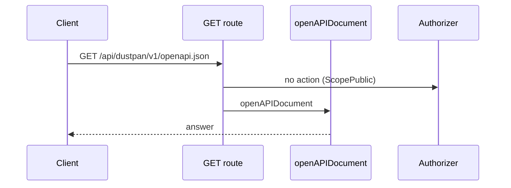
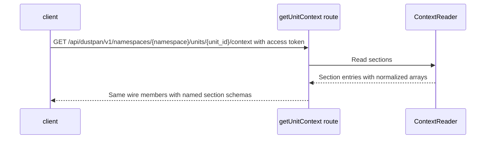
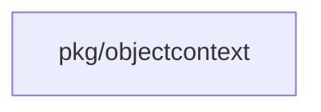

## Context

The context read API answers eight sections. The description shows data as an object with any member, so a generated client holds no typed value for a section. Real answers are never checked against their schemas.

## Decisions

1. **Named per-section schemas with constructor normalization.** Keep the wire members unchanged. Add one named data schema for each section: identity, context, readme, outputs, dependencies, changes, health and audit. A read of several sections answers an array with one entry per section, and each entry carries its section name plus the data member in the named schema of that name. Use a hand-written table from section name to Go type in the description builder, so a missing section fails the description consistency test. Normalize nil slices to empty arrays in a NEW unexported answer constructor in pkg/objectcontext. Keep the subset validator inline in the NEW real-answer test file, with no new package and no new tool.

## Structure

NEW unexported answer constructor in pkg/objectcontext that builds each section answer with empty arrays instead of nil slices; only the constructor can make the validated answer shape, and the real-answer validation test fails when normalization is removed.

## Risks

- A per-section schema drifts from its Go type.
- A nil slice writes null where the schema states an array.

## Diagrams

Today: `GET /api/dustpan/v1/openapi.json` on main (from the route table and the handler body, route row internal/api/server/openapi.go:22, handler not found).

After this change:

Modules that the change touches, and their imports on main:

## Quality attributes

| Attribute | Target | Unit | Scope |
| --- | --- | --- | --- |
| none affected | Description change plus tests; no latency or storage target changes |  |  |
