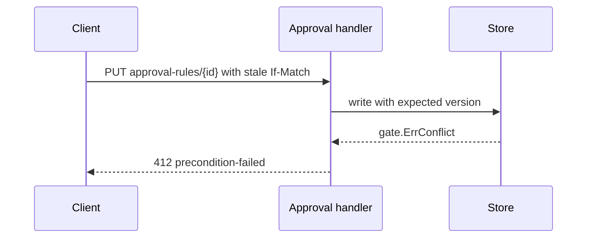
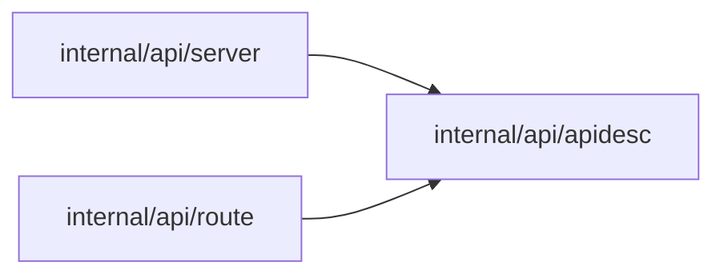

## Context

Approval handlers map gate.ErrConflict to 409 even when If-Match was sent. Named collection, lock, approval, preferences and context mutating routes lack Idempotency-Key replay.

## Decisions

1. **Map at the HTTP adapter and add replay.** The approval adapter in internal/api/server answers 412 when If-Match was present and the store returns gate.ErrConflict. A create conflict with no If-Match keeps 409. Missing object is 404 before any precondition check. Malformed If-Match answers 400. The named mutating routes store and replay answers by caller, route and key through the existing idempotency store after authentication and authorization and before the write.

## Structure

No new type. The defect is a status mapping and missing replay wiring in the adapters, not a missing invariant.

## Risks

- A caller that branches on 409 for a stale approval write handles 412 after this change.

## Diagrams

After this change:

Modules that the change touches, and their imports on main:

## Quality attributes

| Attribute | Target | Unit | Scope |
| --- | --- | --- | --- |
| none affected | Status mapping and replay wiring with no new latency or storage target |  |  |

## Contracts

**Approval rule**

- Invariant: A stored rule has one current version.
- `Write approval rule with If-Match`: pre: The caller holds the write action on the rule.. Post: A matching version commits the next version.; A stale version commits nothing and the handler answers 412..

## Failure modes

| Step | Failure | Retry | State after |
| --- | --- | --- | --- |
| PUT collection or namespace lock with Idempotency-Key | Crash after the lock commit and before the answer is stored | Caller retries the same caller, route and key | Stored answer replays and the lock change applies once |
| PUT approval rule with Idempotency-Key | Crash before the commit | Caller retries the same caller, route and key | Write runs once and its answer is stored for replay |
