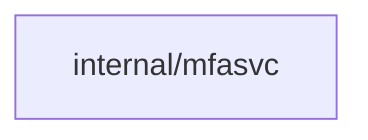

## Context

Persons who sign in with plain OAuth 2.0 or trusted-header sign-in have no provider proof of fresh authentication. This change adds app-level TOTP, passkey and SSH-signature factors that count as a fresh step inside the one freshness window.

## Decisions

1. **One factor service.** Reuse the local-user MFA factor service for enrollment, challenge, check and audit entries behind one Factor port in internal/mfasvc, with no new WebAuthn dependency. The existing /me/passkeys routes stay and share the same service with the new /me/factors routes.
2. **Fresh step bound to one sign-in.** Record the fresh step in the sealed access cookie of the sign-in that did it, with kind passkey, totp or ssh and time. A factor change adds 1 to the session generation, which ends other sign-ins; the sign-in that did the change keeps its fresh step.
3. **First-enrollment proof and sealed storage.** Enroll the first factor only with an administrator enrollment code (128 bits, single use, one hour) or a one-time first-enrollment-only email code. Seal TOTP secrets and WebAuthn credentials with the installation key hierarchy. TOTP accepts one step of skew each way; used codes persist durably per person. After a restore into a new installation or a lost key, factors stay unreadable until re-enrollment.
4. **Actions for each route.** Per-person routes use me:read-factors on GET and me:manage-factors on enroll, step-up and delete, on the caller. The setting and the enrollment-code issue route use server:manage-sign-in on the installation.

## Structure

Unexported type factorService in internal/mfasvc with constructor newFactorService that checks the store port, the clock and the allowlisted WebAuthn config; only the constructor makes valid challenge state, which removes replay and cross-origin bypass as a bug class.

## Risks

- A stolen session enrolls the first factor without an independent proof.
- A weak email channel becomes a sign-in factor instead of a one-time enrollment proof.

## Layers (defense in depth)

| Layer | Guard | Hostile test |
| --- | --- | --- |
| port adapter boundary check | Allowlist factor type, base32 TOTP secret shape, WebAuthn origin and RP ID at the API boundary; reject invalid input. | Send unknown factor type, malformed secret and cross-origin response to the handler; expect 400 and no state change. |
| service check | Constant-time TOTP compare, single-use durable nonces, sealed secrets. | Replay a used code across restart and with a cookie from another sign-in; expect rejection. |
| HTTP handler authorization | Action on each route; fresh-step check at point of use. | Create a token with a fresh step of another sign-in; expect 403 mfa.fresh-step-required. |

## Diagrams

Modules that the change touches, and their imports on main:

## Quality attributes

| Attribute | Target | Unit | Scope |
| --- | --- | --- | --- |
| Step-up latency | 95 | percent of step-up requests answered within 300 ms | POST /api/dustpan/v1/me/factors/step-up on one server process |
| Brute-force resistance | 5 | failed TOTP or enrollment-code attempts per person per 15 minutes before 429 | all factor routes |
| Replay window | 0 | accepted replays of a used code | all replicas and restarts |

## Threat model

Data flow and trust boundaries:

```mermaid
flowchart LR
 subgraph Browser[Browser trust boundary]
 P[Person]
 end
 subgraph Server[Server trust boundary]
 H[HTTP handler]
 S[factorService]
 end
 subgraph Store[Database trust boundary]
 D[(Sealed factors and used codes)]
 end
 P -->|session cookie and factor proof| H
 H --> S
 S --> D
```

| Boundary | STRIDE | Threat | Layer | Guard | Hostile test |
| --- | --- | --- | --- | --- | --- |
| Browser to server | S | A stolen session cookie passes a fresh step or enrolls the first factor. | boundary check | First enrollment needs an enrollment code or email code. | Send enroll with a stolen cookie and no code; expect 403. |
| Browser to server | S | A stolen session cookie passes a fresh step or enrolls the first factor. | encode or contain | The fresh step is sealed in the cookie of one sign-in. | Present a step from another sign-in; expect 403. |
| Browser to server | S | A stolen session cookie passes a fresh step or enrolls the first factor. | limit | Per-person retry limit on codes. | Send 6 wrong enrollment codes; expect 429. |
| Browser to server | S | A stolen session cookie passes a fresh step or enrolls the first factor. | authorize at point of use | Fresh-step check on token creation, reveal and factor change. | Create a token with another sign-in's step; expect 403 mfa.fresh-step-required. |
| Browser to server | S | A stolen session cookie passes a fresh step or enrolls the first factor. | fail closed | An unreadable cookie seal denies and writes an audit entry. | Send a tampered cookie; expect 403 and an audit entry. |
| Server to database | T | A replayed TOTP code or assertion passes after a restart. | boundary check | Allowlist code shape before lookup. | Send a malformed code; expect 400. |
| Server to database | T | A replayed TOTP code or assertion passes after a restart. | encode or contain | Used-code records keyed by person and step in durable storage. | Replay a used code after restart; expect rejection. |
| Server to database | T | A replayed TOTP code or assertion passes after a restart. | limit | Retry limit on step-up. | Replay 6 times; expect 429. |
| Server to database | T | A replayed TOTP code or assertion passes after a restart. | authorize at point of use | Step-up checks the caller owns the factor. | Use a factor of another person; expect 403. |
| Server to database | T | A replayed TOTP code or assertion passes after a restart. | fail closed | An unreadable used-code record denies. | Replay with the store unreadable; expect rejection. |
| Browser to server | D | Brute force of TOTP or enrollment codes. | boundary check | Reject codes of the wrong length at once. | Send a 3 digit code; expect 400 with no counter use. |
| Browser to server | D | Brute force of TOTP or enrollment codes. | encode or contain | Constant-time compare of codes. | Compare timing of near and far codes; expect no difference beyond noise. |
| Browser to server | D | Brute force of TOTP or enrollment codes. | limit | Per-person retry limit with 429. | Send 6 wrong codes in 15 minutes; expect 429 on the sixth. |
| Browser to server | D | Brute force of TOTP or enrollment codes. | authorize at point of use | The limit key is the person, not the cookie. | Switch sign-ins between attempts; expect the same counter. |
| Browser to server | D | Brute force of TOTP or enrollment codes. | fail closed | A counter store error denies the attempt. | Break the counter store; expect 503 and no acceptance. |
| Server to database | I | Factor secrets leak from a database copy. | boundary check | List and read routes never return a secret after enrollment. | List factors; expect no secret field. |
| Server to database | I | Factor secrets leak from a database copy. | encode or contain | Secrets sealed with the installation key hierarchy. | Read the factor rows without the key; expect no plain secret. |
| Server to database | I | Factor secrets leak from a database copy. | limit | A secret shows one time at enrollment. | Fetch the enrollment result twice; expect the secret once. |
| Server to database | I | Factor secrets leak from a database copy. | authorize at point of use | List needs me:read-factors on the caller only. | List factors of another person; expect 403. |
| Server to database | I | Factor secrets leak from a database copy. | fail closed | An unsealable row denies the fresh step. | Open a row with a wrong key; expect 403. |
| Browser to server | R | A factor change leaves no record. | boundary check | Each change route requires an authenticated principal. | Call delete with no token; expect 401 and no change. |
| Browser to server | R | A factor change leaves no record. | encode or contain | Audit entries strip CR and LF from free text. | Send a name with CR LF; expect clean audit text. |
| Browser to server | R | A factor change leaves no record. | limit | Notice failure is bounded and does not block the change. | Fail the notice sink; expect the change to finish. |
| Browser to server | R | A factor change leaves no record. | authorize at point of use | The audit entry names the caller and the factor. | Remove a factor; expect an entry with both. |
| Browser to server | R | A factor change leaves no record. | fail closed | Audit entry and session generation bump are one transaction. | Fail the audit write; expect no factor change. |
| Browser to server | E | A person with no factor reaches a fresh-step operation. | boundary check | Reject step-up with an unknown factor kind. | Send kind=unknown; expect 400. |
| Browser to server | E | A person with no factor reaches a fresh-step operation. | encode or contain | The step kind is a closed set in the cookie. | Forge a kind value; expect the seal check to fail. |
| Browser to server | E | A person with no factor reaches a fresh-step operation. | limit | A step lasts only the freshness window. | Use a step after the window; expect 403. |
| Browser to server | E | A person with no factor reaches a fresh-step operation. | authorize at point of use | Refuse when MFA is on and no factor exists. | Call token creation with no factor and MFA on; expect 403 naming the enrollment page. |
| Browser to server | E | A person with no factor reaches a fresh-step operation. | fail closed | An unknown session state denies. | Send a session with no provider field; expect 403. |
