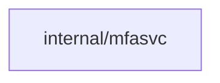
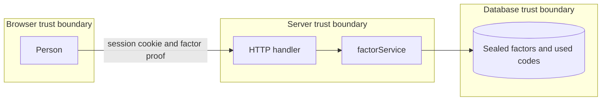

## Context

Persons who sign in with plain OAuth 2.0 or trusted-header sign-in have no provider proof of fresh authentication. This change adds app-level TOTP, passkey and SSH-signature factors that count as a fresh step inside the one freshness window.

## Decisions

1. **One factor service.** Reuse the local-user MFA factor service for enrollment, challenge, check and audit entries behind one Factor port in internal/mfasvc, with no separate OAuth-only copy and no new WebAuthn dependency. The existing /me/passkeys routes stay and share the same service with the new /me/factors routes.
2. **Fresh step bound to one sign-in.** Record the fresh second-factor step in the sealed access cookie of the sign-in that did it, with kind passkey, totp or ssh and time, and check it with the one freshness window; a fresh step in one sign-in never passes another sign-in. A factor change adds 1 to the session generation of the person, which ends other sign-ins; the sign-in that did the change keeps its fresh step.
3. **First-enrollment proof and sealed storage.** Enroll the first factor of a person with no factor only with an administrator enrollment code with 128-bit randomness, single use and a one-hour life, or a one-time first-enrollment-only email code; seal TOTP secrets and WebAuthn credentials with the installation key hierarchy and show a secret one time. TOTP accepts one step of clock skew each way; used codes persist durably per person to survive restart and replicas. After a restore into a new installation or a lost key, factors stay unreadable and every fresh step is invalid until re-enrollment.
4. **Actions for each route.** Per-person routes use me:read-factors on GET and me:manage-factors on enroll, step-up and delete, on the caller. The require-second-factor setting and the enrollment-code issue route use server:manage-sign-in on the installation. Each route declares its action and object in the route table.

## Structure

Unexported type factorService in internal/mfasvc with constructor newFactorService that checks the store port, the clock and the allowlisted WebAuthn config; only the constructor makes valid challenge state, which removes replay and cross-origin bypass as a bug class.

## Risks

- A stolen session enrolls the first factor without an independent proof.
- A weak email channel becomes a sign-in factor instead of a one-time enrollment proof.

## Layers (defense in depth)

| Layer | Guard | Hostile test |
| --- | --- | --- |
| port adapter boundary check | Allowlist factor type, base32 TOTP secret shape, WebAuthn origin and RP ID check at the API boundary; reject invalid input without normalization. | Send unknown factor type, malformed secret and cross-origin WebAuthn response directly at the handler and expect 400 with no state change. |
| service check | Constant-time TOTP compare, single-use challenge nonces in durable storage that survives restart, sealed storage of factor secrets. | Replay a used TOTP code and a used WebAuthn assertion, including across restart and with a stolen cookie from another sign-in, and expect rejection. |
| HTTP handler authorization | Authorization action on each factor route for the person object, fresh-step check at the point of use for token creation, secret reveal and factor changes. | Call token creation with a session whose fresh step belongs to another sign-in and expect 403 mfa.fresh-step-required. |

## Diagrams

Modules that the change touches, and their imports on main:

## Quality attributes

| Attribute | Target | Unit | Scope |
| --- | --- | --- | --- |
| Step-up latency | 95 | percent of step-up requests answered within 300 ms | POST /api/dustpan/v1/me/factors/step-up on one server process |
| Brute-force resistance | 5 | failed TOTP or enrollment-code attempts per person per 15 minutes before 429 | all factor routes |
| Replay window | 0 | accepted replays of a used code | all replicas and restarts |

## Threat model

Data flow and trust boundaries:

| Boundary | STRIDE | Threat | Layer | Guard | Hostile test |
| --- | --- | --- | --- | --- | --- |
| Browser to server | S | A stolen session cookie passes a fresh step or enrolls the first factor. | boundary check | First enrollment needs an enrollment code or email code; the step is bound to one sign-in. | Send enroll with a stolen cookie and no code, and a fresh step from another sign-in; expect 403. |
| Browser to server | S | A stolen session cookie passes a fresh step or enrolls the first factor. | authorize at point of use | Fresh-step check on token creation, reveal and factor change. | Create a token with another sign-in's step; expect 403 mfa.fresh-step-required. |
| Server to database | T | A replayed TOTP code or assertion passes after a restart. | fail closed | Durable used-code records; an unreadable record denies. | Replay a used code after restart and with the store unreadable; expect rejection. |
| Browser to server | D | Brute force of TOTP or enrollment codes. | limit | Per-person retry limit with 429. | Send 6 wrong codes in 15 minutes; expect 429 on the sixth. |
| Server to database | I | Factor secrets leak from a database copy. | encode or contain | Secrets sealed with the installation key hierarchy. | Read the factor rows without the key; expect no plain secret. |
| Browser to server | R | A factor change leaves no record. | fail closed | Audit entry and session generation bump for each change, even with no notice channel. | Enroll with notice delivery failing; expect an audit entry and a generation plus 1. |
| Browser to server | E | A person with no factor reaches a fresh-step operation. | authorize at point of use | Refuse when MFA is on and no factor exists. | Call token creation with no factor and MFA on; expect 403 naming the enrollment page. |
