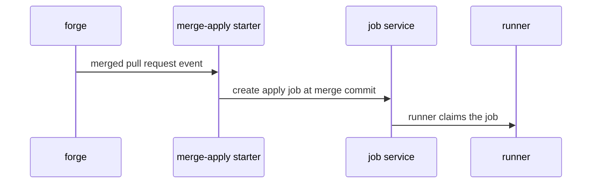
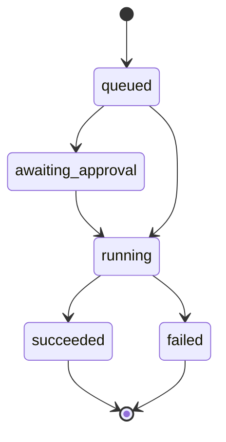

## Context

The merge event starts 1 apply job per touched unit. The job pins the default branch name and the merge commit sha at creation, then the executor checks out that sha.

## Decisions

1. **Pin the commit at job start.** Start the apply only from a merge event on the default branch, with the merge commit sha stored on the job. A later push to the default branch starts a new job and never moves a running job. A merge event for a non-default branch starts nothing.
2. **Replan before apply.** Reuse the plan-then-apply chain of pull-request-automation-first-slice and the approval handling of policy-approvals: startFromMerge replans at the pinned merge commit before any apply. When the replan differs from the reviewed plan, reset approvals per policy-approvals; when it is identical, keep existing signatures. A gate refusal keeps signatures unchanged and fails the job with the new decision record.
3. **Deduplicate merge events.** Record the merge event id with the created jobs in the same write, so a replayed event or a restart creates no second job per unit. A retry after a partial write creates only the missing unit jobs. Order concurrent merges on one unit by merge time: the second merge waits queued behind the running apply, and the earlier result never cancels or moves the queued job.

## Structure

Structure: unexported field pinnedCommit in the merge-apply starter, set only by constructor newMergeApply(branch, sha) which rejects an empty branch, an empty sha, or a branch that is not the default branch of the unit.

## Risks

- A push between merge and job start leaves the merge commit behind the branch head.
- A gate that passed on the branch fails at the merge commit.
- Two merges on one unit arrive out of order and the older commit applies last.

## Diagrams

After this change:

States and transitions after this change:

## Quality attributes

| Attribute | Target | Unit | Scope |
| --- | --- | --- | --- |
| correctness | at most 1 apply job | job | per merged pull request event per unit |
| pin stability | 0 moves of pinned sha after creation | move | per merge apply job |

## Contracts

**merge-apply starter**

- Invariant: pinned branch equals the default branch of the unit
- Invariant: pinned sha is a non-empty commit sha
- `startFromMerge`: pre: merge event is for the default branch; merge commit sha is present. Post: 1 apply job per touched unit pinned to branch and sha, or refusal that names the missing sha.

## Failure modes

| Step | Failure | Retry | State after |
| --- | --- | --- | --- |
| create merge apply jobs | job creation fails midway for some units | retry the same merge event id; the retry creates only the missing unit jobs | each touched unit has 1 job for the merge event |
| survive restart | server restarts after merge event before creation completes | replay the stored merge event id once on boot; when the replay fails, keep the stored event and report it until an operator replays it | each touched unit has 1 job for the merge event |
| validate merge event | merge event holds no usable sha | no retry; refusal names the missing sha | no job created |
| order concurrent merges | two merges on one unit arrive out of order | order jobs by merge time; the older merge applies first and the newer stays queued | jobs run in merge order and the older commit never overwrites the newer |
| check out pinned commit | pinned commit missing at checkout | no retry of the same sha; job fails with the missing sha named | job failed, queued successor still waits |
