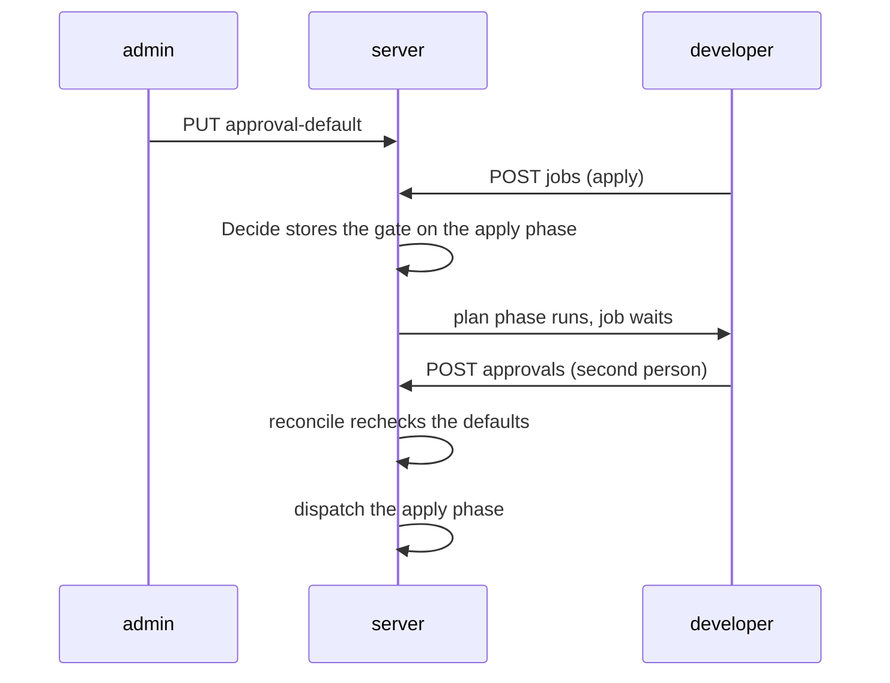
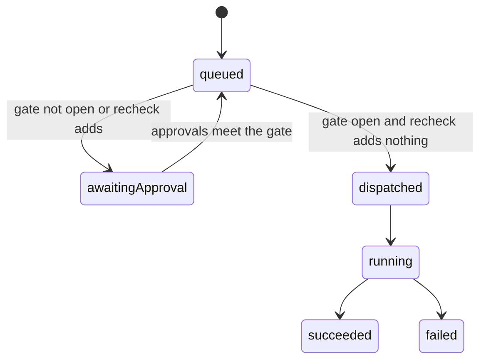

## Context

The approval defaults are stored, `jobgate.Decider` is wired into the job service (`pkg/dustpan/jobservice.go:45`), and the service stores a gate on each phase that changes. What stops a default from taking effect on a live job is the start: the planner refuses an apply and a destroy (`pkg/dustpan/jobservice.go:597`), so `Decide` meets a plan only and gives it no gate. This change lifts that refusal for an OpenTofu workspace and adds the one check that main lacks at the dispatch.

## Decisions

1. **Lift the refusal for OpenTofu only.** `startsOnRunner` accepts `apply` and `destroy` when the unit is an OpenTofu workspace. The steps already exist (`TestOperationSteps` in `pkg/dustpan/jobservice_applysteps_internal_test.go:25`). The runner protocol stores a plan and gives it to the apply phase (`internal/api/runnerapi/plan.go`, `pkg/runner/protocol/protocol.go:87`), so the reason in the comment of `startsOnRunner` no longer holds. A Pulumi stack keeps the refusal, because the docs say that no runner runs its plan step (`docs/reference/jobs-api.md:11`).
2. **Recheck in the reconcile.** The reconcile is the one place that dispatches a queued phase (`pkg/job/reconcile.go:372`), and it already moves a queued job with a closed gate to `awaiting-approval` (`reconcile.go:425`). The recheck asks the decision port for the gate of the phase and adds the gate to the stored phase when the stored phase has none or fewer approvals than the decision. It never removes or lowers a stored gate: that is the rule "A recheck only adds" of ADR 224.
3. **A failed read blocks.** When the decision port returns an error, the reconcile leaves the job queued and records the reason. It never dispatches on an unknown default.
4. **Signatures.** An approval that is bound to the stored plan keeps counting against a gate with the same or a lower requirement. A gate with a higher requirement needs the missing approvals. The distinct-approver count and the dev-data rules are in `several-approval-requirements-one-change` and `gate-evaluation-must-apply-dev`.

## Structure

The decision port of the reconcile takes a job and returns a `job.Decision`. `jobgate.Decider` already builds the gate in its constructor-checked state, so the reconcile cannot build a partial gate. The store port gets one method that adds a gate to a stored phase at a given version, and the conformance suite covers it before an adapter implements it.

## Risks

- The reconcile reads the defaults for each queued job. The read is a snapshot of the scope chain of the unit (`jobgate.go:113`). The run takes a batch (`ReconcilerConfig.Batch`), so the cost is bounded by the batch.
- Until `evaluate-gates-on-pulumi-jobs` lands, a gate that the Cedar engine would evaluate still refuses the start and the claim (`pkg/job/service_start.go:370`, `pkg/job/claimer.go:512`). An OpenTofu apply on such a unit is refused, which is the safe answer.

## Layers (defense in depth)

| Layer | Guard | Hostile test |
| --- | --- | --- |
| port adapter | The planner refuses an operation, an executor and a field that it does not know, before the Decider (`checkPlanRequest`). The Decider checks that the unit is a unit (`jobgate.go:75`). | An operation with control characters and an apply on a unit of another tool: refusal, no job. |
| service | The service checks the action of the starter for the operation on the unit, the access limits and the gate guard, and stores the gate with the job. | An apply by a principal with only the plan action: 403 and no job. |
| reconcile | The recheck reads the defaults of the chain of the unit and keeps only the scopes of that chain (`jobgate.go:151`). It dispatches only on a successful read. | A reader that returns defaults of another namespace, and one that fails: no dispatch. |
| HTTP handler | The route authorizes the start and the approval with the actions of the route and the unit. | The table of hostile cases in `internal/api/jobs/start_test.go`. |

## Diagrams

After this change:

States and transitions after this change:

## Quality attributes

| Attribute | Target | Unit | Scope |
| --- | --- | --- | --- |
| durability | 100 | percent restored | approval wait and signatures across restart (stored on the phase) |

## Threat model

| Boundary | STRIDE | Threat | Layer | Guard | Hostile test |
| --- | --- | --- | --- | --- | --- |
| Client to job route | E | A principal with the plan action starts an apply. | authorize at point of use | The service checks the action of the operation on the unit. | Start an apply with plan rights only: 403. |
| Client to job route | T | A hostile operation or unit text reaches the Decider or the log. | boundary check | The route and the planner allowlist the operation and the unit. | Operation with control characters: 400 or 422, no job. |
| Reconcile to store | T | A default of another scope adds or lowers a gate. | encode or contain | The recheck keeps the scopes of the chain of the unit only. | A reader that returns another namespace: the other default has no effect. |
| Reconcile to store | E | An unreadable default releases a job. | fail closed | A failed read blocks the dispatch. | A reader that fails: the job stays queued. |
| Reconcile to store | R | A gate change leaves no record. | fail closed | The reason of the change names the default, and the audit entry of the start names the policy version. | Read the entry and the reason in the test. |

## Contracts

**job**

- Invariant: A stored gate is never removed or lowered by a recheck.
- `Service.Start`: pre: the caller holds the action of the operation on the unit. Post: the job holds the gate of the decision on each phase that changes, and the audit entry names the policy version.
- `Reconciler.Run`: pre: the job is queued. Post: dispatched only when the gate is open after a successful recheck.

## Failure modes

| Step | Failure | Retry | State after |
| --- | --- | --- | --- |
| Recheck | The defaults cannot be read | The next run of the reconcile | queued, with the reason |
| Recheck | A default adds a requirement | None; approvals follow | awaiting-approval |
| Plan phase | The state changed after the plan | The job plans again (`EventReplan`) | plan phase, approvals dropped |
| Restart | The server stops during a wait | The store holds the gate and the approvals | awaiting-approval, signatures intact |

## Change impact (computed from main)

Tests that name the touched code:

- `pkg/dustpan/jobservice_internal_test.go:531` (`TestJobPlannerRefusesApplyAndDestroyWithTheOldAnswer`)
- `pkg/dustpan/jobservice_applysteps_internal_test.go:25` (`TestOperationSteps`)
- `pkg/job/service_test.go:963` (`TestStartGateOnFirstPhase`)
- `pkg/job/jobtest/reconcile.go:245` (`testReconcileGate`)
- `pkg/gate/jobgate/jobgate_test.go:189` (`TestDecideGatesTheApplyPhase`)
- `e2e/jobs_api_test.go:186` (`approvalsRefuseWhatDoesNotWait`)
