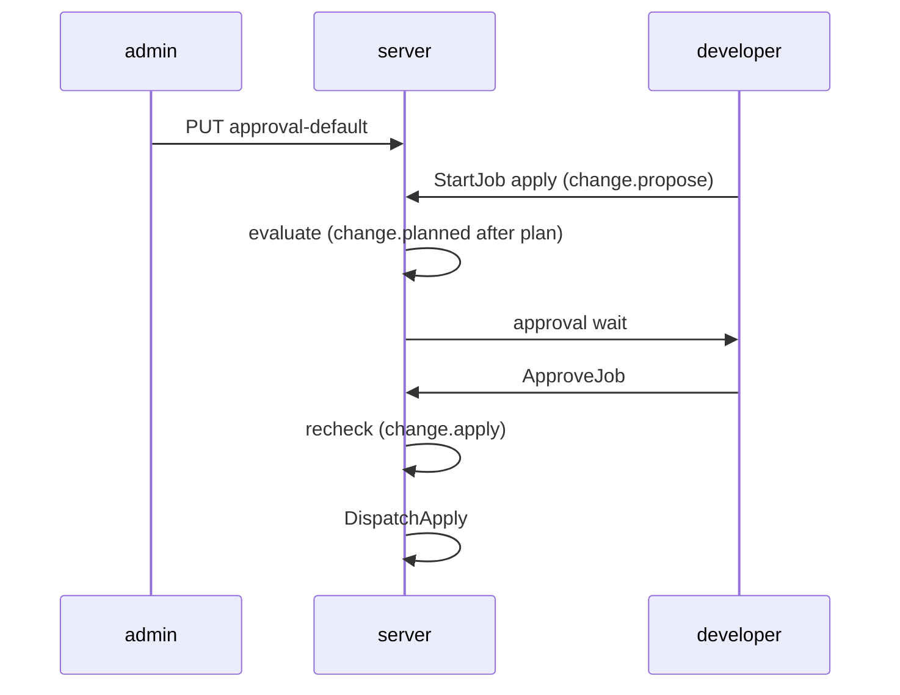
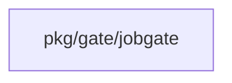
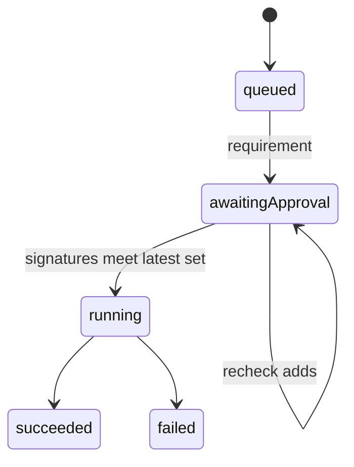
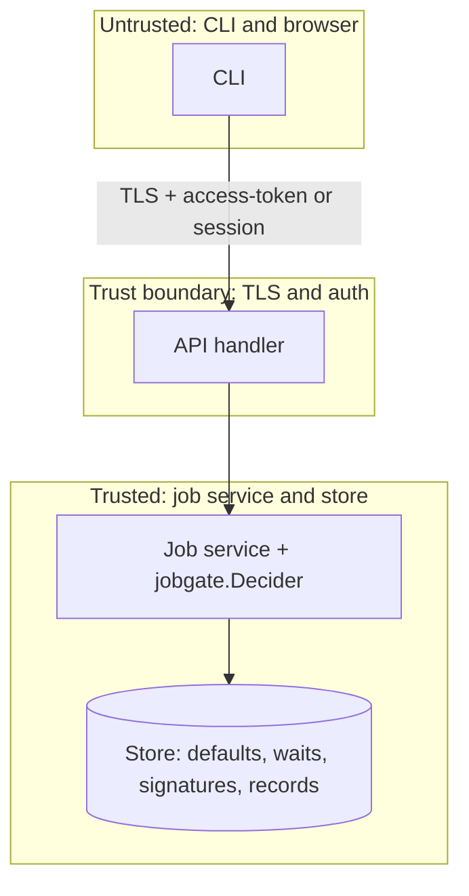

## Context

Slice 1 stored approval defaults and rules and left pkg/gate/jobgate tested in isolation and wired nowhere. This change wires the existing Decider into the job service path from #968 with gate evaluation from #899 so stored defaults take effect on live Pulumi and OpenTofu jobs at the fixed decision points.

## Decisions

1. **Reuse jobgate.Decider at propose, planned and apply.** Wire the existing jobgate.Decider at the job service points that map to change.propose at StartJob, change.planned after the plan is stored, and change.apply before DispatchApply of the apply phase; state.write, profile.save and profile.open stay with their own changes.
2. **Hold and resume on the latest requirement set.** Hold a job that gains a requirement in approval wait and resume it only when the stored signatures meet every requirement of the latest evaluation; signatures that still meet a requirement of the new result still count per ADR 224 decision 3. The recheck runs inside one store transaction that holds the dispatch lock, so concurrent ApproveJob calls serialize. Distinct-approver counting and break-glass dev-data rules live in their depended changes.

## Structure

The unexported gate evaluation state lives behind jobgate.Decider which only its constructor builds after the service passes a checked unit reference and a server-produced fact document, so callers cannot construct a partial approval gate.

## Risks

- A job started before a default save uses the facts at evaluation time per the recheck rule.
- Two tools share one wait semantic with tool-specific copy only.

## Layers (defense in depth)

| Layer | Guard | Hostile test |
| --- | --- | --- |
| port adapter | Job service validates the unit reference and the subject at the boundary before it calls the Decider; the Decider itself does no input rewrite. | Call StartJob with an empty subject and a malformed unit reference and check refusal without engine call. |
| service | Job service checks the grant for the job action on the unit object at the point of use, and re-reads the stored decision record version inside the dispatch transaction before DispatchApply. | Start an apply job as a principal with only plan rights and check 403 even when gates allow; replay a prior-revision approval and check refusal with the record named. |
| HTTP handler | Tool handlers refuse a state write when the stored record version does not match the dispatched revision. | Replay an approval for a prior plan revision against a new plan and check refusal with the record named. |

## Diagrams

After this change:

Modules that the change touches, and their imports on main:

New imports of this change (each one allowed by the module rules):

- `add the new file internal/jobsvc` imports `pkg/gate/jobgate`

States and transitions after this change:

## Quality attributes

| Attribute | Target | Unit | Scope |
| --- | --- | --- | --- |
| durability | 100 | percent restored | approval wait and signatures across restart |

## Threat model

Data flow and trust boundaries:

| Boundary | STRIDE | Threat | Layer | Guard | Hostile test |
| --- | --- | --- | --- | --- | --- |
| TLS and auth between CLI and API handler | S | Spoofed principal starts or approves a job of another person. | boundary check | Authenticate access-token or session and validate unit reference at the boundary. | Send an apply with a forged token and a malformed unit and check 401 or 422 with no evaluation. |
| TLS and auth between CLI and API handler | S | Spoofed principal starts or approves a job of another person. | encode or contain | Encode the unit by stable ID in stored wait and signatures; contain paths with allowlisted patterns. | Rename a unit mid-wait and send hostile path input and check the wait still binds to the same unit ID with no traversal. |
| TLS and auth between CLI and API handler | S | Spoofed principal starts or approves a job of another person. | limit | Limit body size and auth attempts per client address. | Send an oversized approval body and check 413 with no state change. |
| TLS and auth between CLI and API handler | S | Spoofed principal starts or approves a job of another person. | authorize at point of use | Authorize the job action on the unit at the point of use. | Start an apply with plan-only rights and check 403 even when gates allow. |
| TLS and auth between CLI and API handler | S | Spoofed principal starts or approves a job of another person. | fail closed | Deny and engine error stop the change with the record. | Match a deny gate and force an engine error and check the change stops. |
| Job service to store | T | Tampered plan revision or facts release an apply without the required approvals. | boundary check | Allowlist fact producers; never take facts from the client. | Send client facts in the job request and check the server ignores them. |
| Job service to store | T | Tampered plan revision or facts release an apply without the required approvals. | encode or contain | Encode unit reference by stable ID in stored wait and signatures. | Rename a unit mid-wait and check the wait still binds to the same unit ID. |
| Job service to store | T | Tampered plan revision or facts release an apply without the required approvals. | limit | Serialize recheck and dispatch as one step. | Race two approvals at dispatch and check only one outcome wins. |
| Job service to store | T | Tampered plan revision or facts release an apply without the required approvals. | authorize at point of use | Authorize the dispatch on the stored record version at the point of use. | Replay a prior-revision approval at dispatch and check refusal with the record named. |
| Job service to store | T | Tampered plan revision or facts release an apply without the required approvals. | fail closed | Fail closed on unavailable facts and stale revisions. | Replay a prior-revision approval and check refusal with the record named. |

## Contracts

**job**

- Invariant: Approval wait is stored with the plan revision it was evaluated on.
- Invariant: Recheck only adds a requirement, never removes a stored requirement in wait.
- `StartJob`: pre: Caller holds the job start action on the unit.. Post: Decision record written with gate versions and schema version..
- `ApproveJob`: pre: Approver is eligible and not excluded.. Post: Signature counted only against the latest evaluation..
- `DispatchApply`: pre: Latest change.apply evaluation allows dispatch.. Post: Apply dispatch holds until recheck and signature check complete as one step..

## Failure modes

| Step | Failure | Retry | State after |
| --- | --- | --- | --- |
| Hold in approval wait | Runner claim lease expires mid-wait | Another runner reclaims the job; wait state and signatures stay stored. | approval wait with stored signatures intact |
| Persist wait | Server restarts during wait | Reload stored wait and signatures on start; no auto-approve. | approval wait restored |
| Recheck at change.planned | New plan stored while in wait | No retry; keep signatures that still meet a requirement of the new change.planned result and drop the rest. | approval wait on new revision |
| Recheck at change.apply | Approval arrives during apply recheck | Serialize under the dispatch transaction; one winner, other sees latest set. | dispatched or approval wait on latest set |
| Evaluate gates | Gate engine error in enforce mode | No retry of dispatch; stop with error result and Cedar message. | failed with decision record |

## Change impact (computed from main)

Tests:

- `internal/expr/owned_internal_test.go` names `gate.ErrRuleFailed`
- `internal/expr/hostile_test.go` names `gate.ErrRuleFailed`
- `internal/expr/timeout_internal_test.go` names `gate.ErrRuleFailed`
- `pkg/job/service_test.go` names `job.Decider`
- `pkg/gate/jobgate/jobgate_test.go` names `job.Decider`

ADRs:

- `docs/adr/0114-the-policy-port-and-its-default-adapters.md` names `gate.ErrRuleFailed`
- `docs/adr/0223-access-limits-cedar-forbid-policies-for-each-scope.md` names `gate.ErrRuleFailed`
- `docs/adr/0112-blueprints-the-document-versions-and-expr.md` names `gate.ErrRuleFailed`
- `docs/adr/0114-the-policy-port-and-its-default-adapters.md` names `job.Decider`
- `docs/adr/0116-request-states-jobs-approvals-and-freezes.md` names `job.Decider`
- `docs/adr/0110-the-catalog-a-gateway-of-declarative-requests.md` names `job.Decider`
