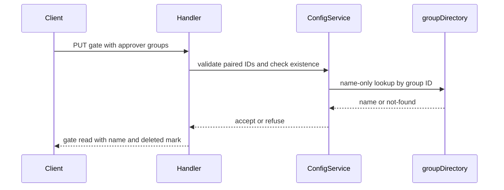
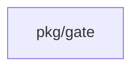

## Context

Approval rules in pkg/gate store group names with group IDs. The read path refreshes names through currentNames. Job start checks approvers.

## Decisions

1. **Paired IDs, name-only reads, marked deletions.** Stored rules require paired IDs and names with one constructor check. Legacy no-ID branches are deleted. Reads use a name-only directory lookup keyed by stored group ID. Saves keep member counting. A live renamed group shows the current name. A missing group shows the stored name with the NEW boolean field deleted set true. Job start refuses a deleted group. PUT stays writable on a legacy stored rule so the rule can be rewritten. Job start rechecks each group ID at start time.

## Structure

Unexported approver store shape with constructor that checks len(GroupIDs) equals len(Groups); only the constructor makes a stored value.

## Risks

- A stored rule with the unpaired legacy shape fails the whole gate read with a validation error until rewritten through PUT.

## Diagrams

After this change:

Modules that the change touches, and their imports on main:

## Quality attributes

| Attribute | Target | Unit | Scope |
| --- | --- | --- | --- |
| none affected | Short low-risk cleanup with no latency or storage target change |  |  |
