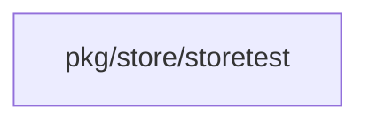

## Context

The store conformance suites in pkg/store/storetest are large single files. Parallel store work conflicts in the same case table. This part splits only the workspace and update suites by area with no behavior change.

## Decisions

1. **Split workspace suite by named areas.** Split pkg/store/storetest/workspaces.go into the NEW files workspaces_lock.go, workspaces_state.go, workspaces_outputs.go, workspaces_history.go, workspaces_inventory.go and workspaces_delete.go. Each owns one NEW ordered slice: workspaceLockCases, workspaceStateCases, workspaceOutputCases, workspaceHistoryCases, workspaceInventoryCases, workspaceDeleteCases. RunWorkspace concatenates the slices in current order.
2. **Split update suite with shared setup in place.** Split pkg/store/storetest/updates.go into NEW files updates_<area>.go that mirror its current section blocks. Each owns one NEW slice updates<Area>Cases. RunUpdates concatenates them in current order. Shared setup stays in workspaces.go and updates.go. No init function.

## Structure

No NEW unexported type; each area file owns its ordered slice and RunWorkspace and RunUpdates alone set the run order by concatenation.

## Risks

- A case is dropped or reordered during the move, which changes go test -run filters.

## Diagrams

Modules that the change touches, and their imports on main:

## Quality attributes

| Attribute | Target | Unit | Scope |
| --- | --- | --- | --- |
| none affected | Pure test-file move with identical case names and order; no runtime or storage change |  |  |
