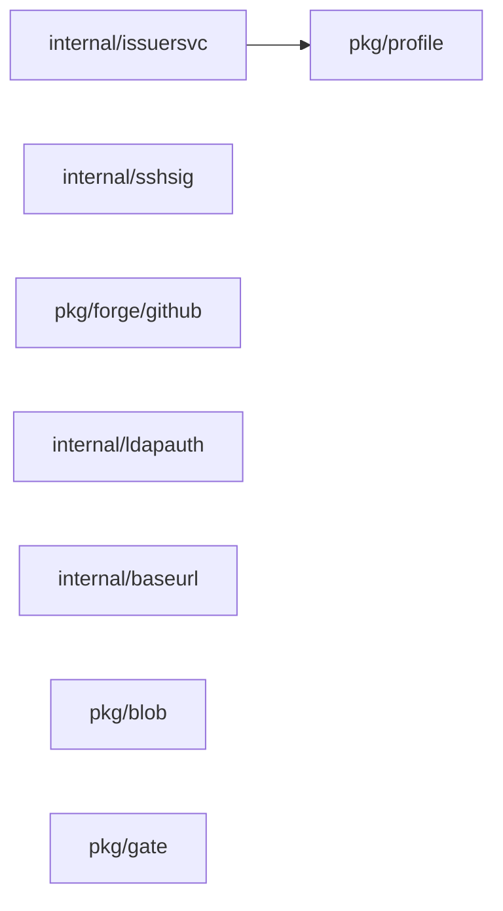

## Context

Six hand-rolled ASCII validators hold inline range loops. The risk is an off-by-one in a security parser. The fix adds direct boundary tests and fuzz oracles without changing production behavior.

## Decisions

1. **Tests only, no production change.** Add only tests in this change: internal table tests with boundary bytes plus fuzz targets with a regexp oracle in the test file only. Keep production code unchanged, so the change cannot alter accept or reject behavior.
2. **Cover baseurl, defer shared helper.** Cover all six locations named in the issue, including the check at internal/baseurl/baseurl.go. Defer only the optional shared ident helper to a later change; the oracle tests become the proof for that later refactor.

## Structure

No new production type. Test files in internal/issuersvc, internal/sshsig, pkg/forge/github, internal/ldapauth, pkg/profile and internal/baseurl use table cases and a regexp oracle compiled in the test with anchors \A and \z and byte-wise input handling.

## Risks

- Fuzz seed corpus runs in the default unit test run; the 30 s extended run is on demand only.

## Diagrams

Modules that the change touches, and their imports on main:

## Quality attributes

| Attribute | Target | Unit | Scope |
| --- | --- | --- | --- |
| none affected | Test-only change; no production latency, storage, or limit changes. |  |  |
