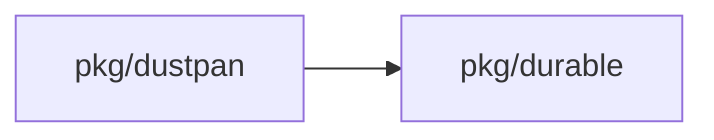
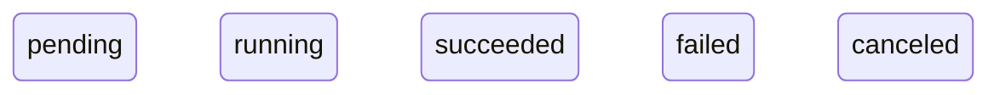

## Context

Time is injected per package and does not reach the lease runner, claim paths, or adapters, so lease tests fall back to real time.

## Decisions

1. **One shared clock with fake in clocktest.** Add the NEW leaf package internal/clock with a Clock interface (Now, NewTimer, NewTicker with Stop, Reset and identical channel semantics for Real and Fake) and Real. Add the NEW package internal/clocktest with Fake, made only by NewFake, with Advance that fires timers and tickers. No new tool and no custom analyzer.
2. **Reference conversion first.** Convert only the pkg/durable runner lease, the claim time at claimedAt and the deadline timers. Keep other callers on a forbidigo exclusion list with one to-convert line each. The constructor denies a nil clock. Only pkg/dustpan wiring passes clock.Real{}. New time-based code uses internal/clock and the exclusion list only becomes shorter, so land this change before changes that add time-based code.

## Structure

Unexported fake timer heap behind Fake made only by NewFake; unexported real struct behind Real; constructors check non-nil clock and non-negative durations.

## Risks

- Fake timer semantics can differ from real timers; keep the reference test with a 1-tick margin mutation.
- Packages in pkg that import an internal package constrain embedders; keep both new packages leaf.

## Diagrams

Modules that the change touches, and their imports on main:

New imports of this change (each one allowed by the module rules):

- `pkg/durable` imports `internal/clock NEW`
- `pkg/dustpan` imports `internal/clock NEW`

States on main in the touched packages:

## Quality attributes

| Attribute | Target | Unit | Scope |
| --- | --- | --- | --- |
| none affected | No user-visible latency or storage change; only test determinism of lease paths |  |  |

## Contracts

**Fake clock**

- Invariant: Advance only moves forward
- Invariant: Each due timer fires exactly once
- Invariant: Stop prevents a pending fire
- `Advance`: pre: Duration to advance is non-negative. Post: Due timers and tickers have fired exactly once.

## Failure modes

| Step | Failure | Retry | State after |
| --- | --- | --- | --- |
| Durable runner lease renew | Lease renewal tick lost while holder still runs | Runner renews on the next tick or releases | Claim held with new expiry or released to unclaimed |
| Deadline timer wait | Deadline timer fires early or late under wall clock | Reference test drives only the fake clock | Operation ends at the fake deadline with no extra renew |
