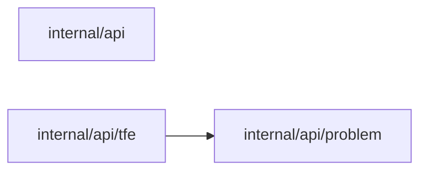
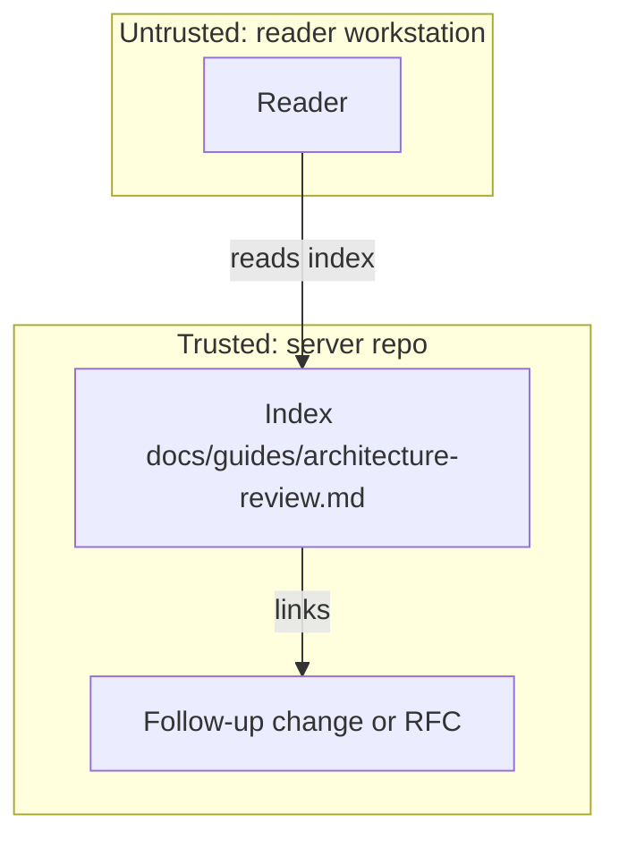

## Context

Findings in #1399, #1400, #1464 and #3037 stay open. This change is an index and changes no behavior. Pins are 9464ad0 for #1399 and #1400 and 28f0e3cb6 for #3037.

## Decisions

1. **Index not implementation.** Each deepening is its own follow-up change with its own gate: F1 to F4, F5 to F9, F10 to F15, findings 1 to 8 of #1400, the #1464 nit groups, and the 4 numbered findings of #3037. This change holds the index only.
2. **Link duplicates, land last.** The index links existing changes instead of filing duplicates: exported-pkg-signatures-name-internal for leaked internal types, the four new-services-adapters-land-in changes for service moves, and errcode-catalog-imports-domain-packages for the errcode import edge. This index lands last, after those changes merge or re-scope.
3. **Done, rejected and drift rule.** A finding is done when its follow-up merges and its check passes. A rejected finding closes with its reason in the index. A stale line reference is flagged by the drift check and updated by re-running the finding rg on current main.
4. **Re-check on current main.** Each finding keeps its pin. Before a follow-up starts, it re-runs the finding evidence on current main and updates line references, because open PRs #1371, #1388, #1389, #1392, #1395 and #1398 change packages that last-gated findings need.

## Structure

No new type. Each follow-up names its unexported type and constructor when it lands.

## Risks

- A follow-up can drift from the finding text. The re-check rule limits this.

## Diagrams

Modules that the change touches, and their imports on main:

## Quality attributes

| Attribute | Target | Unit | Scope |
| --- | --- | --- | --- |
| none affected | tracking change with no runtime change |  |  |

## Threat model

Data flow and trust boundaries:

| Boundary | STRIDE | Threat | Layer | Guard | Hostile test |
| --- | --- | --- | --- | --- | --- |
| Untrusted: reader workstation to Trusted: server repo | T | A wrong index link sends a follow-up to change the wrong helper and hide an F2b security drift. | boundary check | Accept only finding IDs F1-F15, findings 1-8, and #3037 edges 1-4; reject other input. | Send unknown finding ID and check the index rejects it. |
| Untrusted: reader workstation to Trusted: server repo | T | A wrong index link sends a follow-up to change the wrong helper and hide an F2b security drift. | encode or contain | Render finding references as text, never as HTML or links with schemes. | Inject markup in a finding note and check it renders as text. |
| Untrusted: reader workstation to Trusted: server repo | T | A wrong index link sends a follow-up to change the wrong helper and hide an F2b security drift. | limit | Index holds at most 40 findings; drift check reads at most 200 lines per file. | Feed an oversize finding list and check the check stops at the limit. |
| Untrusted: reader workstation to Trusted: server repo | T | A wrong index link sends a follow-up to change the wrong helper and hide an F2b security drift. | authorize at point of use | Landing the index needs no grant; each follow-up enforces its own action at its own route. | Attempt a behavior change through the index and check the route test refuses it. |
| Untrusted: reader workstation to Trusted: server repo | T | A wrong index link sends a follow-up to change the wrong helper and hide an F2b security drift. | fail closed | On stale evidence the drift check fails closed and flags the line for re-run. | Move a cited line and check the drift test fails instead of linking a stale line. |
