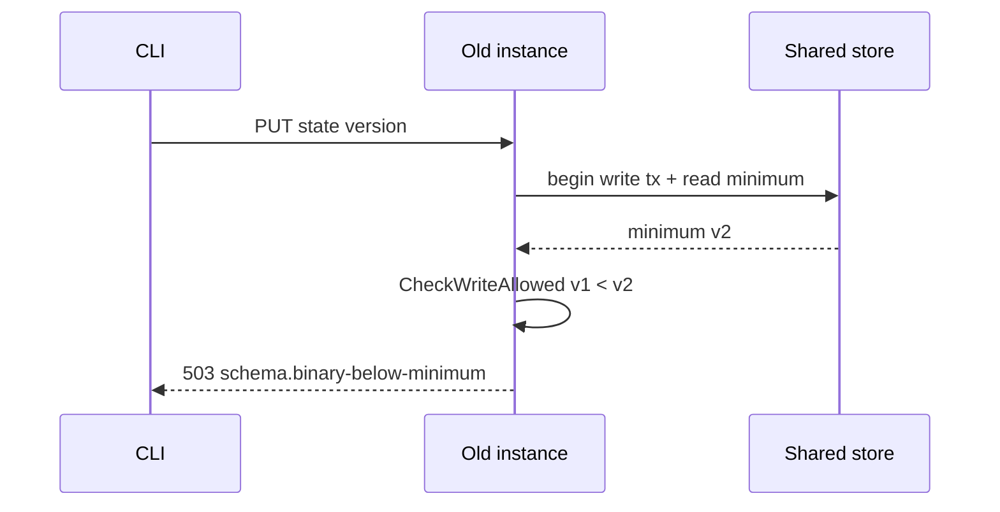
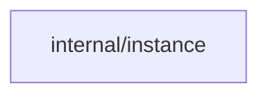

## Context

During a rolling deploy old and new binaries share one database. Old binaries must not write new contract shapes. The stored minimum binary version is the single gate on the write path.

## Decisions

1. **Stored minimum gates writes.** Store one minimum binary version row plus one row per instance in the existing baseline tables, edited in place for sqlite and postgres with no numbered migration. Each instance calls the NEW VersionStore.RecordInstance at start with BinaryVersion, then calls the NEW VersionStore.RaiseMinimum to its own release version. Dev-builds record but never raise. Each write path calls the NEW VersionStore.CheckWriteAllowed inside the same store transaction as the write with a fresh read of the minimum, so a raise between check and commit cannot slip through. Reads skip the check.
2. **Old write refusal shape (PM decision, rule 16; no ADR fixes the status: `rg -n -i "binary-below-minimum" docs/adr` finds none).** The request is valid and another instance of the new version can serve it, so the answer is 503 with Retry-After, as main already answers (`internal/api/problem/problem.go:501` belowMinimum gives `http.StatusServiceUnavailable`). Return 503 with Retry-After and error code `schema.binary-below-minimum` through `belowMinimum` in tool-neutral shape, and `belowMinimumText` in Pulumi shape. TFE-compatible shape carries the same code. Reads keep 200. The instance list shows each version row and the effective minimum. Each raise writes an audit entry.

## Structure

The NEW type `NEW VersionGate` holds the unexported field `NEW minVersion` built only by the NEW constructor `NEW NewVersionGate`, and only the NEW method `NEW CheckWriteAllowed` in the same sentence can compare a fresh minimum read with the binary version, so callers cannot cache or bypass parsing.

## Risks

- Concurrent raise from two new instances writes a split minimum.
- A write path skips the gate and writes an old shape over a new shape.

## Diagrams

After this change:

Modules that the change touches, and their imports on main:

New imports of this change (each one allowed by the module rules):

- `internal/instance` imports `pkg/store/schema`

## Quality attributes

| Attribute | Target | Unit | Scope |
| --- | --- | --- | --- |
| write-path latency | 5 | ms p99 added | each write that calls CheckWriteAllowed |
| storage growth | 1 | row per instance plus one minimum row | per installation version rows |

## Contracts

**Installation version record**

- Invariant: One stored minimum binary version per installation.
- Invariant: Minimum version only moves forward.
- Invariant: Raise of minimum is atomic against concurrent raises.
- `NEW VersionStore.RecordInstance`: pre: Instance ID is valid.; Binary version string uses semver shape or dev-build shape.. Post: Instance row with binary version is stored for the instance ID..
- `NEW VersionStore.RaiseMinimum`: pre: Caller holds installation scope check.; Requested version is a valid release semver.. Post: Stored minimum equals the greater of prior minimum and requested version.; Raise writes an audit entry with the old value and the new value..
- `NEW VersionStore.CheckWriteAllowed`: pre: Stored minimum is read in the same transaction as the write.; Binary version of the serving instance is known.. Post: Returns the NEW error code `schema.binary-below-minimum` when binary version is below stored minimum, else allows the write..
