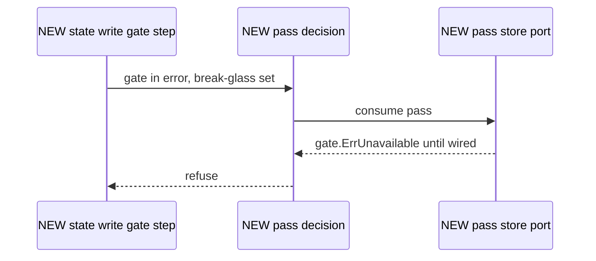
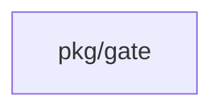
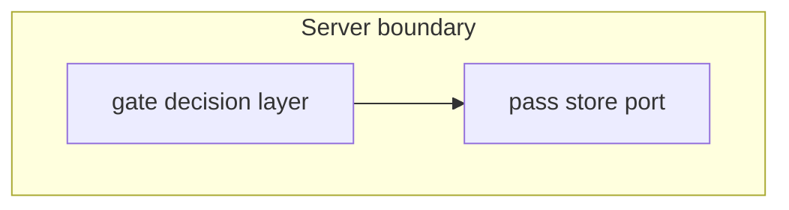

## Context

The decision layer lives in pkg/gate. It has no HTTP, SQL or audit code. The port has no adapter in this change.

## Decisions

1. **Checked pass value.** Only the constructor can make a pass. It checks the reason, kind, holder and unit stable ID.
2. **Port that fails closed.** The pass store port has a default value whose methods return gate.ErrUnavailable. A missing store never grants a pass.
3. **Pass bound to stable IDs.** The pass names the unit by its stable ID, never by name.

## Structure

Unexported type breakGlassPass with constructor newBreakGlassPass that checks reason, kind, holder, unit ID and the 15-minute window.

## Risks

- A pass key that is too wide lets a pass cross units or kinds.
- An error path that also passes deny.
- Clock use: expiry takes an injected time, so the follow-up change must give the store clock.

## Layers (defense in depth)

| Layer | Guard | Hostile test |
| --- | --- | --- |
| decision service | Passes only a result of error in enforce mode, and only when the pass matches holder, unit ID and kind. | TestBreakGlassDenyStillRefuses and TestBreakGlassWrongUnitOrKindRefuses send a deny, another unit and another kind; each is refused. |
| pass constructor | Refuses an empty, overlong or control-character reason. | TestBreakGlassBadReasonRefuses sends each bad reason; no pass is built. |
| store port | The default port answers gate.ErrUnavailable. | TestBreakGlassChangeFailsClosed sets break-glass with the default port; the write is refused. |

## Diagrams

After this change:

Modules that the change touches, and their imports on main:

## Quality attributes

| Attribute | Target | Unit | Scope |
| --- | --- | --- | --- |
| correctness | 1 | winner per pass under concurrent use | break-glass consume in the port conformance suite |

## Threat model

Data flow and trust boundaries:

| Boundary | STRIDE | Threat | Layer | Guard | Hostile test |
| --- | --- | --- | --- | --- | --- |
| decision layer to port | E | A caller passes a deny or a wrong unit with a valid pass | boundary check | The constructor checks reason, kind, holder and unit ID | Build passes with bad reasons and empty IDs; each is refused |
| decision layer to port | E | A caller passes a deny or a wrong unit with a valid pass | encode or contain | The pass key is the tuple of holder, unit stable ID and operation kind; the store port matches the whole tuple and never a name or a prefix | TestBreakGlassWrongUnitOrKindRefuses uses a pass of another unit, another kind and a name that looks like the unit ID; each is refused |
| decision layer to port | E | A caller passes a deny or a wrong unit with a valid pass | limit | 15-minute single-use pass | Replay and use after expiry; both refused |
| decision layer to port | E | A caller passes a deny or a wrong unit with a valid pass | authorize at point of use | The decision matches holder, unit ID and kind at use | Swap the unit or kind; refused |
| decision layer to port | E | A caller passes a deny or a wrong unit with a valid pass | fail closed | The default port answers gate.ErrUnavailable and deny never passes | Use the default port and a deny; both refused |

## Contracts

**BreakGlassPass**

- Invariant: One use only
- Invariant: Expiry 15 minutes after issue
- `consume`: pre: The pass exists, is unused and is not expired. Post: The pass is used once and is returned; a second consume is refused. The caller checks the key and the window of the returned pass again, and fails closed with gate.unavailable on a mismatch.

## Failure modes

| Step | Failure | Retry | State after |
| --- | --- | --- | --- |
| Pass store read | The port is not wired or errors | Fix the wiring in the follow-up change | The write is refused and no pass is used |

## Change impact (computed from main)

Tests:

- `internal/expr/owned_internal_test.go` names `gate.ErrRuleFailed`
- `internal/expr/hostile_test.go` names `gate.ErrRuleFailed`
- `internal/expr/timeout_internal_test.go` names `gate.ErrRuleFailed`

ADRs:

- `docs/adr/0114-the-policy-port-and-its-default-adapters.md` names `gate.ErrRuleFailed`
- `docs/adr/0112-blueprints-the-document-versions-and-expr.md` names `gate.ErrRuleFailed`
- `docs/adr/0230-gate-configuration-actions-routes-errors-and-audit.md` names `gate.ErrRuleFailed`
