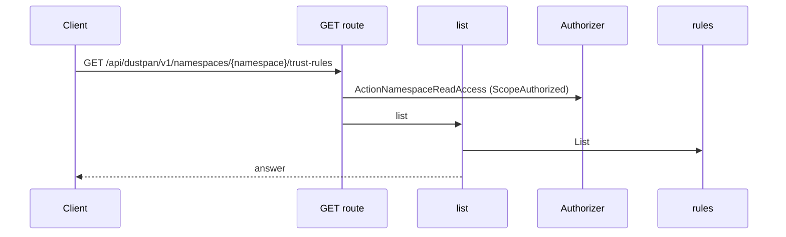
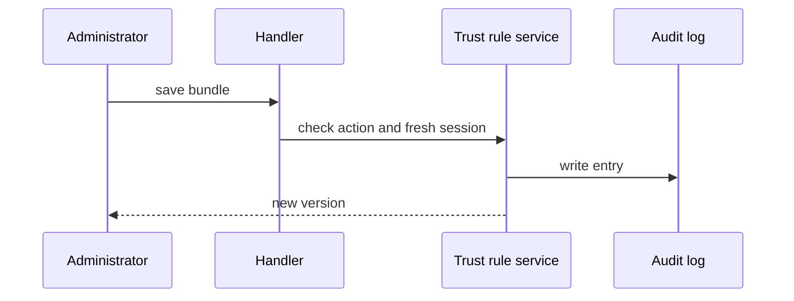
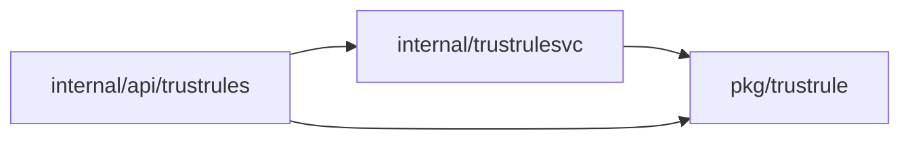
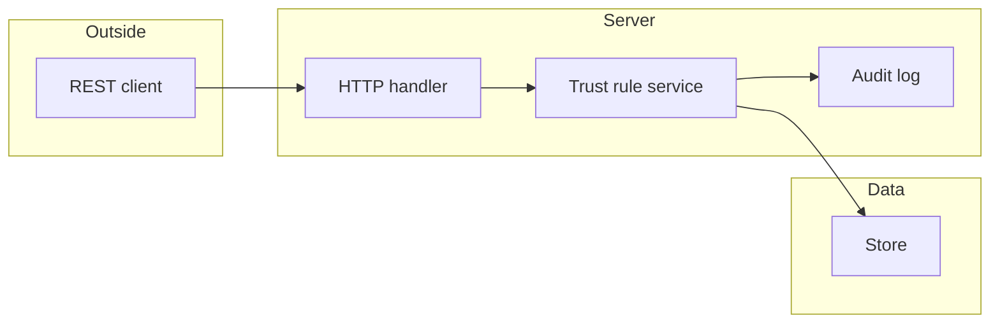

## Context

Main has pkg/trustrule, internal/trustrulesvc and the routes in internal/api/trustrules. This change extends them. It adds no parallel package.

## Decisions

1. **Extend the trust rule domain.** Bundle versions and the rule fields go into pkg/trustrule. Save, rotate, update and the fresh-authentication check go into internal/trustrulesvc. Routes extend internal/api/trustrules.
2. **Wire shapes.** Paths follow the trust-rules routes. JSON is camelCase. Bundle fields: id, namespace, active, versions, overlapEndsAt, revision, createdAt. Rule fields added: spiffePattern, bundle. Times are RFC 3339.
3. **Actions.** Writes use a namespace action on the namespace. Reads use the existing read action of the trust-rule reads.
4. **ETag and revision.** ETag is the revision in quotes, PATCH needs If-Match, a stale value answers 412.
5. **Tables.** trust_bundles and trust_bundle_versions, with Unix millisecond BIGINT times, go after triggers and before trust_rules in the baseline of each dialect. No numbered migration.
6. **Stable IDs.** A rule stores the namespace ID, the stable rule ID, the stable principal ID and the bundle ID. Evaluation uses the active version.

## Structure

An unexported bundle version type in pkg/trustrule. Only its constructor makes a value, and it checks PEM, expiry, bounds and the namespace. The service is the only writer of each route.

## Risks

- Rotation overlap allows two CAs at once by design. The read states the overlap end.
- Proxy TLS termination and CLI client certificate transport stay with the exchange part.

## Layers (defense in depth)

| Layer | Guard | Hostile test |
| --- | --- | --- |
| port adapter | The store checks the fence, PEM, expiry, bounds and the namespace of the version in the write transaction. | Save expired CA, malformed PEM, oversize PEM, 11th CA and a cross-namespace version; each is refused. |
| service | internal/trustrulesvc checks the namespace action, the reach and the fresh session before the write. | Write without grant, with a stale session and with a token only; each gives 403. |
| HTTP handler | The route declares its action and object, checks If-Match and audits. | Cross-namespace create, stale If-Match and repeated delete give 403, 412 and 404. |

## Diagrams

Today: `GET /api/dustpan/v1/namespaces/{namespace}/trust-rules` on main (from the route table and the handler body, route row internal/api/trustrules/trustrules.go:185, handler internal/api/trustrules/handlers.go:86).

After this change:

Modules that the change touches, and their imports on main:

## Quality attributes

| Attribute | Target | Unit | Scope |
| --- | --- | --- | --- |
| correctness | 100 percent of malformed, expired and oversize saves refused with the CA index | percent | bundle save refusal |

## Threat model

Data flow and trust boundaries:

| Boundary | STRIDE | Threat | Layer | Guard | Hostile test |
| --- | --- | --- | --- | --- | --- |
| REST API boundary | T | Attacker plants a rogue CA or a cross-namespace rule to get workload tokens | boundary check | Allowlist PEM, SPIFFE shape, bounds and same-namespace version | Post a bundle with 11 CAs; the server refuses with 400 |
| REST API boundary | T | Attacker plants a rogue CA or a cross-namespace rule to get workload tokens | encode or contain | Store parsed keys only; errors show the index only | Save PEM with CRLF; the error shows the index only |
| REST API boundary | T | Attacker plants a rogue CA or a cross-namespace rule to get workload tokens | limit | Cap 64 KB, 10 CAs, 5 kept versions, 24 hour overlap | Send over-cap input; the server refuses |
| REST API boundary | T | Attacker plants a rogue CA or a cross-namespace rule to get workload tokens | authorize at point of use | Namespace action and fresh session | Replay a write with a token only; 403 |
| REST API boundary | T | Attacker plants a rogue CA or a cross-namespace rule to get workload tokens | fail closed | Deny and audit on any error | Force a store error; nothing stored and the refusal is audited |

## Contracts

**trust bundle**

- Invariant: One bundle per namespace with append-only versions and one active pointer
- Invariant: The active version holds unexpired CAs only
- `save-bundle`: pre: namespace action held; fresh authentication; PEM valid. Post: new version stored; audit entry written.
- `rotate-bundle`: pre: namespace action held; fresh authentication; If-Match matches. Post: new version active; overlap end stated.

**trust rule**

- Invariant: A rule belongs to one namespace
- Invariant: A rule names a stable principal ID
- `update-rule`: pre: If-Match matches; fresh authentication. Post: rule stored with new ETag; audit entry written.

## Failure modes

| Step | Failure | Retry | State after |
| --- | --- | --- | --- |
| Save bundle | Expired CA in the bundle | Remove the expired CA and save again | No new version stored |
| Update rule | Stale ETag | Read the ETag and send again | Rule unchanged, 412 returned |
