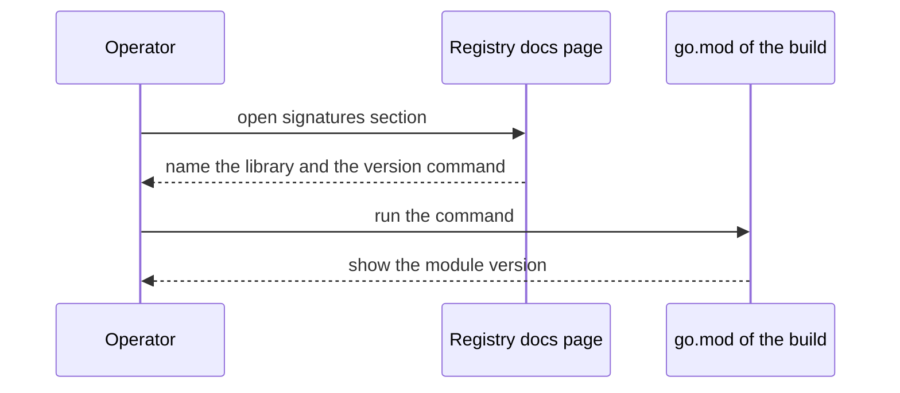
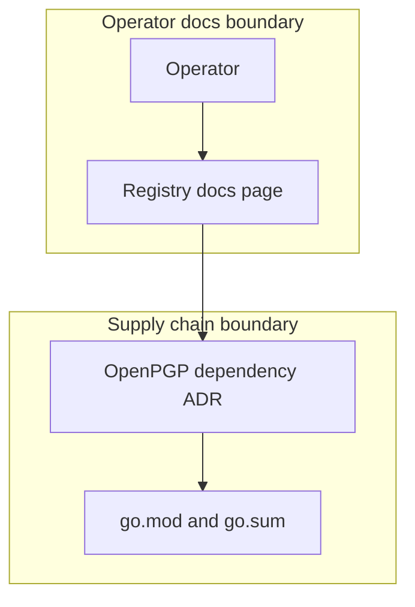

## Context

The registry signature check needs an OpenPGP dependency. Issue 1293 asks for its own ADR with the approved modules, the approval and the GO-2026-5932 disposition.

## Decisions

1. **Verify the dependency ADR.** ADR 379 exists at docs/adr/0379-the-openpgp-dependency-of-the-registry.md. Verify that its versions match go.mod and that it has fresh govulncheck output. ADR 379 decision 2: "The owner accepts the residual risk of GO-2026-5932 (owner, 2026-11-14)."
2. **List and state with existing checks only.** Add the index entry for ADR 379 and add a plain statement to the registry docs signature section: the library and the command that shows its version. The page holds no ADR reference, as the rule for user docs says. Checks use go list -m, make vuln, make docs-lint and rg. No new tool.

## Structure

No code change. One ADR file under docs/adr/, its entry in docs/adr/INDEX.md, and one plain statement in the registry page docs/guides/private-registry.md.

## Risks

- The ADR records versions that differ from go.mod, so readers trust a wrong fact.

## Diagrams

After this change:

## Quality attributes

| Attribute | Target | Unit | Scope |
| --- | --- | --- | --- |
| correctness | 100 | percent of recorded versions that match go.mod | OpenPGP dependency ADR |

## Threat model

Data flow and trust boundaries:

| Boundary | STRIDE | Threat | Layer | Guard | Hostile test |
| --- | --- | --- | --- | --- | --- |
| Supply chain boundary | T | A dependency update changes a module version, so the ADR no longer matches go.mod and misleads the Operator. | boundary check | The version check compares the ADR versions with go list -m output. | Change one version in the ADR text and run the version check. It fails and names the module. |
| Supply chain boundary | T | A dependency update changes a module version, so the ADR no longer matches go.mod and misleads the Operator. | encode or contain | The ADR records exact module paths and versions in one fixed list, so no free text names a version. | Add a version in prose that is not in the list. The review check refuses the ADR. |
| Supply chain boundary | T | A dependency update changes a module version, so the ADR no longer matches go.mod and misleads the Operator. | limit | The ADR lists only the three modules that go.mod holds. It claims no other module. | Add a fourth module that go list -m does not show. The version check fails. |
| Supply chain boundary | T | A dependency update changes a module version, so the ADR no longer matches go.mod and misleads the Operator. | authorize at point of use | ADR 379 records the owner approval (decision 1). No one else sets the approval line. | Remove the owner approval line from the ADR. The review refuses it. |
| Supply chain boundary | T | A dependency update changes a module version, so the ADR no longer matches go.mod and misleads the Operator. | fail closed | On a mismatch the change is not done. A version change needs the owner's word (ADR 379 decision 3). | Run make vuln with a differing result. The change is not done until the ADR shows the fresh output. |
| Operator docs boundary | S | The docs page names a wrong library or a fixed version, so the Operator trusts a fact that the build does not hold. | boundary check | make docs-lint checks the page for a banned word and an internal reference. | Add an ADR number to the page and run make docs-lint. It names the line. |
| Operator docs boundary | S | The docs page names a wrong library or a fixed version, so the Operator trusts a fact that the build does not hold. | encode or contain | The page names the module path as a fixed string and the command as a code block. | Put a free URL in the page. The review refuses it. |
| Operator docs boundary | S | The docs page names a wrong library or a fixed version, so the Operator trusts a fact that the build does not hold. | limit | The page has one statement, next to the signature text, and no fixed version. | Add a fixed version to the page. The review refuses the change. |
| Operator docs boundary | S | The docs page names a wrong library or a fixed version, so the Operator trusts a fact that the build does not hold. | authorize at point of use | The ADR index entry is in the same change as the ADR, so the ADR that backs the statement is a listed ADR. | Remove the index entry and run make docs-lint. It reports the missing entry. |
| Operator docs boundary | S | The docs page names a wrong library or a fixed version, so the Operator trusts a fact that the build does not hold. | fail closed | The docs check fails the change when the page holds an internal reference. | Add an ADR reference to the page and run make docs-lint. The check exits with an error. |

## Failure modes

| Step | Failure | Retry | State after |
| --- | --- | --- | --- |
| Read the registry docs statement on signatures. | The page holds an internal reference or a fixed version. | Remove it, then run the docs check again. | The page names the library and the command, and the docs check passes. |
| Run the vulnerability check again. | Fresh govulncheck output differs from the issue report. | Paste the fresh output into the ADR. The risk review date is 2027-02-14 (ADR 379 decision 2). | ADR records fresh output. |
