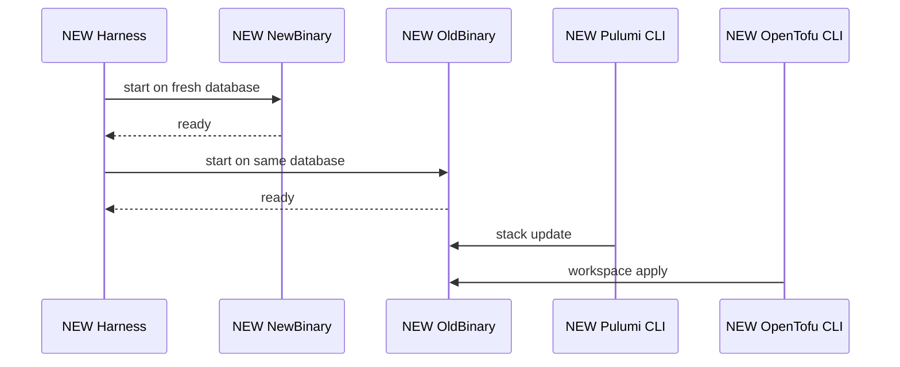

## Context

CI proves that the current schema runs with the last 2 release binaries on one database, on SQLite and PostgreSQL, before the first tag ships.

## Decisions

1. **Matrix choice, tool versions, and SQLite order.** Build the last 2 v* tags that are ancestors of HEAD, newest first. Ignore non-v* tags and tags that are not ancestors of HEAD. When 3 or more ancestor tags exist the harness runs the newest 2. When exactly 1 ancestor tag exists the harness runs that 1 tag. Drive every binary with the current e2e Pulumi CLI and OpenTofu versions and record those versions in the log. On PostgreSQL run new and old binaries at the same time. On SQLite start one binary at a time on the same file, never two servers at once, so SQLite multi-instance stays out of scope.
2. **Failure handling and self-check boundary.** Tag fetch, build, migrate, and start failures fail the harness loudly with the tag name and the log line. A failure of one old tag fails the run even when the other old tag works. The harness never falls back to the zero-tag report on any fetch, build, or start failure. An old tag that predates the minimum-check code fails the run and names the tag, because it gives no refusal signal. The below-minimum self-check stays distinct from the matrix: it starts one old binary on a scratch database with a test-raised minimum, and the old binary itself reads the row and refuses its own writes with the existing code schema.binary-below-minimum from rolling-deploy-version-minimum-check. Matrix tags must start and serve, and any matrix tag that refuses its own writes fails the matrix.

## Structure

No new server structure. The harness is a test-only builder in e2e with an explicit tag list. It changes no server behavior because it starts binaries and drives CLIs.

## Risks

- Tag fetch fetches too much history and slows CI.
- Old binaries need old tool versions and drift from the current e2e matrix.

## Diagrams

After this change:

## Quality attributes

| Attribute | Target | Unit | Scope |
| --- | --- | --- | --- |
| none affected | CI job proves mixed-version runs; no production latency or storage change |  |  |
