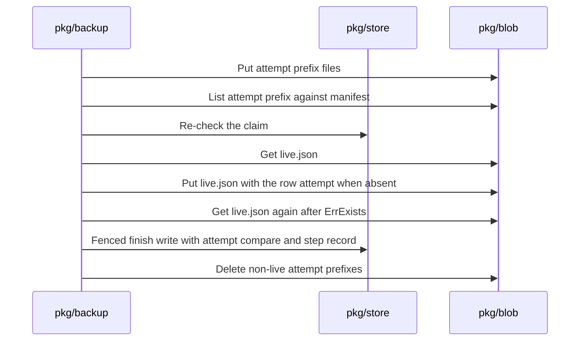
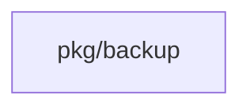
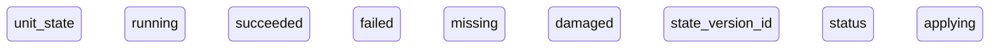
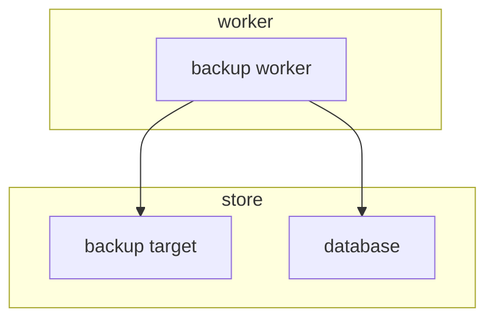

## Context

Backup target writes run on two or more instances behind one load balancer on one PostgreSQL database and one S3-compatible bucket with no conditional writes.

## Decisions

1. **Attempt prefix as a type.** Attempt-scoped layout `backups/<id>/<attempt>/` makes cross-attempt damage impossible by shape. NEW unexported type `attemptPrefix` in `pkg/backup` with NEW constructor `newAttemptPrefix` checks allowlist for each part and refuses dot-dot and slash. Clear, put, delete, and manifest-write helpers take `attemptPrefix`, never a plain string. The attempt equals the claim fencing token of the holder that runs the write step. The write step records it in the backups row with a fenced write (the database decides which attempt counts) and in the manifest. Each Put and each Delete re-reads the claim token right before the target call and skips the call when the claim moved. The finish step takes the attempt from the backups row, never from the token of its own claim: the durable runner skips a recorded step, so a holder that took over after the write step wrote no files under its own token. Finish calls `Check` on the prefix of the row attempt with sizes and blob copies, then commits in a fenced transaction that checks the live claim and compares the manifest attempt with the row attempt. The record of the write step and the row attempt commit in one fenced transaction. The finish commit records the finish step in the same transaction (`FinishBackup` at pkg/store/sqlite/backup.go), so the runner never runs the finish step again after a successful commit. The manifest write is fenced too.
2. **Cleanup under the live claim.** Only the live-claim holder deletes old prefixes, after its own finish commit and after the pointer reads the row attempt (decision 3). The live holder lists the parent `backups/<id>/`, deletes only non-live attempt prefixes of the same backup, and re-checks the claim before each delete batch. It never deletes the prefix of the row attempt. A crash after the finish commit skips the cleanup, and the orphaned prefixes stay until an operator deletes them. A stale writer that resumes after the delete recreates only its own stale prefix; the next list by the live holder removes it again. A backup that never finishes leaves its prefixes in the target. Main has no backup retention and no backup delete, so they stay until an operator deletes them; the several-instances guide names the attempt layout so that the operator can find them.
3. **Live pointer.** A reader that has only the target and the backup id cannot find the live attempt prefix from the manifest, because the manifest lies inside that prefix (a restore into a fresh installation is such a reader: `Check` at pkg/backup/service.go and `readManifestLimit` read `backups/<id>/manifest.json` today). So the finish step writes the fixed object `backups/<id>/live.json`. It holds only the attempt, in one fixed byte form, so that two writes of the same attempt are byte-identical. The pointer is a copy of the row attempt, not a write that must win: the database decides, and the correctness of the pointer does not depend on conditional writes. Some S3-compatible stores ignore `If-None-Match` on a put and replace the object (Garage v2.5.0 is one); others refuse the second put. The writer gives the same result on both:
   - The finish step writes the pointer after `Check` passed on the prefix of the row attempt and before the fenced finish commit, and it re-checks the claim right before the put. It does not write the pointer after the commit: the commit records the finish step, so the runner gives no second chance, and a crash between the commit and the put would leave a finished backup with no pointer for good. A pointer that exists before the commit names a prefix that already passed `Check`.
   - It first reads the pointer with a size limit. When the pointer names the row attempt, the step is done and there is no put. When the pointer is absent, the writer puts it. When the put returns `ErrExists`, the writer reads the pointer again and applies the same rules; `ErrExists` alone never decides the result.
   - When the pointer names another attempt or does not parse, the writer does not replace it, on any store. The finish step fails the backup with `backup.corrupt`, logs the backup id and both attempts, and runs no cleanup. The backup never reads succeeded, so the operator runs a new backup.
   - A second run of the finish step for the same backup id (a retry, or a takeover after a crash or a lost claim before the commit) follows the same steps. On a store that refuses the second put and on a store that replaces the object, the pointer then holds the same bytes, and the step result is the same.

   A reader reads the pointer with a size limit, builds the attempt prefix with `newAttemptPrefix` (allowlist), reads the manifest in that prefix, requires that the manifest names the same attempt and the same backup id, and runs `Check` on that prefix (sizes and checksums of each file that the manifest names). A reader that has the backups row (the check route) also requires that the pointer attempt equals the row attempt. No pointer, an unreadable pointer, a pointer that fails the allowlist, a missing manifest, a mismatch and a failed `Check` each report `backup.corrupt`. There is no fallback to a listing of the parent prefix. So a pointer that names a stale attempt, if one ever exists, gives either `backup.corrupt` or a stale attempt whose manifest and files are whole and consistent with each other; a restore never reads a part of one attempt and a part of another. Cleanup (decision 2) runs only after the pointer reads the row attempt. It keeps the prefix of the row attempt, never deletes the prefix that the pointer names, and never deletes `live.json`. When the pointer and the row differ, cleanup deletes nothing.
4. **Baseline edit.** Schema change is an in-place edit of the baseline of each dialect adding the backups attempt column, per ADR 322. No numbered migration and no old-layout read path because no tag shipped the old layout.

## Structure

NEW unexported type `attemptPrefix` in `pkg/backup` built only by NEW `newAttemptPrefix`; all target writes take it so a stale attempt cannot name the survivor prefix.

## Risks

- The manifest must name the attempt, and the pointer must name the same attempt, or a reader cannot tell which prefix is live. A reader refuses a pointer and a manifest that differ.
- A crash between the pointer write and the finish commit leaves a pointer and a running row. The finish step is not recorded, so the next holder runs it again on the row attempt, finds the pointer equal, and commits.
- A pointer can exist for a backup that the row never records as succeeded, for example when a cancel wins before the commit. The prefix that it names passed `Check`, so a reader that has only the target reads a whole backup. The check route also reports the row state.
- A stale holder and the live holder can both reach the pointer put. Both write the row attempt in the same bytes, so the order of the two puts and the conditional-write support of the store do not change the pointer.
- Each takeover leaves one orphaned prefix until the live holder deletes it.

## Diagrams

After this change:

Modules that the change touches, and their imports on main:

States on main in the touched packages:

## Quality attributes

| Attribute | Target | Unit | Scope |
| --- | --- | --- | --- |
| storage growth | at most 1 extra prefix per takeover until cleanup deletes it | prefixes | one backup |
| latency | at most 1 extra list of the attempt prefix per finish | lists | backup finish step |

## Threat model

Data flow and trust boundaries:

| Boundary | STRIDE | Threat | Layer | Guard | Hostile test |
| --- | --- | --- | --- | --- | --- |
| worker boundary | T | A stale holder deletes or truncates the survivor attempt prefix after the survivor finished. | boundary check | Allowlist on backup id and attempt when building the attempt prefix. | Send dot-dot and slash as attempt and check the constructor refuses them. |
| worker boundary | T | A stale holder deletes or truncates the survivor attempt prefix after the survivor finished. | encode or contain | Build target keys only from the attemptPrefix type, never by joining strings. | Remove the type and check the test fails to build. |
| worker boundary | T | A stale holder deletes or truncates the survivor attempt prefix after the survivor finished. | limit | Stale attempt addresses only its own prefix. | Replay a stale delete against the survivor prefix and check no file is removed. |
| worker boundary | T | A stale holder deletes or truncates the survivor attempt prefix after the survivor finished. | authorize at point of use | Finish commit compares manifest attempt with the claim fencing token. | Finish with a mismatched attempt and check the commit is refused. |
| worker boundary | T | A stale holder deletes or truncates the survivor attempt prefix after the survivor finished. | fail closed | Deny finish on any check or fence error and keep the backup running. | Fail the list and check the backup is not marked succeeded. |
| store boundary | I | A stale holder commits finish or cleanup for an attempt it no longer holds. | boundary check | Fenced finish transaction checks the claim token and the attempt in one statement. | Commit with a stale token and check the transaction refuses it. |
| store boundary | I | A stale holder commits finish or cleanup for an attempt it no longer holds. | encode or contain | Attempt stored as a bounded token string of at most 64 allowlisted characters. | Store an oversized attempt and check the write is refused. |
| store boundary | I | A stale holder commits finish or cleanup for an attempt it no longer holds. | limit | Only the live-claim holder deletes non-live prefixes of the same backup. | Delete a live prefix from a stale claim and check it is refused. |
| store boundary | I | A stale holder commits finish or cleanup for an attempt it no longer holds. | authorize at point of use | Cleanup delete checks the live claim at the point of use before each batch. | Run cleanup with a stale token and check no delete happens. |
| store boundary | I | A stale holder commits finish or cleanup for an attempt it no longer holds. | fail closed | Deny cleanup on fence loss and leave the prefixes for the live holder. | Lose the claim mid-cleanup and check that the remaining prefixes stay. |
| worker boundary | T | A stale holder writes or replaces the live pointer after a survivor finished. | boundary check | The pointer holds only the attempt, and the writer builds it from the attemptPrefix type. | Send a pointer with dot-dot, a slash or an oversized attempt and check the reader refuses it. |
| worker boundary | T | A stale holder writes or replaces the live pointer after a survivor finished. | limit | Only the live-claim holder writes the pointer, with the row attempt, after `Check` and before its fenced finish commit. | Replay a pointer write from a stale holder and check the pointer still names the survivor. |
| worker boundary | T | A stale holder writes or replaces the live pointer after a survivor finished. | authorize at point of use | The writer re-checks the claim right before the put and skips the put when the claim moved. | Move the claim between the check and the put in a fake store and check no pointer is written by the stale holder. |
| worker boundary | T | A stale holder writes or replaces the live pointer after a survivor finished. | fail closed | No pointer, an unreadable pointer, a pointer that fails the allowlist and a manifest that names another attempt or backup id each report corrupt, with no fallback to a listing. | Remove the pointer, truncate it, and change the manifest attempt, and check Check reports `backup.corrupt` each time. |
| worker boundary | T | A cleanup deletes the prefix that the pointer names. | limit | Cleanup runs only after the pointer write and never deletes the prefix that the pointer names. | Run cleanup with a pointer that names a listed prefix and check that prefix stays. |
| worker boundary | T | A store that ignores conditional writes lets a later put replace the pointer with another attempt. | boundary check | The writer puts only the attempt of the backups row, in one fixed byte form, and reads the pointer before the put. | Run two finishes of one backup id against a fake store that replaces objects and one that refuses the second put, and check that the pointer bytes and the step result are the same. |
| worker boundary | T | A store that ignores conditional writes lets a later put replace the pointer with another attempt. | fail closed | A pointer that names another attempt is never replaced; the finish step reports `backup.corrupt` and cleanup deletes nothing. `ErrExists` alone never decides the result. | Seed a pointer with another attempt on both fake stores and check that it stays, the step reports `backup.corrupt`, and no prefix is deleted. |
| store boundary | I | A holder that took over after the write step finishes against the prefix of its own token, which holds no files. | authorize at point of use | Finish takes the attempt from the backups row, and the fenced commit compares the manifest attempt with the row attempt. | Record the write step under one token, run finish under a later token, and check that it checks and commits the prefix of the row attempt. |

## Contracts

**backup**

- Invariant: A finished backup id names exactly one live attempt prefix and its manifest names that attempt.
- Invariant: A finished backup id has one fixed pointer `backups/<id>/live.json` that names its live attempt, and the manifest in that attempt prefix names the same attempt and backup id.
- Invariant: A stale attempt writes or deletes only under its own attempt prefix.
- Invariant: Only the holder of the live claim deletes a non-live attempt prefix of the same backup.
- Invariant: The attempt that counts is the attempt that the backups row records; the pointer is a copy of it in one fixed byte form, so every write of the pointer writes the same bytes.
- `Check`: pre: The pointer names an attempt prefix and the manifest in it names the same attempt and backup id; with the backups row, the pointer attempt equals the row attempt. Post: Reports corrupt when a listed file of the attempt prefix is missing or its size differs from the manifest.

## Failure modes

| Step | Failure | Retry | State after |
| --- | --- | --- | --- |
| Backup target write | Instance killed between target writes and finish commit | Another worker instance reclaims after lease expiry and runs the next attempt under a new prefix | Backup stays running; old prefix is orphaned until the live holder deletes it |
| Backup finish pointer | Instance killed after the pointer write and before the finish commit | The next holder runs the unrecorded finish step again on the row attempt, finds the pointer equal, and commits | Backup stays running until then; the pointer names a prefix that passed `Check` |
| Backup finish pointer | A second finish of the same backup id puts the pointer again | No retry; the writer reads the pointer first and after `ErrExists`, and a store that replaces the object gets the same bytes | Pointer names the row attempt on every store; the step result is the same |
| Backup finish pointer | The pointer names another attempt than the row | No retry; the writer does not replace it | Finish reports `backup.corrupt`; cleanup deletes nothing; the backup reads corrupt, and the operator runs a new backup |
| Backup finish | Takeover after the write step was recorded | The new holder runs only the finish step, on the prefix of the row attempt | Backup finishes; no prefix of the new token exists |
| Backup finish | Stale holder resumes with blob delete in flight after survivor finish | No retry; delete lands under the stale attempt prefix only | Finished backup stays complete; Check passes |
| Backup finish cleanup | Cleanup lists parent while a stale writer still runs | Live holder re-lists the parent and deletes the recreated stale prefix | Live prefix stays readable; stale prefix is removed on the next pass |
