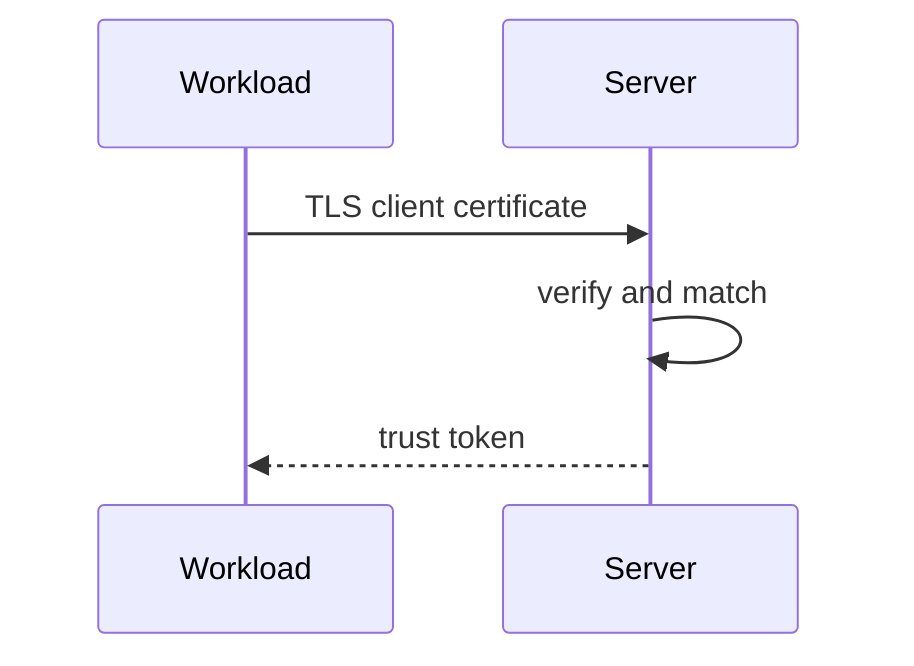
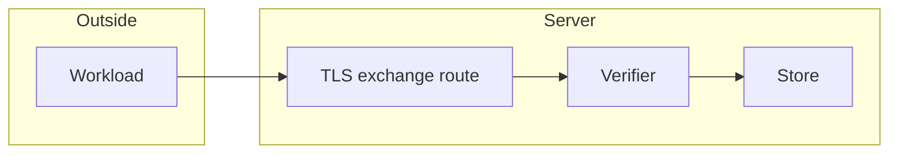

## Context

The exchange is security code on an external TLS endpoint. It fails closed.

## Decisions

1. **Verified chain value only.** The service takes an opaque verified-chain value from the TLS layer and never reads headers for a chain.
2. **Single enabled rule match.** Match picks at most 1 enabled rule for each exchange call, by bundle ID and exact SPIFFE ID; 0 or 2 or more matches refuse.
3. **Stored issue.** Match check and issue share one transaction. Revoke uses the service-token revoke routes.
4. **Own kind.** The token has the kind `mtls-exchange` (ADR 371 decision 2). The constant `KindMTLSExchange` (NEW) sits next to the other kinds in `pkg/accesstoken`. The credential stays `trust-token`.

5. **Store matches again.** `trustrule.Exchange` gets the field `SPIFFEID`. For a token of the kind `mtls-exchange` the adapter reads the rules of the fence namespace in the `RecordExchange` transaction, and refuses unless exactly one rule names the SPIFFE ID in the bundle of the rule of the exchange and that rule is the rule of the exchange. The JWT exchange sets `SPIFFEID` to empty. A rule added after the service read its rules still refuses. The write already carries the namespace fence: the exchange writes a token and an audit entry, so it uses the fence of `Namespaces.WritableHere`, and no new write path exists.
6. **One route.** The route stays `POST .../trust-rules/exchange`, on the public scope. A call with an empty body is an mTLS call. A call with a body is the JWT exchange, unchanged. The listener setting that requests a client certificate is part 3; until then no certificate reaches the handler and an mTLS call gets 401 mtls.no-client-certificate.
7. **Revocation is an injected check.** NEW `VerifyChain` takes a check function. A nil check gives ErrRevocationUnknown and no token. The source of revocation data is outside this change.

8. **Place and review.** The mTLS service sits in `internal/trustrulesvc` next to the JWT exchange, as the service of the port in `pkg/trustrule`. The work lands in two commits: (a) the trustrule port, its conformance cases and both store adapters; (b) the service, the handler, the error codes and the docs. The Opus security review (rev2) covers the exact head of each commit.
9. **Store checks the bundle version again.** `trustrule.Exchange` gets the fields `BundleID` (the stable ID of the bundle, ADR 362) and `BundleVersion` (the number of the bundle version that the service verified the chain against). For a token of the kind `mtls-exchange` the adapter reads the bundle row of the fence namespace with the existing query `GetTrustBundleOfNamespace` in the `RecordExchange` transaction. It refuses with `ErrNotFound` unless that row exists, its ID is `BundleID`, `BundleID` is the bundle of the rule of the exchange, and its active version is `BundleVersion`. The bundle model has no flag besides the active version: no bundle row in the namespace of the fence refuses, as does a verified version that is not the active one. A rotation between the verify step and the record step refuses. The bundle of another namespace reads as no row and refuses. The JWT exchange sets `BundleID` to empty and `BundleVersion` to 0. No schema change, no new query, no new migration.
10. **Exact SPIFFE ID in a rule.** A rule has no field for its kind: it is a rule for the mTLS exchange when its `spiffePattern` is not empty. The check of a pattern segment in `checkSpiffeSegment` (`pkg/trustrule/trustrule.go`) refuses a segment `*` with the NEW sentinel `trustrule.ErrSpiffeWildcard`, which wraps `ErrInvalid`. `Rule.Validate` runs it, so the create, the update, the store and the restore refuse the same input. The handler maps it to 400 `trust-rule.spiffe-wildcard`. The message names the field `spiffePattern` and says that the rule must name an exact SPIFFE ID. A rule with an empty `spiffePattern`, as the JWT rules have, is not changed. The refusal writes no audit entry, as for other input that is not valid.

## Structure

Unexported fields of MtlsExchanger with a constructor that takes the stores, the issuer, the clock and the policy and refuses nil values.

## Risks

- Two rules with the same SPIFFE ID refuse.
- A large chain or high rate loads the verifier.

## Layers (defense in depth)

| Layer | Guard | Hostile test |
| --- | --- | --- |
| boundary check | The TLS adapter checks chain, time, revocation, depth 8 and size 32 KB. | Send another CA, expired, revoked and oversize chains; each refuses. |
| authorize at point of use | The service rechecks rule, bundle version, principal and namespace in one transaction, and the store reads the active bundle version in the same transaction as the token write. | Send a forged forwarded-chain header, disabled rule, cross-namespace principal, a bundle version that is no longer active and the active version of another namespace; each refuses. |
| limit | The handler caps body size and rate and fails closed. | Flood with no-certificate calls and force a store error; no token. |

A `VerifiedChain` has unexported fields, and only `VerifyChain` makes one with a leaf. It carries the bundle ID and the version number that `VerifyChain` used, and the service copies both into the `Exchange`. The kinds of an exchange stay in the one set of `Kind.FromExchange`.

## Diagrams

After this change:

## Quality attributes

| Attribute | Target | Unit | Scope |
| --- | --- | --- | --- |
| correctness | 0 tokens issued for refused chains | tokens | mTLS exchange |

## Threat model

Data flow and trust boundaries:

| Boundary | STRIDE | Threat | Layer | Guard | Hostile test |
| --- | --- | --- | --- | --- | --- |
| TLS exchange route | S | A spoofed certificate or forwarded-chain header gains a trust token. | boundary check | Verify chain, time and revocation. | Replay other CA, expired and revoked chains. |
| TLS exchange route | S | A spoofed certificate or forwarded-chain header gains a trust token. | encode or contain | Read the chain only from the TLS session; ignore headers. | Send a forged forwarded-chain header; it refuses. |
| TLS exchange route | S | A spoofed certificate or forwarded-chain header gains a trust token. | limit | Cap chain size, body and rate. | Flood with oversize chains. |
| TLS exchange route | S | A spoofed certificate or forwarded-chain header gains a trust token. | authorize at point of use | Single enabled rule and in-namespace enabled principal. | Replay duplicate rules and cross-namespace principal. |
| TLS exchange route | S | A spoofed certificate or forwarded-chain header gains a trust token. | fail closed | Any error gives no token. | Force a store error; no token. |
| Record step | T | A rotation of the bundle between the verify step and the record step ends in a token for a chain that the new active version does not accept. | authorize at point of use | The store reads the active version of the bundle in the transaction of the record. | Send a version that is no longer active, a version that is not stored, and the active version of the bundle of another namespace; each refuses. |
| Rule write | R | A rule with a `*` in its SPIFFE ID pattern looks valid and never matches, so no record explains the refusal. | boundary check | The rule check refuses a `*` segment with a message that names the field. | Create, update and restore a rule with a `/*` pattern; each refuses and stores nothing. |

## Contract

Ports and types (Go signatures; no function body):

- `pkg/accesstoken`: `const KindMTLSExchange Kind = "mtls-exchange"`; `Kind.Valid` and `Kind.FromExchange` accept it. `type MtlsInput struct { At, LeafNotAfter time.Time; PrincipalID, Name, CreatedBy string }`. `func (s *Service) NewMtlsTrustToken(ctx context.Context, in MtlsInput) (Issued, error)` returns a token that expires at the earlier of `At` plus the exchange lifetime and `LeafNotAfter`. It returns `ErrInvalid` for a bad name, a zero or past `LeafNotAfter`, or a lifetime that is not positive; it does not store the token.
- `pkg/trustrule`: `type Exchange struct { Token accesstoken.Token; Digest accesstoken.Digest; Rule ID; SPIFFEID string; BundleID BundleID; BundleVersion int64 }`. `ExchangeStore.RecordExchange(ctx, x Exchange, fence namespace.Fence, e audit.Entry) error` keeps its signature. New rule: for `mtls-exchange`, `SPIFFEID` is not empty and has no `*`, `BundleID` is a valid bundle ID and `BundleVersion` is at least 1; for `jwt-exchange` `SPIFFEID` and `BundleID` are empty and `BundleVersion` is 0; otherwise `ErrInvalid`. A rule that is not the one rule that names `SPIFFEID` in its bundle gives `ErrNotFound`. A bundle that is not in the namespace of the fence, is not `BundleID`, is not the bundle of the rule, or has an active version other than `BundleVersion` gives `ErrNotFound`. NEW `var ErrSpiffeWildcard`, which wraps `ErrInvalid`, from `ValidateSpiffePattern` for a pattern with a `*` segment. Other sentinels are unchanged: `ErrPrincipal`, `accesstoken.ErrAlreadyExists`, `namespace.ErrFenced`, `audit.ErrInvalidEntry`.
- `pkg/store/internal/trustrulestore`: `func CheckExchangeMatch(rows []Row, x *trustrule.Exchange) error` returns `ErrNotFound` unless exactly one row names `x.SPIFFEID` in the bundle of the row of `x.Rule` and it is that row. `CheckExchange` accepts both kinds. `type BundleRow struct { ID string; Active int64; Found bool }` is the bundle row of the fence namespace as the transaction reads it. `func CheckExchangeBundle(rows []Row, b BundleRow, x *trustrule.Exchange) error` returns `ErrNotFound` unless `b.Found`, `b.ID` is `x.BundleID`, the row of `x.Rule` names that bundle, and `b.Active` is `x.BundleVersion`; it returns nil for an exchange with no `BundleID`.
- `internal/trustrulesvc` (existing package, NEW files mtls_exchange.go and mtls_exchange_limit.go; the JWT `Exchanger`, `ExchangeConfig`, `ExchangeInput`, `ExchangeResult`, `TokenIssuer` and `ActionExchange` keep their names, and the mTLS code reuses `ActionExchange`): `func VerifyChain(rawChain [][]byte, roots *x509.CertPool, now time.Time, check func(*x509.Certificate) error) (VerifiedChain, error)`; `func MatchRule(rules []trustrule.Rule, ns namespace.Name, spiffeID, bundleID string) (trustrule.Rule, error)`; `func NewMtlsExchanger(cfg MtlsConfig) (*MtlsExchanger, error)`; `func (e *MtlsExchanger) Verify(ctx, *MtlsVerifyInput) (VerifiedChain, error)`; `func (e *MtlsExchanger) Exchange(ctx, *MtlsExchangeInput) (MtlsExchangeResult, error)`; `func NewMtlsGuard(cfg MtlsGuardConfig) (*MtlsGuard, error)`; `type MtlsTokenIssuer interface`. Sentinels: ErrNoCertificate, ErrUnknownIssuer, ErrExpired, ErrNotYetValid, ErrRevoked, ErrRevocationUnknown, ErrNoMatchingRule, ErrAmbiguousRule, ErrBundleUnknown, ErrInvalid, ErrIssueFailed, ErrRateLimited, ErrMissingDependency. Bounds: `MaxChainBytes` 32768, `MaxChainDepth` 8. The leaf time check has no skew.

API: `POST /api/dustpan/v1/namespaces/{namespace}/trust-rules/exchange`, public scope (no sign-in, no authorization action; the route stays on the public list of the route test). Request: an empty body, and a client certificate in the TLS handshake. Response 201: `{"expiresAt": RFC 3339 UTC, "token": secret, "id": token ID, "principal": principal ID, "rule": rule ID}`, header `Cache-Control: no-store`. No paging, no ETag. The audit entry has the action `trust-rule:exchange`, the object of the namespace, the keys principal, kind, spiffeID and expiresAt, and the fence of the namespace. Each refusal writes a denial entry with outcome denied.

| Status | errorCode | Sentinel |
| --- | --- | --- |
| 401 | mtls.no-client-certificate | ErrNoCertificate |
| 401 | mtls.unknown-issuer | ErrUnknownIssuer, and ErrInvalid for an oversize, too deep or unparsable chain |
| 401 | mtls.expired | ErrExpired |
| 401 | mtls.not-yet-valid | ErrNotYetValid |
| 401 | mtls.revoked | ErrRevoked |
| 401 | mtls.revocation-unknown | ErrRevocationUnknown |
| 401 | mtls.no-matching-rule | ErrNoMatchingRule, and trustrule.ErrNotFound from the store |
| 401 | mtls.ambiguous-rule | ErrAmbiguousRule |
| 401 | mtls.bundle-disabled | ErrBundleUnknown (no bundle, or no active version) |
| 401 | mtls.principal-disabled | trustrule.ErrPrincipal (not found, not a service principal, other namespace, or disabled) |
| 413 | request.body-too-large | body over `MaxBodyBytes` (existing code) |
| 429 | mtls.rate-limited | ErrRateLimited |
| 500 | token.issue-failed | ErrIssueFailed: no token and no entry |

The JSON (JWT) path of the same route answers 400 `request.body-invalid` for a body over the limit, because the body decoder reports it there. The 413 `request.body-too-large` of the table is therefore reachable only from the guard of the mTLS path, and its test must call the guard.

Until a revocation source exists (open question below), no revocation check is injected, so every real mTLS call answers 401 `mtls.revocation-unknown`. Tests inject a check; the e2e step of part 3 cannot get a token until the source is decided.

The store reads only the rules that the verified chain can match inside the fenced transaction, not every rule of the namespace (issue #3685: 172.7 ms at 100k rules against 0.56 ms at 100).

A call with the forged header of a forwarded chain and no handshake certificate gives 401 mtls.no-client-certificate. Out of scope: the listener setting that requests the client certificate, the e2e step and the docs page (part 3), the source of revocation data, JWT behavior.

Rule write: `POST .../trust-rules` and `PATCH .../trust-rules/{rule_id}` answer 400 `trust-rule.spiffe-wildcard` for a `spiffePattern` with a `*` segment, and store nothing. The message reads: "spiffePattern holds a *. A rule for the mTLS exchange must name an exact SPIFFE ID. Remove the * and name the whole SPIFFE ID." Every other answer of the two routes is unchanged.

Error codes: NEW mtls.* in `internal/errcode/catalog_mtls.go`; NEW token.issue-failed in `internal/errcode/catalog_token.go`; NEW trust-rule.spiffe-wildcard in `internal/errcode/catalog_trustrule.go`; the golden lists of the codes are written by hand; the API description and the Go client golden are generated.

## Contracts

**trust-token**

- Invariant: One live token names one namespace, one rule and one non-person principal. Its kind is `mtls-exchange`.
- `exchange`: pre: A verified client chain is present.. Post: A stored token with an audit entry exists, or no token exists..

## Failure modes

| Step | Failure | Retry | State after |
| --- | --- | --- | --- |
| Verify revocation | Responder slow or unreachable | Retry the exchange after the cache TTL. | No token. |
| Issue | Store fails | Retry as a new call. | No token and no audit entry. |
