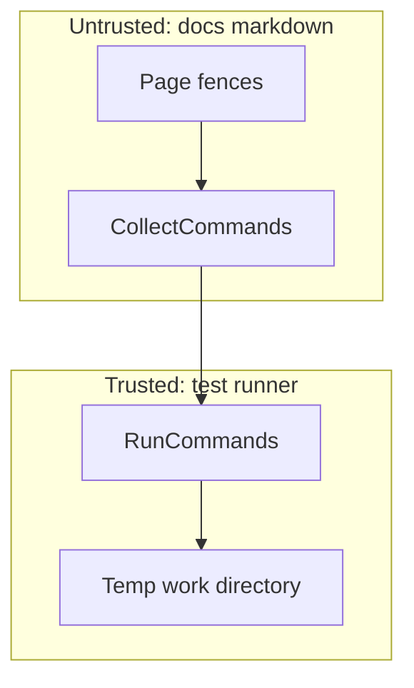

## Context

Operators copy commands from install and run guides. A copied command that fails wastes time and trust. The check reads the pages as written and runs the same text in a test fixture.

## Decisions

1. **Corpus plus isolated per-page runner with closed allowlists.** Scope is fenced blocks tagged sh, bash or shell in docs/guides, docs/reference and README, with backtick fences and tilde fences, where the first word of the info string equals sh, bash or shell. Extra words are ignored. An unclosed fence fails the gate. A missing in-scope directory fails the gate. An empty corpus fails the gate. CollectCommands extracts page path, block index and exact bytes. RunCommands runs the exact bytes with no rewrite. The skip marker is the HTML comment docs-check-skip with a reason from the closed allowlist needs-secret, needs-human, needs-docker or destructive-outside-fixture, on the line before the fence. An unknown or stale marker fails the check. Blocks of one page share one clean work directory and run in page order. Pages are isolated from each other. A block that needs state runs only when earlier blocks of the same page set it up; otherwise it carries needs-secret or needs-human. Each block has a 300 second timeout. A timeout kills the whole process group. Output capture keeps at most 1048576 bytes per block. The environment of each block is the closed allowlist PATH, HOME, TMPDIR, OPENDUSTPAN_URL and E2E_COMPOSE. A block needs Docker when its text invokes docker or docker compose; such a block without the needs-docker marker fails the gate. Docker blocks run only when E2E_COMPOSE=1, else they are skipped. The runner refuses sudo, refuses writes outside the work directory, and redacts token strings from output. This change builds first in the milestone: a new page from a sibling change of this milestone adds its corpus entries in the same pull request, so the unrun-block and stale-entry gates keep passing. Expected new pages are the production install page, the install-from-artifacts page, the SDK guide, the runner guide, and the key rotation docs; those pages do not exist on main, so this change tests none of them.
2. **Two checked-in page lists, so that no page is silent.** About 250 shell blocks in 46 files on main call a running server with a token, and no clean per-page directory runs them as written. So the gate does not claim that every block runs on the first day. Two NEW files list the pages: the NEW file `docs/commands-checked-pages.txt` holds the pages whose blocks the gate runs, and the NEW file `docs/commands-pending-pages.txt` holds each other page that has an in-scope block. Each line is a page path. The first checked list may be empty. On main no page has blocks that run in a clean directory with no server, no token, no Docker and no checkout of the repository, so README.md and docs/guides/quickstart.md start on the pending list. The runner tests use fixture pages under the test directory, not the pages of the checked list, so the runner stays proven while the checked list is empty. An empty checked list is valid; an empty corpus is not. The gate fails when a page with an in-scope block is in neither list, when a page is in both lists, when a listed page does not exist or has no in-scope block, and when a list has a duplicate, an unsorted line or a path outside the scope. A pending page gets no skip marker and no run: its blocks are not covered, and the list says so in the open. Only a later change moves a page from the pending list to the checked list, in the same pull request that makes the blocks of the page run against a server fixture. No new skip reason is added: needs-secret and needs-human keep their meaning, and no block hides under them for want of a server. The pending list is the measure of the work that is left.

## Structure

Unexported type docsCommand with unexported text, page and index fields and constructor newDocsCommand that rejects empty text and text over 65536 bytes. The extractor copies fence bytes verbatim, and a mutation test that rewrites one byte must fail.

## Risks

- The parser misses a fence form outside the closed fence allowlist.
- A page depends on state from another page and fails in isolation.

## Layers (defense in depth)

| Layer | Guard | Hostile test |
| --- | --- | --- |
| boundary check | Extractor copies fence bytes verbatim and newDocsCommand rejects empty text and text over 65536 bytes. | Change one byte of a listed block and require a corpus mismatch failure. |
| encode or contain | Runner starts each page in a fresh temporary work directory with the closed environment allowlist and refuses sudo. | Run a block with sudo rm -rf / and require a refusal without host change. |
| limit | 300 second per-block timeout kills the process group; 1048576 byte output cap. | Run sleep 600 with a background child and require both processes dead. |
| authorize at point of use | Runner checks the docs-check-skip marker and the reason allowlist for each block at run time. | Run a docker block without the needs-docker marker and require a gate failure. |
| fail closed | Unknown marker reason, stale marker, unclosed fence, missing directory and empty corpus fail the gate. | Add an unknown skip reason and require a gate failure. |

## Quality attributes

| Attribute | Target | Unit | Scope |
| --- | --- | --- | --- |
| none affected | No latency or storage target changes; this change adds a docs test gate only. |  |  |

## Threat model

Data flow and trust boundaries:

| Boundary | STRIDE | Threat | Layer | Guard | Hostile test |
| --- | --- | --- | --- | --- | --- |
| Docs markdown to shell runner | T | Docs text executes a destructive shell command on the host during the check. | boundary check | Extractor accepts only first-word sh, bash or shell and rejects unclosed fences and unknown skip reasons. | Submit a console fence and an unknown skip reason and require rejection. |
| Docs markdown to shell runner | T | Docs text executes a destructive shell command on the host during the check. | encode or contain | Runner confines each page to a fresh temp directory and refuses sudo and writes outside it. | Submit rm with an absolute host path and require refusal. |
| Docs markdown to shell runner | T | Docs text executes a destructive shell command on the host during the check. | limit | 300 second per-block timeout with process-group kill and 1048576 byte output cap. | Submit sleep 600 with a forked child and require both dead. |
| Docs markdown to shell runner | T | Docs text executes a destructive shell command on the host during the check. | authorize at point of use | Marker and reason allowlist checked at point of use for each block. | Submit a docker block without the needs-docker marker and require gate failure. |
| Docs markdown to shell runner | T | Docs text executes a destructive shell command on the host during the check. | fail closed | Any extractor or runner error fails closed with page path and block index. | Submit a missing directory and require gate failure. |

## Contracts

**Docs command corpus**

- Invariant: Each listed command runs with the exact text of the page.
- Invariant: A page with an unrunnable command fails the gate.
- Invariant: Each skipped block carries a marker from the closed reason allowlist.
- `CollectCommands`: pre: Scope lists docs/guides, docs/reference and README.; Fence tag belongs to the closed fence allowlist.. Post: Returns each in-scope fenced block with page path and block index..
- `RunCommands`: pre: Block list comes from CollectCommands.; Skip reason belongs to the closed reason allowlist.. Post: Marks each listed block as passed, failed or skipped with page path and block index..
