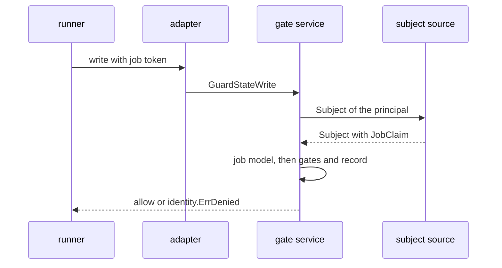
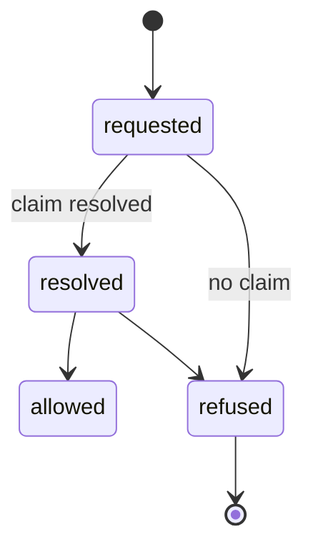
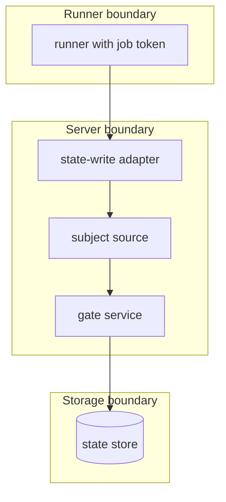

## Context

The gate subject of a job token has no job, so the gate service refuses each job-token state write. The subject source builds the job claim from the job record for each write.

## Decisions

1. **Resolve JobClaim in the subject source.** `Service.GuardStateWrite` asks the `gate.SubjectSource` for the subject of the principal on each write. A new subject source in pkg/dustpan wraps the principal subject source and, for a job-token principal, reads the job by `Principal.JobID` and sets `Subject.Job`. No field is added to `gate.StateWrite`, and no adapter builds a claim. A job that does not resolve, a job in a terminal state, or a principal with an empty job ID gives an error that wraps identity.ErrDenied.
2. **Run the gates after the job model allows (ADR 395).** In `Evaluate`, `jobTokenWrite` stays first. When it allows, the call goes on to `evaluateStateWrite` with the fence and the state of the write, so a `deny` gate refuses the write and a decision record is written. `GuardStateWrite` reads the fence for a job token too, in place of the fixed zero-version fence. A job token sets no break-glass pass.

3. **Carry the claim on the refusal.** `gate.RefusalError` gets the field `Job *JobClaim`, which `GuardStateWrite` sets from the subject it already read. The log line of the adapter reads it. This makes no second read of the job record. No field is added to `gate.StateWrite` or to the `Guard` port.

## Structure

Unexported type jobClaimSubjects in the new file pkg/dustpan/jobclaim.go, made only by newJobClaimSubjects, which takes the job reader and the inner subject source; call sites cannot write a JobClaim literal. The state-guard builder in pkg/dustpan/stateguard.go uses it in place of principalSubjects.

## Risks

- A job token with no resolvable job fails closed until the job record resolves.

## Layers (defense in depth)

| Layer | Guard | Hostile test |
| --- | --- | --- |
| subject source | Only the subject source sets Subject.Job, from the job record of the verified token. | Send a write with a forged job ID and phase; it fails with identity.ErrDenied. |
| service | The service refuses any write except the plan lock or lease when PassedApply is false or the unit is outside the job. | Skip the adapter check; the service still refuses out-of-phase and cross-unit writes. |
| gates | After the job model allows, `evaluateStateWrite` runs the gates of state.write and writes the decision record. | A deny gate on the unit; an allowed job-token write is refused with a record that names the gate. |
| HTTP handler | The handler declares the state.write action and returns the denial. | Call each tool write route with an out-of-phase job token; the refusal is the same. |

## Diagrams

After this change:

States and transitions after this change:

## Quality attributes

| Attribute | Target | Unit | Scope |
| --- | --- | --- | --- |
| correctness | 100 | percent refused when out of phase, cross-unit or unresolvable | each state.write call with a job token |

## Threat model

Data flow and trust boundaries:

| Boundary | STRIDE | Threat | Layer | Guard | Hostile test |
| --- | --- | --- | --- | --- | --- |
| runner boundary | E | A job token writes state outside its phase or unit. | boundary check | Accept only a server-issued job token. | Send a forged token; it is refused. |
| runner boundary | E | A job token writes state outside its phase or unit. | encode or contain | Use only the subject source output. | Send client fields naming another job; they are ignored. |
| runner boundary | E | A job token writes state outside its phase or unit. | limit | A plan phase writes only its lock or lease. | Send a plan-phase body write; it is refused. |
| runner boundary | E | A job token writes state outside its phase or unit. | authorize at point of use | Check the unit against the units of the job. | Write another unit; it is refused. |
| runner boundary | E | A job token writes state outside its phase or unit. | fail closed | Refuse when the claim does not resolve. | Delete the job first; the write is refused. |

## Contracts

**gate**

- Invariant: Each job-token write evaluates with a JobClaim that the subject source reads from the job record on that call.
- Invariant: A phase that did not pass change.apply writes only the lock or lease of its plan.
- `GuardStateWrite`: pre: The caller and the unit are known.. Post: The write is evaluated with the claim or refused with identity.ErrDenied..

## Failure modes

| Step | Failure | Retry | State after |
| --- | --- | --- | --- |
| Resolve the claim | The job, phase or units do not resolve | The server does not retry; a later write resolves again | Write refused; job record unchanged |
