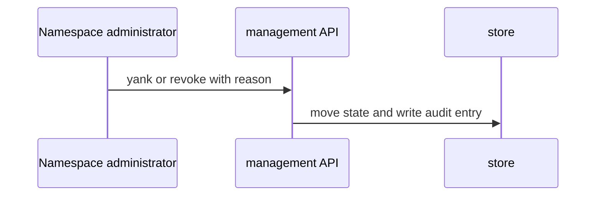
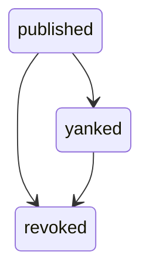

## Context

Release life cycle and reads sit on the stored registry release. Earlier parts added publish, signature checks, and grants. This part adds state moves and reads. Provisional decision: three marks stand in for the four states of ADR 345 until the owner names them.

## Decisions

1. **Life cycle as one state type.** The stored release holds one state field. Only the yank and revoke constructors move it. A move out of revoked is refused. The owner names replace the provisional marks in one place.
2. **API moves, CLI reads.** Yank and revoke run through the management API with the manage grant and a reason field. List, show, and keys list use the read grant. The CLI wraps the same API operations.

## Structure

Unexported registry release state type. Only the yank and revoke constructors can make a moved value, and each rejects an unknown state and a move out of revoked.

## Risks

- A client caches the index and asks for a yanked version. Download of a yanked version still succeeds.
- A revoked pin stops working. The 409 error names the version only.

## Diagrams

After this change:



States and transitions after this change:



## Quality attributes

| Attribute | Target | Unit | Scope |
| --- | --- | --- | --- |
| correctness | 100 | percent success | download of a yanked version |
| correctness | 100 | percent refused with 409 | download of a revoked version |

## Threat model

Data flow and trust boundaries:

```mermaid
Namespace administrator -> management API -> registry store and audit log; Tool -> mirror, module index, plugin download
```

| Boundary | STRIDE | Threat | Layer | Guard | Hostile test |
| --- | --- | --- | --- | --- | --- |
| Management API to registry store | T | A caller without the grant changes or reads a release. | authorize at point of use | Check the manage grant for yank and revoke and the read grant for reads, on the same namespace. | Call each route without the grant and across namespaces; each fails with 403 or 404. |
| Management API to registry store | T | A caller without the grant changes or reads a release. | boundary check | Validate the reason length and the state move before the store write. | Send a reason over 500 characters and a move out of revoked; both are refused. |
| Tool download to registry store | T | A tool fetches a revoked version through a cached index or a direct URL. | fail closed | Refuse revoked downloads with 409 at the download path. | Request the archive of a revoked version by direct URL; the server refuses. |
| Tool download to registry store | T | A tool fetches a revoked version through a cached index or a direct URL. | encode or contain | Omit yanked and revoked versions from each index answer. | Resolve a version range after yank and revoke; both are absent. |

## Contracts

**registry release**

- Invariant: Each release belongs to one namespace.
- Invariant: A revoked release refuses download.
- Invariant: A yanked release stays downloadable.
- `yank`: pre: caller holds the manage grant; release exists in the namespace; release is not revoked. Post: index omits the version; download succeeds.
- `revoke`: pre: caller holds the manage grant; release exists in the namespace; reason has at most 500 characters. Post: index omits the version; download answers 409.

## Failure modes

| Step | Failure | Retry | State after |
| --- | --- | --- | --- |
| Yank or revoke a release | Store write fails. | Retry the same call. | Release stays in the prior state with no audit entry. |
| List after a move | Index read races the move. | Read the index again. | Index omits the version once the move commits. |
| Download a revoked version | Download races the revoke. | Later downloads refuse with 409. | Release stays revoked and the audit entry records the move. |
