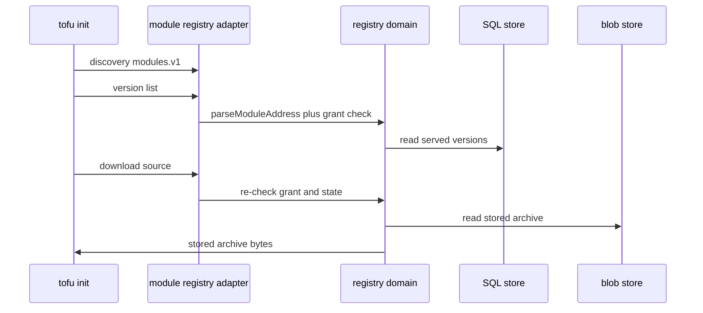
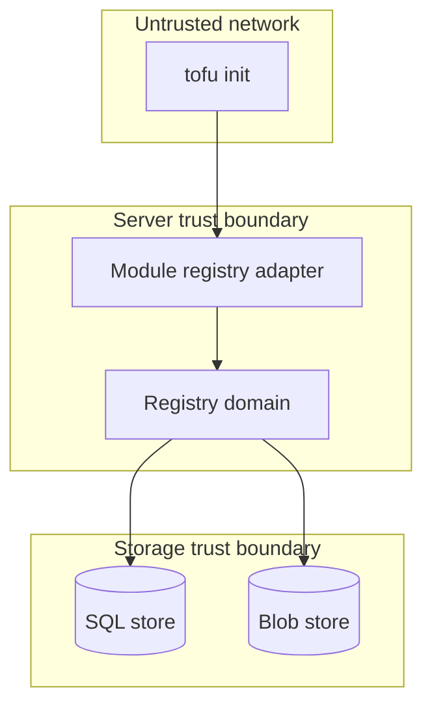

## Context

This part adds module publish checks and module serve routes beside the provider routes of the split. It reuses the publish API shape, signing keys, grants, audit, and version rules, with module archive layout and module registry protocol mapping.

## Decisions

1. **Module serve adapter reuses registry domain state.** Add a module serve adapter beside the provider serve adapter. Share the stored release record, key check result, and version state through the registry domain port. Serve service discovery with modules.v1 from the same adapter. Read list and download from the store on each request with no index cache, so a state change shows on the next request.
2. **Caller namespace from path with same not-found answers.** Derive the caller namespace from the request path namespace of the registry routes. The token must carry a grant on that namespace. The namespace segment of the module address must equal the path namespace exactly. A mismatch gets the same not-found answer as a missing module, with an audit entry. A caller without read grant gets the same not-found answer, so answers do not disclose existence.

## Structure

Registry domain keeps unexported type moduleAddress with constructor parseModuleAddress that checks host, namespace, and registry-safe name; only the constructor builds a value, so malformed or cross-namespace addresses cannot reach storage.

## Risks

- Module address confusion across namespaces causes a wrong download.
- A blocked version stays reachable through a cached index answer.

## Diagrams

After this change:

## Quality attributes

| Attribute | Target | Unit | Scope |
| --- | --- | --- | --- |
| availability | 99.9 | percent | module version list and download routes |
| latency | 500 | ms | module version list per namespace |

## Threat model

Data flow and trust boundaries:

| Boundary | STRIDE | Threat | Layer | Guard | Hostile test |
| --- | --- | --- | --- | --- | --- |
| Server trust boundary | S | Attacker forges a module address to read a private module of another namespace or a blocked version. | boundary check | Adapter checks host by exact match, registry-safe name, and path namespace match before domain call. | Send wrong host, malformed name, and foreign namespace address directly to the adapter; each gets not-found without reaching storage. |
| Server trust boundary | S | Attacker forges a module address to read a private module of another namespace or a blocked version. | encode or contain | Serve stored bytes with stored checksum and content type; never decode archive contents as code. | Upload an archive with hostile path entries and download it; served bytes match stored bytes exactly. |
| Server trust boundary | S | Attacker forges a module address to read a private module of another namespace or a blocked version. | limit | Serve only downloadable states; read store on each request with no index cache. | Change a version to a blocked state then request list and download; both hide the version. |
| Server trust boundary | S | Attacker forges a module address to read a private module of another namespace or a blocked version. | authorize at point of use | Check read grant on the path namespace at list and re-check at download; hide existence with same not-found answer. | Call list and download with a token that lacks the grant; each gets not-found with an audit entry. |
| Server trust boundary | S | Attacker forges a module address to read a private module of another namespace or a blocked version. | fail closed | Fail closed on unknown version state, missing key, or store error; deny with not-found and write an audit entry. | Force store error during download; request is denied and audited. |
| Storage trust boundary | T | Attacker tampers with a stored module archive or version state to serve altered code. | boundary check | Domain constructor parses module address and refuses malformed input before any query. | Call the domain with hostile address strings; each is refused before SQL runs. |
| Storage trust boundary | T | Attacker tampers with a stored module archive or version state to serve altered code. | encode or contain | Use placeholders for namespace, name, and version in every query; contain blob reads to the stored release key. | Send SQL metacharacters in module name; query treats them as a literal name. |
| Storage trust boundary | T | Attacker tampers with a stored module archive or version state to serve altered code. | limit | Read only rows of the caller namespace; refuse archives over the size limit with too-large code. | Request a foreign namespace row and an oversize archive; both are refused. |
| Storage trust boundary | T | Attacker tampers with a stored module archive or version state to serve altered code. | authorize at point of use | Re-check read grant and downloadable state inside the same transaction as the read. | Revoke the grant between list and download; download is denied. |
| Storage trust boundary | T | Attacker tampers with a stored module archive or version state to serve altered code. | fail closed | Fail closed when the release row or blob is missing; never serve a partial archive. | Delete the blob of a served version in a test double; download fails closed with an audit entry. |

## Contracts

**Registry release**

- Invariant: A served module version maps to one stored archive and its stored checksum.
- Invariant: A module address names host, namespace, name, and version only.
- `PublishModuleVersion`: pre: Caller holds write grant on the namespace registry.; Archive set is staged under a staging key.. Post: Version is stored in a served state only after checksum and trusted signature checks pass..
- `ServeModuleDownload`: pre: Version is in a downloadable state.; Caller holds read grant on the namespace registry.. Post: Caller receives the stored archive bytes without added signature..

## Failure modes

| Step | Failure | Retry | State after |
| --- | --- | --- | --- |
| Serve module download | Blob store fails during download. | Retry the same `tofu init` download source; server does not change version state. | Version stays in its state; audit entry records the failed download. |
| Publish module version | Publish upload fails checksum check. | Fix the archive and upload again with a new staging key. | No version is stored; staging key expires; audit entry records the refused upload. |
| Serve module download | Grant revoked between version list and download. | Request access again, then run `tofu init` again. | Download is denied with not-found answer; audit entry records the denial. |
