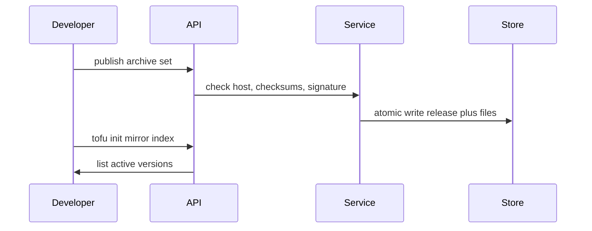
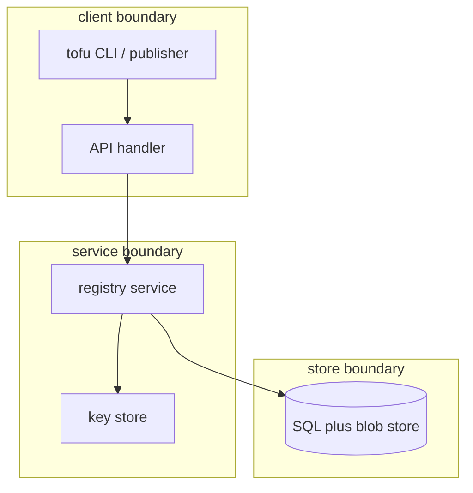

## Context

Provider serving is security code. Untrusted archives, checksums, signatures, and addresses enter at the API boundary. The store holds immutable versions in the active state and per-namespace keys.

## Decisions

1. **Atomic publish of an immutable version.** Publish is one atomic unit: the service checks host, safe name, checksum list, archive set membership, and OpenPGP signature against registered keys, then writes the release and its files in one transaction with a unique key on address plus version. An identical repeat succeeds without change. A different repeat fails as immutable. Of two parallel publishes with different files, one wins and the other gets 409. A failed commit deletes its staged blobs.
2. **Serve from committed active rows only.** Serve reads only committed rows in the active state for the requesting namespace. Trust is checked at publish only, so key removal never changes a published version. A version that fails its serve-time checksum leaves the index until a later life-cycle part defines it.

## Structure

Unexported type registryPublisher with constructor newRegistryPublisher that takes the namespace ID, the configured host, and the key set. Only the constructor builds a publish, and it checks host, safe name, checksums, and signature before it returns a value.

## Risks

- A weak key check lets a bad archive serve as trusted.
- A partial publish leaves an index entry without files.
- A stolen key leaves a published version served until the life-cycle part ships.

## Layers (defense in depth)

| Layer | Guard | Hostile test |
| --- | --- | --- |
| HTTP handler | Decode and bound the upload: allowlisted address fields, size limit, exact host, safe name, traversal check, well-formed OpenPGP packets. | Send a foreign host, unsafe name, oversized file, ../ file name and malformed signature; each gets 4xx and no row. |
| service | Check archive set, SHA-256 list and signature against namespace keys before any write. | Upload a tampered archive, a missing signature and a signature of another namespace key; nothing is written. |
| port adapter | Placeholders, one transaction, unique key on address plus version, namespace predicate on each read. | Put SQL text in the version and read another namespace; the query returns no rows. |

## Diagrams

After this change:

## Quality attributes

| Attribute | Target | Unit | Scope |
| --- | --- | --- | --- |
| serve correctness | 100 | percent verified SHA-256 checks before bytes | provider download path |
| publish atomicity | 0 | partial releases per failed commit | provider publish path |
| serve latency | 500 | ms p95 local | mirror index and download metadata on SQLite and PostgreSQL |

## Threat model

Data flow and trust boundaries:

| Boundary | STRIDE | Threat | Layer | Guard | Hostile test |
| --- | --- | --- | --- | --- | --- |
| client boundary | S | Spoofed publisher uploads an archive for a namespace it does not hold. | boundary check | Handler allowlists address fields, checks exact host and safe name. | Send foreign host and unsafe name; handler answers 400. |
| client boundary | S | Spoofed publisher uploads an archive for a namespace it does not hold. | encode or contain | File names cleaned and contained. | Send file name with ../; handler refuses and stores nothing. |
| client boundary | S | Spoofed publisher uploads an archive for a namespace it does not hold. | limit | Upload size limit enforced at decode. | Send oversized archive; handler refuses before store write. |
| client boundary | S | Spoofed publisher uploads an archive for a namespace it does not hold. | authorize at point of use | Access token checked for the grant on the namespace object. | Call publish without grant; handler answers 403. |
| client boundary | S | Spoofed publisher uploads an archive for a namespace it does not hold. | fail closed | Malformed archive or signature fails with 4xx and no row. | Send malformed signature packet; handler answers 400. |
| service boundary | T | Tampered archive or signature passes as trusted and serves to tofu init. | boundary check | Service checks SHA-256 list and signature against same-namespace keys before write. | Send tampered archive; service refuses with 422. |
| service boundary | T | Tampered archive or signature passes as trusted and serves to tofu init. | encode or contain | Signature bytes pass only to the OpenPGP verifier. | Send hostile signature packet; verifier rejects. |
| service boundary | T | Tampered archive or signature passes as trusted and serves to tofu init. | limit | Trust checked at publish only; key removal never changes published rows. | Remove key then download published version; download still verifies by stored checksum. |
| service boundary | T | Tampered archive or signature passes as trusted and serves to tofu init. | authorize at point of use | Namespace predicate rechecked at publish and at serve. | Request namespace B data from namespace A; service answers 404. |
| service boundary | T | Tampered archive or signature passes as trusted and serves to tofu init. | fail closed | Missing signature or untrusted key fails with 422 and an audit entry. | Send missing signature; service answers 422 and writes nothing. |
| store boundary | I | Cross-namespace read or checksum bypass serves another namespace file. | boundary check | Placeholders only for version and address strings. | Send SQL text in version; query treats it as data. |
| store boundary | I | Cross-namespace read or checksum bypass serves another namespace file. | encode or contain | Release and files in one transaction under a unique key. | Race two publishes; one wins and one gets 409. |
| store boundary | I | Cross-namespace read or checksum bypass serves another namespace file. | limit | Immutable versions and staged-blob cleanup bound storage effect. | Fail commit then list blobs; no orphan blob remains. |
| store boundary | I | Cross-namespace read or checksum bypass serves another namespace file. | authorize at point of use | Each read carries a namespace predicate. | Read cross-namespace address; store returns no rows. |
| store boundary | I | Cross-namespace read or checksum bypass serves another namespace file. | fail closed | Serve-time checksum failure gives 500, audit entry and flagged file. | Corrupt stored file then download; serve answers 500. |

## Contracts

**registry release**

- Invariant: One address plus version maps to one immutable file set in one namespace.
- Invariant: Serve reads only committed rows in the active state of the requesting namespace.
- `Publish provider version`: pre: Caller holds publish grant on the namespace.; Host matches configuration and name is registry-safe.. Post: Release stored in active state with verified checksums and signature..
- `Serve provider download`: pre: Caller holds read grant on the namespace.; Version is active in the same namespace.. Post: Bytes served after namespace match and SHA-256 check..
- `Namespace signing keys`: pre: Caller holds publish grant on the namespace.; Key is a well-formed armored OpenPGP key within the size limit.. Post: Key stored for the same namespace only..

## Failure modes

| Step | Failure | Retry | State after |
| --- | --- | --- | --- |
| Publish provider version | Store commit fails after blob stage. | Retry publish once with the same files; failed commit deletes staged blobs. | No release row; mirror index unchanged. |
| Serve provider download | Download finds checksum mismatch at serve time. | Publish a new version with correct files. | Serve answers 500 with audit entry and flagged file; version excluded from mirror index. |
| Parallel publish | Two publishes race on the same new version. | Loser with identical files retries and succeeds; loser with different files publishes under a new version number. | One winner stored; loser gets 409 with no orphan blob. |
