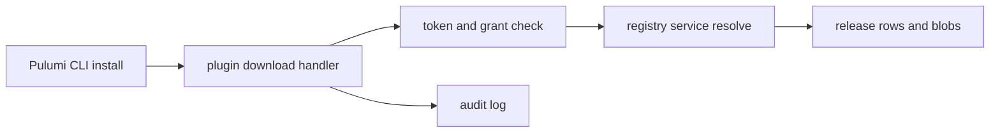
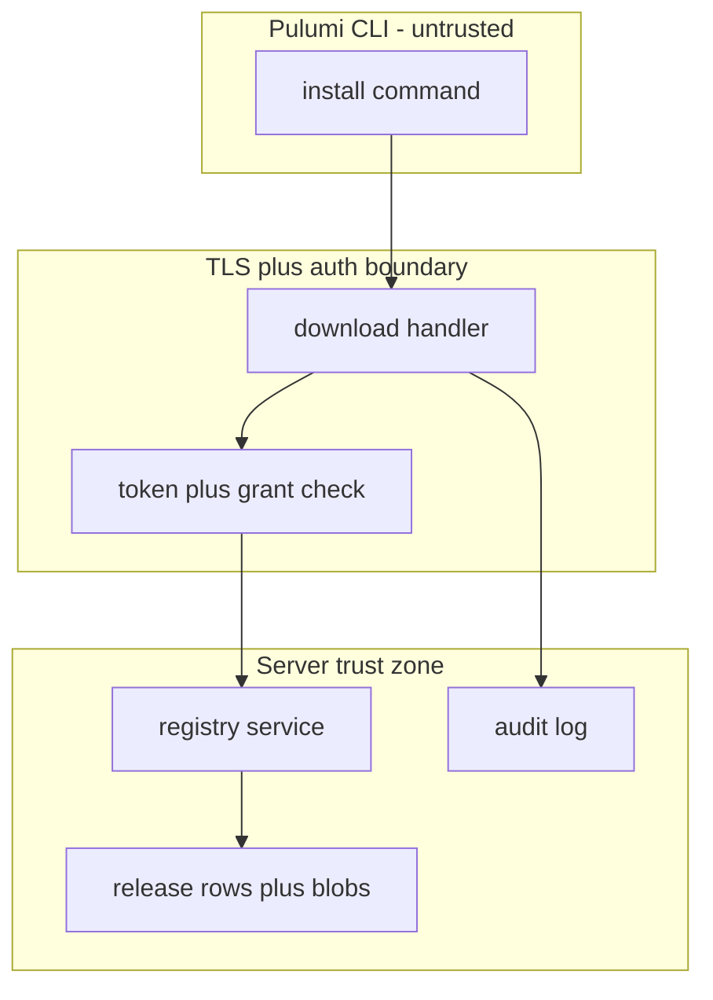

## Context

Private Pulumi plugin download reuses the publish path, per-namespace trusted keys, and stored checksum and signature verdicts of earlier registry parts. The route is new, so this change defines its URL template: a namespaced path with name, version, OS and arch segments. The Pulumi CLI reaches it through its plugin server setting, and the e2e pins the template.

## Decisions

1. **Reuse publish record for plugin download.** Reuse the same release record and blob reference used for providers: publish stores archives and verdicts once, download resolves namespace, name, version, OS and arch to one stored archive and streams its bytes after the stored verdict check. The server sends 200 only after the verdict check, then streams bytes and aborts the connection on a mid-stream SHA-256 mismatch.
2. **New plugin download route.** Define new plugin download routes under the namespace registry path, separate from provider routes, with registry read actions and audit entries on success and on each refusal.

## Structure

Unexported type pluginDownload with unexported fields for namespace ID, release ID, and verified digest; only its constructor builds a value from a verified release row and the constructor refuses a row with a failed verdict.

## Risks

- A bad archive reaches the Pulumi CLI when download skips the stored verdict check.
- One namespace reads the plugin of another namespace through a guessed URL.

## Diagrams

After this change:

## Quality attributes

| Attribute | Target | Unit | Scope |
| --- | --- | --- | --- |
| integrity | 100 | percent of streamed bytes matched against stored SHA-256 | plugin archive download per version, OS, and arch |

## Threat model

Data flow and trust boundaries:

| Boundary | STRIDE | Threat | Layer | Guard | Hostile test |
| --- | --- | --- | --- | --- | --- |
| TLS plus auth boundary | S | Spoofed caller guesses a plugin URL of another namespace to fetch private archives. | boundary check | Reject names outside the registry-safe subset and unknown OS or arch values at the boundary before any store read. | Send uppercase names, path traversal segments, and unknown OS values direct at the route and show rejection with no store read. |
| TLS plus auth boundary | S | Spoofed caller guesses a plugin URL of another namespace to fetch private archives. | encode or contain | Serve archives only as octet-stream with no path or header reflection and scope every resolve to the request namespace ID. | Request namespace B archive with namespace A URL and show 404 with no bytes and no reflected path. |
| TLS plus auth boundary | S | Spoofed caller guesses a plugin URL of another namespace to fetch private archives. | limit | Limit archive size at publish and connection time at the handler. | Request oversized and slow reads and show refusal or timeout with bounded memory. |
| TLS plus auth boundary | S | Spoofed caller guesses a plugin URL of another namespace to fetch private archives. | authorize at point of use | Require valid access token and registry read grant on the namespace; otherwise answer 401 or 404 with no bytes. | Replay a missing, expired, and cross-namespace token direct at the download route and show 401 or 404 with no bytes. |
| TLS plus auth boundary | S | Spoofed caller guesses a plugin URL of another namespace to fetch private archives. | fail closed | Check stored checksum and signature verdict before first byte; refuse failed verdicts with 403 and no bytes. | Flip a stored verdict to failed and request bytes direct; show 403 with no bytes. |
| Server trust zone | T | Tampered archive bytes or verdict row reach the Pulumi CLI as a trusted plugin. | boundary check | Validate namespace, name, version, OS, and arch against stored values before blob read. | Send hostile version and arch strings with null bytes and separators and show 404 with no blob read. |
| Server trust zone | T | Tampered archive bytes or verdict row reach the Pulumi CLI as a trusted plugin. | encode or contain | Match streamed bytes against stored SHA-256 and abort the connection on mismatch; record success and refusal in the audit log. | Corrupt one stored byte and show a stopped stream plus a failed-download audit entry. |
| Server trust zone | T | Tampered archive bytes or verdict row reach the Pulumi CLI as a trusted plugin. | limit | Bound blob read size and stream time and stop the stream on store errors. | Inject a slow and failing blob read and show an aborted stream with bounded server memory. |
| Server trust zone | T | Tampered archive bytes or verdict row reach the Pulumi CLI as a trusted plugin. | authorize at point of use | Scope every resolve to the request namespace ID and refuse cross-namespace names with 404. | Request namespace B archive with namespace A URL and show 404. |
| Server trust zone | T | Tampered archive bytes or verdict row reach the Pulumi CLI as a trusted plugin. | fail closed | Treat missing verdict rows, missing blobs, and store errors as refusal with no bytes and write a failed-download audit entry. | Delete the blob of a published version and request it; show an aborted download and a failure audit entry. |

## Contracts

**RegistryRelease**

- Invariant: Release belongs to one namespace and never moves across namespaces.
- Invariant: Stored SHA-256 and signature verdict never change after publish.
- `ResolvePluginArchive`: pre: Caller holds registry read access on the namespace.. Post: Returns one stored archive for namespace, name, version, OS, arch or refuses..
- `StreamPluginArchive`: pre: Resolved release has a passed checksum and signature verdict.. Post: Streams stored bytes only after stored verdict check and SHA-256 match..

## Failure modes

| Step | Failure | Retry | State after |
| --- | --- | --- | --- |
| Stream plugin archive bytes | Blob store read fails mid-stream after headers. | Retry the Pulumi CLI install command; server aborts the connection and records a failed download audit entry. | No complete archive on the client; release record unchanged. |
| SHA-256 match during stream | Stored bytes do not match stored SHA-256 mid-stream. | Republish the archive set; server aborts the connection with a truncated body and writes a failed download audit entry. | Download refused and audit entry written. |
